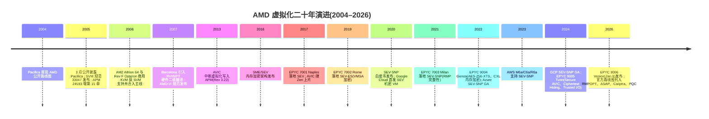

## 1. 总览:AMD 虚拟化技术全景与二十年演进

AMD 的硬件虚拟化技术以 **AMD-V**(AMD Virtualization)为总品牌,其第一代扩展研发代号 Pacifica,最初以《Secure Virtual Machine Architecture Reference Manual》(文档号 33047)形式公开规范[^1^],随后并入《AMD64 Architecture Programmer's Manual Volume 2》(文档号 24593)第 15 章 "Secure Virtual Machine" 并沿用至今——该章于 2005 年 12 月的 Rev 3.11 首次加入手册[^2^],现行版本为 2025 年 7 月的 Rev 3.43[^3^]。自 2006 年随 Socket AM2 的 Athlon 64 与 Rev F Opteron 商用以来[^4^][^5^],AMD 虚拟化已从一组 CPU 指令集扩展发展为覆盖 CPU、内存、I/O 与机密计算四个子系统的完整技术栈。本章给出四大支柱的定位与相互关系(1.1 节)、二十年演进主线及与 Intel 对应技术的对位(1.2 节),并为不同背景的读者提供阅读路径(1.3 节)。

### 1.1 技术全景

#### 1.1.1 AMD 虚拟化四大支柱:SVM(CPU)、NPT(内存)、AMD-Vi(I/O)、SEV(安全)的定位与相互关系

**SVM(Secure Virtual Machine,CPU 虚拟化)** 是整个技术栈的基座。它在原有 ring 0–3 之外新增一对正交的执行模式:host mode 运行 hypervisor,guest mode 运行客户机;hypervisor 以 `VMRUN` 指令(操作数为 VMCB 的物理地址)进入 guest,被拦截的事件触发 `#VMEXIT` 返回 host,guest 则可经 `VMMCALL` 主动发起 hypercall[^1^]。全部控制状态集中于 VMCB(Virtual Machine Control Block)——一个 4KB 页对齐、布局完全公开、以普通内存读写方式操作的内存结构,配套 IOPM(I/O Permission Map)与 MSRPM(MSR Permission Map)两张权限位图[^6^]。

**NPT(Nested Page Tables,内存虚拟化)** 于 2007 年随 Barcelona(Family 10h)落地,市场名 RVI(Rapid Virtualization Indexing),由硬件完成 guest 物理地址到系统物理地址的第二级翻译,取代纯软件的影子页表;VMware 2009 年实测 RVI 相对纯软件虚拟化在 MMU 密集基准上最高提升 42%[^7^]。其关键设计决策是直接复用 AMD64 长模式页表项格式,nPT 表项与传统分页表项逐位一致,而非发明专用格式[^8^]。

**AMD-Vi(I/O 虚拟化)** 即 AMD IOMMU,规范载体为文档 48882,负责 DMA 地址重映射与中断重映射,使设备直通(passthrough)在不牺牲隔离性的前提下成立;其 I/O 页表同样兼容 AMD64 长模式格式[^9^]。

**SEV(Secure Encrypted Virtualization,安全/机密计算)** 家族以片上内存控制器内的 AES 引擎与 PSP(Platform Security Processor)管理的每 VM 独立密钥为基础,把威胁模型扩展到恶意 hypervisor 乃至具有 DRAM 物理接触的攻击者,但明确不防护拒绝服务[^10^]。SEV 并非孤立子系统:它复用 SVM 的 ASID(Address Space Identifier)机制为每个 guest 的代码与数据全程打标,hypervisor 在 VMCB 中设置 ASID 后执行 `VMRUN`,内存控制器即按该 ASID 选取对应加密密钥[^10^];到 SEV-SNP 代,反向映射表 RMP(Reverse Map Table)由 CPU 与 IOMMU 两侧的 table walker 共同检查[^11^],四大支柱在安全边界上正式合流。

表 1-1 给出四大支柱的定位汇总与 Intel 对位。

| 支柱 | 子系统 | 核心机制 / 数据结构 | 首次商用 | 规范载体 | Intel 对位 |
|---|---|---|---|---|---|
| SVM | CPU | host/guest 双模式;`VMRUN`/`#VMEXIT`;VMCB(布局公开)[^6^] | 2006(AM2 / Rev F)[^4^] | APM 24593 第 15 章[^3^] | VT-x(VMCS,布局不透明) |
| NPT | 内存 | 硬件二级地址翻译;复用 AMD64 PTE 格式[^8^] | 2007(Barcelona)[^7^] | APM §15.25 / NPT 白皮书 | EPT(2008 Nehalem,专用格式) |
| AMD-Vi | I/O | DMA / 中断重映射;DTE、IRTE | 2007 起(48882 规范)[^9^] | AMD 48882 | VT-d |
| SEV 家族 | 安全 | 内存控制器 AES + PSP 密钥管理;VMSA 加密;RMP[^10^] | 2017(EPYC 7001)[^12^] | 55766 / 56860 系列 | SGX(进程级)/ TDX(VM 级) |

四条支柱共用一条设计主线:**状态放在内存里、格式复用现成的、硬件只做最少的事**。NPT 与 AMD-Vi 复用同一套 AMD64 页表语义,使得 KVM 的 mmu 代码、`amd_iommu` 驱动与 guest OS 的页表代码可以共享格式约定与遍历逻辑,大页、TLB 等调优知识也能在三条线上直接迁移;SEV-SNP 能用单一 RMP 结构同时约束 CPU walker 与 IOMMU walker,前提正是两侧页表语义同构[^11^]。对照之下,Intel 的 VMCS 布局不透明、EPT 与 VT-d 页表各自为一套格式,整体呈现"功能对等、接口与格式互不兼容"的格局——软件无法跨平台复用控制结构操作代码,只能经抽象层(如 Xen 的 HVM、KVM 的 kvm_x86_ops)分别实现。

#### 1.1.2 设计哲学:最小硬件介入 + 显式软件契约及其长期影响

SVM 最深刻的架构选择是"最小硬件介入 + 显式软件契约":硬件在 world switch 时只做不可委托的最小工作,其余状态搬运以公开数据结构的形式显式移交给软件。三个具体表现:其一,VMCB 布局在手册附录中完整公开,hypervisor 用常规访存指令读写,而 Intel VMCS 布局不透明、必须经 `VMREAD`/`VMWRITE` 按字段编码访问[^6^];其二,`#VMEXIT` 后硬件仅恢复 host 的 `RIP`/`RSP`/`RAX` 三个寄存器,其余通用寄存器仍是 guest 值,完整上下文切换需软件显式执行 `VMSAVE`/`VMLOAD`[^13^];其三,host 状态保存区(`VM_HSAVE_PA` 指向)的格式被故意不公开,处理器实现可将部分或全部 host 状态存于片上隐藏存储[^13^]。

这一路线的长期影响是双向的。正向看,hypervisor 实现更薄:OSDI 2010 的 Turtles 项目观察到嵌套虚拟化在 VMX 上的实现代码量约为 SVM 的两倍("VMX takes approximately twice as many lines of code to implement")[^14^];KVM 自 2006 年 10 月首发后仅数周即获得 AMD SVM 支持并随即合入主线[^15^];2006 年同代对比中 SVM 还独占实模式 guest(含分页实模式)能力,而 VT-x guest 无法运行于实模式,Xen 不得不借助 VM86 编写 vmxloader 绕行[^16^]。反向看,正确性与安全性负担被转移给"契约解析层":VMCB 位于可被 guest 影响的内存中,hypervisor 的拷贝-校验-使用路径一旦存在时间差即构成 TOCTOU 窗口——2021 年披露的 CVE-2021-29657(KVM 嵌套 SVM 的 VMCB12 double-fetch 导致逃逸)正是这一形态的代表,后续章节将看到同类问题在 GHCB、`#VC` 语义等更晚近的契约上反复出现[^17^]。此外应公允指出,"硬件做得少"在第一代产品上并未兑现性能红利:Adams 与 Agesen(ASPLOS 2006)实测第一代硬件辅助虚拟化在许多负载上慢于纯软件二进制翻译,直到 RVI/EPT 补齐 MMU 虚拟化后局面才逆转[^18^]。

### 1.2 演进时间线

#### 1.2.1 2004 Pacifica 披露至 2026 Venice 路线图的二十年主线

主线可考起点是 2004 年 11 月 AMD CTO 在路线图中首次公开提及 Pacifica(虚拟化)与 Presidio(安全)双代号[^19^];2005 年 3 月 30 日 AMD 在奥斯汀 Reviewer's Day 首次公开披露 Pacifica 细节,并表态与 Intel Vanderpool "足够相似"以便软件兼容[^20^]。2006 年是商用与生态的双重落点:5 月 Socket AM2 消费级处理器首发,8 月 Rev F Opteron 将其带入服务器市场,11 月 Avi Kivity 向 LKML 提交 KVM 的 AMD SVM 支持补丁(主体工作由 Yaniv Kamay 完成),12 月 KVM 合入主线、次年 2 月随 Linux 2.6.20 发布[^21^][^15^]。2007 年 Barcelona 的 RVI/NPT 补上 MMU 虚拟化短板,使硬件虚拟化首次在性能上确立优势[^7^]。

2013–2019 年是"等待与补课"期:AVIC(Advanced Virtual Interrupt Controller)规范于 2013 年 5 月写入 APM,但硬件迟至 2017 年才随 Zen 上片[^22^],且因 Zen1/Zen2 的 erratum #1235 被 Linux 上游默认关闭约八年,直到 2025 年年中方有 Zen 4 起默认启用的 RFC[^23^]。2016 年 AMD 发布 SME/SEV 内存加密架构,2017 年随第一代 EPYC(Naples,Zen 1)落地[^24^];SEV-ES(加密 VMSA,防 hypervisor 读取 guest 寄存器)2017 年 12 月公布、2019 年随 Rome 实现[^24^]。

2020 年起进入机密计算主航道:1 月 SEV-SNP 白皮书提出以 RMP 提供内存完整性[^25^];7 月 Google Cloud 以 AMD SEV 首发机密 VM,成为三大云中第一家[^26^];2021 年 3 月 SEV-SNP 随 EPYC 7003 Milan 落地[^27^]。随后云端 GA 密集发生:Azure DCasv5/ECasv5 于 2022 年 7 月 GA(Milan)[^28^],AWS 2023 年起在 M6a/C6a/R6a 提供 SEV-SNP 开关[^29^],Google Cloud 2024 年 8 月宣布 SEV-SNP 在 N2D GA[^30^]。硬件侧,2022 年 Genoa(EPYC 9004)将加密升级为 AES-256-XTS、密钥槽扩至 1006 个并支持 CXL 附加内存加密;2024 年 10 月发布的 Turin(EPYC 9005)加入 Segmented RMP、Secure AVIC、Ciphertext Hiding 与 Trusted I/O(TDISP)[^12^][^31^];2026 年 7 月 Venice(EPYC 9006,Zen 6)正式亮相,AMD 官方代际表已为其列入 RMPOPT、增强型安全处理器(ASAP)信任根、集成 Caliptra 与 PQC(仅 LMS)等前瞻能力[^32^][^12^]。

SEV 密钥槽从 Naples 的 15 个增至 Genoa 的 1006 个,直接决定单主机可运行的加密 VM 密度(数据与图表详见 8.2.1 节图 8-1)[^12^][^12^]。

#### 1.2.2 与 Intel VT-x/EPT/VT-d/TDX 的对位关系总表(功能对等、接口不兼容)

| 维度 | AMD | Intel | 对位要点 |
|---|---|---|---|
| CPU 虚拟化扩展 | SVM,2006 年商用[^4^] | VT-x(Vanderpool),2005 年 | 功能对等;无指令级兼容 |
| 启用模型 | 置位 `EFER.SVME` 即启用[^33^] | `VMXON`/`VMXOFF` 进入/退出 VMX operation | AMD 无独立"进入操作模式"指令 |
| 控制结构 | VMCB:布局公开,普通内存读写[^6^] | VMCS:布局不透明,`VMREAD`/`VMWRITE` 访问 | 接口哲学根本不同(见 1.1.2 节) |
| 二级地址翻译 | NPT/RVI,2007 Barcelona[^7^] | EPT,2008 Nehalem | AMD 早约一年 |
| 页表格式 | nPT 项 = AMD64 长模式 PTE[^8^] | EPT 专用格式(独立 R/W/X 位、无 U/S 位) | 格式不兼容,遍历逻辑不可复用 |
| TLB 标记 | ASID,2006 起[^16^] | VPID,引入更晚 | AMD 先到 |
| IOMMU | AMD-Vi(48882;I/O 页表兼容 AMD64)[^9^] | VT-d(又一种页表格式) | AMD 侧三处页表同构,Intel 侧三种格式并存 |
| 中断虚拟化 | AVIC:2013 入规范、2017 上片[^22^] | APICv:2013 Haswell | 同年起步,Intel 先上片;AMD 因 erratum 长期默认关[^23^] |
| 机密计算 | SEV-SNP,2021 Milan;VMEXIT 延迟均值 +240%[^34^] | TDX;同测 VMEXIT 延迟 +472%[^34^] | VM 级 TEE 对位;SNP 商用与云 GA 均更早 |

这张表呈现两个稳定规律。其一是"功能对等、接口不兼容":两家在每一项能力上都最终对齐,但数据结构布局、启用模型与指令接口无一相同,虚拟化软件必须以抽象层分别对接。其二是先发位置交替:AMD 在 ASID、NPT、嵌套虚拟化与 VM 级机密计算(2021 年 Milan 对 2023 年才规模落地的 TDX)上先行,Intel 则在中断虚拟化上片(2013 年 Haswell 对 2017 年 Zen)与微架构迭代速度上占优。性能维度不宜笼统断言强弱:SIGMETRICS 2025 对 4th Gen EPYC 与 5th Gen Xeon 的实测显示两者总体性能特征接近,但 SNP 的 VMEXIT 延迟增幅(+240%)显著低于 TDX(+472%),机密 VM 启动时间增幅(8 vCPU/64 GiB 配置下达 +231%)也低于 TDX(+394%);同时 AMD 侧证明固件(ASP SEV firmware)仅约 29 KLoC,TCB 规模透明且较小[^34^]。这些数字均来自同一研究的同条件对比,平台与时间范围如上所述,外推至更新代际需谨慎。

### 1.3 知识库使用指南

#### 1.3.1 章节地图:开发者、架构师、安全研究员三条阅读路径

本知识库其余十四章按"机制 → 实现 → 安全 → 落地"四个层次组织,不同背景的读者可按需取径,不必通读。

**虚拟化/系统开发者路径**:从第 2 章 SVM 指令集(VMCB 布局、world switch 时序、拦截体系)入手,依次进入内存虚拟化(NPT 页表遍历、TLB/PWC 行为)、IOMMU(DTE/IRTE 与设备直通)与 KVM 实现章节(`kvm_amd` 源码结构、嵌套虚拟化、调优参数),最后以性能测量章节收束。此路径的目标是"能写、能调、能量":每章的机制描述都落到公开数据结构或内核代码行,可对照 APM 24593 与上游源码复现。

**架构师/平台选型路径**:先读本章 1.2 节建立代际坐标,再跳读 IOMMU 与性能章节评估 I/O 密集负载的翻译开销,重点研读云落地与路线图章节——三大云 SEV-SNP 实例矩阵、Confidential Containers 生态就绪度、Turin/Venice 的硬件演进方向,据此做机型选型与三到五年的平台规划。

**安全研究员路径**:从 SEV 家族的威胁模型章节切入(理解"信任假设逐层收缩"的主线:SEV 信任页表与寄存器、SEV-ES 撤回寄存器、SEV-SNP 以 RMP 撤回页表),再进入漏洞系谱章节(SEVered、CacheWarp、WeSee、RMPocalypse、StackWarp 等案例的机制剖析与修复层级),最后回到 1.1.2 节所述"显式契约即攻击面"的框架,审计新版本中的契约解析路径。

三条路径共享同一引用体系:正文中的 `[^N^]` 上标均可回溯至 AMD 官方手册、内核源码、一手论文或厂商公告,读者可按来源类型自行核验证据强度。
