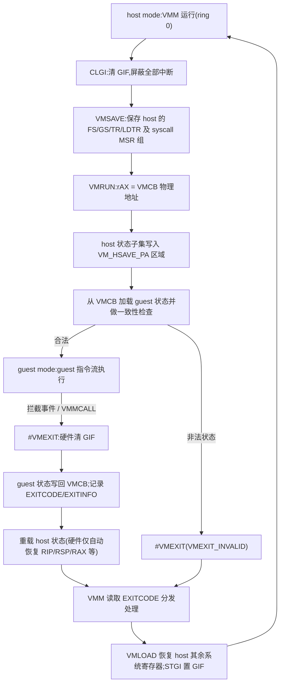

## 2. SVM 核心架构与指令集

第 1 章提出的"显式软件契约"哲学——硬件做最少的事、把状态放进公开的内存结构、由软件显式驱动切换——在本章落到指令层面。SVM(Secure Virtual Machine）的全部机制围绕三个对象展开：一个总开关（EFER.SVME)、一块公开布局的控制结构（VMCB)、一组仅八条的专用指令。理解这一章的关键在于：SVM 没有引入 Intel VMX 那样的独立"根操作模式",world switch 的进出完全由 `VMRUN` 与 `#VMEXIT` 两个原子动作构成，而这两次动作之间所有"硬件不做的部分",都显式地摊在 hypervisor 作者面前。本章引用 VMCB 字段时仅到机制所需的最小深度，字段级布局见第 3 章。

### 2.1 启用与双模式模型

#### 2.1.1 EFER.SVME 启用、VM_CR 锁定与 BIOS "SVM Mode" 的硬件根源

SVM 的能力探测走标准 CPUID 路径：`CPUID Fn8000_0001_ECX[2]`(SVM 位）置 1 即宣告处理器支持 `VMRUN`、`VMLOAD`、`VMSAVE`、`CLGI`、`VMMCALL`、`INVLPGA` 这组基础指令[^35^]。探测通过并不等于可用：SVM 的运行时总开关是 `EFER.SVME`(EFER bit 12,EFER 本身位于 MSR `C000_0080h`)。APM 对该位的定义是："Enables the SVM extensions. When this bit is zero, the SVM instructions cause #UD exceptions. EFER.SVME defaults to a reset value of zero."[^33^] 两个后果值得注意：其一，复位默认值为 0，意味着任何 OS/VMM 都必须显式置位才能使用 SVM;其二，guest 运行期间关闭 EFER.SVME 的行为是未定义的，因此手册要求 VMM 必须阻止 guest 写 EFER[^33^]。

在 EFER.SVME 之上还有一层固件级控制：VM_CR MSR(`C001_0114h`)。BIOS 可以通过置位 SVMDIS 并以 LOCK 锁定的方式禁用 SVM——锁定后对 LOCK/SVMDIS 的写被静默忽略，只有专用 SVM_KEY MSR 能解锁，否则状态保持到下次复位[^36^]。操作系统侧的可见表现是：hypervisor 初始化时读 VM_CR 发现 SVMDIS=1，只能报告"被 BIOS 禁用"并退出——FreeBSD bhyve 的检测代码即打印 `SVM: disabled by BIOS.` 后返回[^37^]。这正是主板固件设置中 "SVM Mode" 开关的硬件根源：该开关拨动的不是软件配置，而是 VM_CR 的 SVMDIS/LOCK 位组合[^36^]。

VM_CR 的完整位布局如下表所示（bit 0–2 与 SKINIT 安全启动流程联动，见 2.3.1):

| 位 | 名称 | 语义 | 引用 |
|---|---|---|---|
| 0 | DPD | 置 1 关闭 HDT 与部分内部调试特性；SKINIT 执行时无条件置 1 | [^38^] |
| 1 | R_INIT | 置 1 时未拦截的 INIT 信号转为 #SX 异常（向量 30);SKINIT 执行时无条件置 1 | [^38^] |
| 2 | DIS_A20M | 置 1 关闭 A20 掩码；SKINIT 执行时无条件置 1 | [^38^] |
| 3 | LOCK | 置 1 后 LOCK/SVMDIS 的写被静默忽略，仅 SVM_KEY MSR 可解锁 | [^36^] |
| 4 | SVMDIS | 置 1 时 EFER.SVME 被视为 MBZ;EFER.SVME=1 时写 SVMDIS 产生 #GP | [^36^][^37^] |

这一位表揭示了一个分层设计：bit 0–2 服务于"安全启动后封锁调试面"（DRTM 场景）,bit 3–4 服务于"固件对虚拟化能力的最终裁定权"。后者在历史上具有现实重要性——2006 年 Blue Pill rootkit 演示之后，OEM 长期倾向于出厂默认关闭 SVM,VM_CR 的锁定机制正是这一策略的执行点；也因此，排查"CPU 支持 SVM 但 hypervisor 加载失败"类问题时，检测链必须是 CPUID 位 → VM_CR.SVMDIS → EFER.SVME 三级，缺一不可[^36^][^37^]。

#### 2.1.2 host mode / guest mode：无 VMXON 式根模式切换的扁平设计

置位 EFER.SVME 后，处理器并不进入任何新的"操作模式"。SVM 在原 ring 0–3 之外新增的是一对正交的执行上下文：**host mode**(VMM 运行）与 **guest mode**（客户机运行），两种模式各自保有完整的 ring 0–3;guest mode 由 VMRUN 进入，被拦截的事件触发 #VMEXIT 返回 host mode。AMD 手册对术语有明确定义："The use of the term host refers to the execution context of the VMM. World switch refers to the operation of switching between the host and guest."[^1^]

这与 Intel VMX 形成启用模型上的结构性差异：VMX 要求先执行 `VMXON` 进入 "VMX operation"（根模式），退出需 `VMXOFF`；而 SVM **没有任何进入/退出"虚拟化操作态"的指令**，置位 EFER.SVME 即完成启用，此后 hypervisor 就是普通的 ring 0 代码，仅在执行 VMRUN 的瞬间才发生模式跃迁[^39^]。扁平设计带来的直接工程后果是：hypervisor 的宿主侧不需要维护一个全局的"VMX 已开启"生命周期（VMXON 区域、每个逻辑 CPU 的 on/off 状态机），启用 SVM 就是写一个 MSR 位；代价则是 SVM 无法像 VMX 那样用"处于 VMX operation"这一全局状态天然隔离 host 代码——隔离责任完全落在每次 world switch 的边界处理上（见 2.2.3 的 GIF 机制）。

### 2.2 世界切换机制

#### 2.2.1 VMRUN 进入 guest:host 状态保存至 VM_HSAVE_PA

`VMRUN` 以 rAX 中的 VMCB 物理地址为唯一（隐式）操作数。执行约束是硬性的：只能在 CPL=0 的保护模式且 EFER.SVME=1 下执行，否则分别触发 #GP/#UD;rAX 中的地址未按 4KB 边界对齐同样触发 #GP[^1^]。此外 APM 假定 VMM 在执行 VMRUN 之前已清除 GIF——"It is assumed that VMM software cleared GIF some time before executing the VMRUN instruction, to ensure an atomic state switch."[^40^] 这一条把"进入 guest"的原子性前提也显式地写进了软件契约。

VMRUN 的执行序列分为三步。第一，将 host 处理器状态的一个子集保存到 `VM_HSAVE_PA` MSR(`C001_0117h`）指定的物理内存区域；该 MSR 必须在首次 VMRUN 之前设置，软件不得直接读写这块 host 保存区[^1^]。第二，从 VMCB 加载 guest 状态（段寄存器含隐藏部分、GDTR/IDTR、EFER、CR4/CR3/CR2/CR0、RFLAGS、RIP、RSP、RAX、DR7/DR6、CPL 等）并做一致性检查（Canonicalization and Consistency Checks)；非法组合——如 EFER.SVME=0、CR0.CD=0 且 CR0.NW=1、CR0[63:32] 非零、ASID=0 等——立即以 #VMEXIT 失败，EXITCODE 为 `VMEXIT_INVALID`(64 位值 −1)[^1^]。第三，开始执行 guest 指令流；保存的 host RIP 即 VMRUN 的下一条指令地址，因此 #VMEXIT 后 VMM 恰好从 VMRUN 之后继续执行[^1^]。

关于 host 保存区有一个刻意的设计决定需要强调：其格式**故意不公开**。APM 警告："Processor implementations may store only part or none of host state in the memory area pointed to by VM_HSAVE_PA MSR and may store some or all host state in hidden on-chip memory … software must not rely on the format or contents of the host state save area."[^13^] 也就是说，VM_HSAVE_PA 指向的内存只是一个"溢出区"，实现可以把全部 host 状态放在片上。这一决定的推论是双向的：hypervisor 无法通过检查该区域验证 host 状态，调试非法 host 状态极其困难（任何问题都直接导致处理器 shutdown)；同时硬件微架构获得了完全的状态缓存自由度[^13^]。

#### 2.2.2 #VMEXIT：清 GIF → 写回 guest 状态 → 记录退出原因 → 重载 host

拦截事件触发时，处理器按固定顺序执行退出序列[^1^]：

1. **清除 GIF**，屏蔽包括 NMI/SMI 在内的全部中断，保证后续状态切换原子完成；
2. 将 guest 当前状态（与 VMRUN 加载的同一子集，另含 V_IRQ、V_TPR、INTERRUPT_SHADOW）写回 VMCB 状态保存区；
3. 在 VMCB 的 EXITCODE、EXITINFO1/2、EXITINTINFO 字段记录退出原因；
4. 清除全部拦截位与 V_IRQ/V_INTR_MASKING/TSC_OFFSET,ASID 寄存器归 0(host ASID)，关闭嵌套分页；
5. 从 host 保存区重载 host 状态（GDTR、IDTR、EFER、CR0——其中 CR0.PE 被强制置 1、CR4、CR3、RIP、RSP、RAX、RFLAGS 等），在 VMRUN 的下一条指令处恢复执行[^1^]。

整个进出循环可用下图概括：

需要逐层拆解的是"硬件恢复多少"这一问题。#VMEXIT 后，**只有 RIP、RSP 和 RAX 恢复为此前的 host 值，其余全部通用寄存器仍持有 guest 的值**;FS、GS、TR、LDTR 及其隐藏状态、STAR/LSTAR 等 syscall MSR 也不在自动切换之列——"a full context switch requires manual execution of the VMSAVE/VMLOAD instructions which save/load additional system registers (FS, SS, LDTR, STAR, LSTAR …) from memory"[^13^]。这是 SVM "最小硬件 + 显式软件"哲学最直接的体现：硬件只保证 VMM 能拿到一个可执行的最小现场（栈、指令指针、一个可用寄存器），其余上下文恢复是软件责任。工程上的典型形态是教学级 hypervisor 与 KVM 共用的序列 `clgi; vmsave; vmrun; …(exit)…; vmsave/vmload; stgi`——VMRUN 前手工保存 host 段寄存器，退出后手工恢复，临界区两端用 CLGI/STGI 夹住[^41^]。

这一设计的影响值得与 Intel 侧对照评估。VMX 在 VM-exit 时按 VMCS 的 host-state 域做较完整的硬件自动恢复，hypervisor 代码更省心；而 SVM 把状态搬运责任转移给软件，换来的是控制结构（VMCB）作为普通内存对象的简洁性与 host/guest 状态边界的清晰性——VMCB 中根本不含 host 状态字段。风险侧同样明确：状态漂移（host 忘了恢复某个寄存器、或 guest 值泄漏到 host 上下文）成为 hypervisor 作者的正确性负担，Google Project Zero 对 KVM AMD 嵌套虚拟化的逃逸分析正是沿着这条"部分状态切换"边界展开的[^13^]。

与状态切换并行，world switch 还有一条缓存维度的优化：自 64 位 Opteron Rev-F 起，TLB 项携带地址空间标识符（ASID）打标，host 与各 guest 的 TLB 项可以共存——"To reduce the cost of world switches, the TLB is tagged with an address space identifier (ASID) distinguishing host-space entries from guest-space entries."[^1^] 这把 #VMEXIT 序列中"ASID 寄存器归 0"一步的真实含义讲清楚了：归 0 只是切换当前命名空间（0 保留给 host)，并不冲刷 TLB;guest 的翻译项在下次以同一 ASID 重新进入时仍然有效。ASID 的分配额度由 CPUID Fn8000_000A 的 EBX(NASID）报告，按需刷新则由 VMCB 的 TLB_CONTROL 字段与 INVLPGA 指令承担（见 2.3)。

#### 2.2.3 GIF 与 STGI/CLGI：全局中断标志保护 host 关键区

GIF(Global Interrupt Flag）是 SVM 引入的一个全局中断使能位，语义比 RFLAGS.IF 更强：GIF=0 时**包括 NMI、SMI、INIT 在内的一切中断与异常注入源**都被屏蔽。`CLGI` 清 GIF,`STGI` 置位恢复[^38^]。在 world switch 语境下，GIF 的作用是为 host 侧的状态切换临界区提供原子性保证——#VMEXIT 的第一步就是硬件自动清 GIF，而 VMM 在进入 guest 前用 CLGI、退出处理完成后用 STGI 夹住临界区，构成完整的中断安全窗口[^42^][^41^]。

GIF 是物理 CPU 的全局状态，这会在嵌套虚拟化下制造问题：guest（作为 L1 hypervisor）执行的 STGI/CLGI 若直接作用于物理 GIF，就允许 guest 屏蔽本应由 L0 处理的中断。因此无硬件辅助时，guest 内的 STGI/CLGI 必须被拦截模拟。AMD 的解法是 **vGIF** 扩展（CPUID Fn8000_000A_EDX[16]=1 指示）：在 VMCB offset 60h 增加 bit 9(vGIF 值）与 bit 25（本 guest 的 vGIF 使能）；使能后 guest 内执行 STGI/CLGI 直接读写虚拟 GIF 位而**不再产生 #VMEXIT**，物理中断仍由 hypervisor 照常拦截——"This feature allows STGI and CLGI to execute in guest mode and control virtual interrupts in guest mode while still allowing physical interrupts to be intercepted by the hypervisor."[^43^] KVM 的对应实现是在检测到 vGIF 能力后清除对 STGI/CLGI 的拦截并置 VMCB 的 V_GIF_ENABLE 位[^43^]。GIF/vGIF 这一对机制是观察 SVM 设计演化的好样本：先用一条强语义的全局开关简化硬件（GIF)，发现虚拟化场景下的缺口后，再以 VMCB 内的显式虚拟化位（vGIF）补回，全程不引入新的不透明状态。

### 2.3 SVM 指令全集

#### 2.3.1 八条核心指令逐条解析

SVM 基础指令集仅八条，全部由 `CPUID Fn8000_0001_ECX[2]` 一位宣告（SKINIT 另有 ECX[12] 能力位），编码集中在 `0F 01 D8`–`0F 01 DF` 一段[^44^][^35^]。下表逐条给出语义、特权约束与对应的拦截退出码（EXITCODE 编码规律是：数值等于对应拦截位在 VMCB 拦截向量中的位序，完整编码表见第 3 章）[^44^][^1^][^45^]。

| 指令 | 机器码 | 操作数 | 语义 | 特权级与约束 | 被拦截时 EXITCODE |
|---|---|---|---|---|---|
| `VMRUN` | `0F 01 D8` | rAX = VMCB 物理地址 | 保存 host 状态子集至 VM_HSAVE_PA，加载 guest 状态并进入 guest mode | CPL=0、保护模式、EFER.SVME=1;rAX 未 4KB 对齐 #GP；执行前须 GIF=0 | `80h` |
| `VMMCALL` | `0F 01 D9` | 无 | guest 主动发起 hypercall，无条件产生 #VMEXIT，是 guest→host 的标准系统调用入口 | guest mode 内执行；host 侧通常常开拦截 | `81h` |
| `VMLOAD` | `0F 01 DA` | rAX = VMCB 物理地址 | 从 VMCB 加载 FS/GS/TR/LDTR（含全部隐藏状态）、KernelGsBase、STAR/LSTAR/CSTAR/SFMASK、SYSENTER_CS/ESP/EIP | CPL=0、EFER.SVME=1;rAX 越界或未 4KB 对齐 #GP | `82h` |
| `VMSAVE` | `0F 01 DB` | rAX = VMCB 物理地址 | 将上述同一组状态反向保存到 VMCB | 同 VMLOAD | `83h` |
| `STGI` | `0F 01 DC` | 无 | 置位 GIF，恢复中断接收 | CPL=0、EFER.SVME=1；有 vGIF 时 guest 内执行只改虚拟位 | `84h` |
| `CLGI` | `0F 01 DD` | 无 | 清 GIF，屏蔽含 NMI/SMI/INIT 的一切中断 | 同 STGI | `85h` |
| `SKINIT` | `0F 01 DE` | EAX = SLB 物理基址 | 可信启动：重初始化处理器、度量并跳入 Secure Loader（见下文） | CPL=0;SLB 须 ≤64KB、64KB 对齐、位于 4GB 以下 | `86h` |
| `INVLPGA` | `0F 01 DF` | rAX = 虚拟页，ECX = ASID | 选择性失效"指定虚拟页 × 指定 ASID"的 TLB 映射 | CPL=0、EFER.SVME=1；属基础指令集 | `7Ah` |

逐条看，这张表可以按功能分成三组。**进出组**(VMRUN/VMMCALL）构成 world switch 的两个方向：VMRUN 是 host→guest 的唯一入口，VMMCALL 是 guest→host 的唯一主动出口（其余出口都是被动的拦截事件）。**状态组**(VMLOAD/VMSAVE）存在的原因纯粹是 VMRUN/#VMEXIT 的自动切换范围太窄：APM 明确这两条指令"handle the following register state: FS, GS, TR, LDTR (including all hidden state); KernelGsBase; STAR, LSTAR, CSTAR, SFMASK; SYSENTER_CS, SYSENTER_ESP, SYSENTER_EIP"，且与 VMRUN 一样仅限 CPL0[^46^]。隐藏段状态（描述符缓存的 base/limit/attrib）是普通软件无法完整读写的部分，VMLOAD/VMSAVE 是唯一合法的软件访问通道——这也是轻量 hypervisor 进出循环中必须手工调用它们的根本原因[^1^]。**控制组**(STGI/CLGI/INVLPGA/SKINIT）各管一件事：GIF、TLB、可信启动。INVLPGA 是 SVM 基础指令集中唯一的 TLB 维护手段，配合 VMCB 的 ASID 字段实现按地址空间的选择性失效[^44^];SKINIT 则属于与虚拟化正交的安全子系统，下面单独说明。

SKINIT(Secure Init）是 Presidio 安全血统在 SVM 中的遗存，实现 AMD 的 DRTM(Dynamic Root of Trust for Measurement)，对应 Intel TXT/SINIT。其执行序列为：以 INIT 信号的方式重初始化处理器并进入平坦 32 位保护模式（分页关闭），通用寄存器清零仅留 EAX(Secure Loader 入口）、EDX(family/model/stepping）与 ESP;EFER 清零；VM_CR 的 DPD/R_INIT/DIS_A20M 三个标志无条件置 1；对 64KB 的 SLB(Secure Loader Block）启用 SL_DEV 保护以隔绝 DMA/设备访问；经专用总线事务把 SL 镜像送 TPM 度量（软件无法模拟该事务，TPM 据此鉴别真实执行）;**清 GIF** 屏蔽一切中断后跳入 Secure Loader[^38^]。度量结果扩展 PCR17/18，用于后续验证并启动可信内核（如可信 VMM)。注意 SKINIT 是八条指令中唯一不改变 host/guest 模式、也不服务于 world switch 的指令；它出现在 SVM 指令组中，是因为其 CPL0/GIF/VM_CR 语义与 SVM 基础设施深度耦合，TrenchBoot 项目已为 GRUB 与 Linux 实现了基于 SKINIT 的 Secure Launch 路径[^38^]。

#### 2.3.2 CPUID 能力叶与 MSR 清单

SVM 的能力协商集中在两个扩展 CPUID 叶与三个 MSR。`Fn8000_0001` 负责"有无 SVM 及配套指令"的粗粒度宣告，`Fn8000_000A`(SVM Revision and Feature Identification）负责细粒度特性枚举；MSR 侧则是"一个总开关 + 一个固件锁 + 一个 host 保存区指针"的最小集合。

| 类别 | 标识 | 字段/位 | 含义 | 引用 |
|---|---|---|---|---|
| CPUID | `Fn8000_0001_ECX[2]` | SVM | 支持 VMRUN/VMLOAD/VMSAVE/CLGI/VMMCALL/INVLPGA | [^35^] |
| CPUID | `Fn8000_0001_ECX[12]` | SKINIT | 支持 SKINIT 安全启动 | [^35^] |
| CPUID | `Fn8000_0001_ECX[10]` | IBS | 为 Instruction Based Sampling,**并非** NRIPS（常见误植，勘误） | [^35^] |
| CPUID | `Fn8000_000A_EAX[7:0]` | SvmRev | SVM 修订号 | [^47^] |
| CPUID | `Fn8000_000A_EBX` | NASID | 硬件支持的 ASID 数量 | [^48^] |
| CPUID | `Fn8000_000A_EDX[0]` | NP | 嵌套分页 NPT/RVI | [^47^] |
| CPUID | `Fn8000_000A_EDX[1]` | LbrVirt | LBR 虚拟化 | [^47^] |
| CPUID | `Fn8000_000A_EDX[2]` | SVML | SVM Lock（支持 VM_CR.LOCK) | [^47^] |
| CPUID | `Fn8000_000A_EDX[3]` | NRIPS | #VMEXIT 时保存 NEXT_RIP | [^47^] |
| CPUID | `Fn8000_000A_EDX[4]` | TscRateMsr | TSC ratio MSR(`C000_0104h`) | [^47^] |
| CPUID | `Fn8000_000A_EDX[5]` | VmcbClean | VMCB clean bits（状态缓存） | [^47^] |
| CPUID | `Fn8000_000A_EDX[6]` | FlushByAsid | 按 ASID 刷 TLB(TLB_CONTROL 编码 3/7) | [^47^] |
| CPUID | `Fn8000_000A_EDX[7]` | DecodeAssist | 译码辅助（EXITINFO 提供已译码信息） | [^47^] |
| CPUID | `Fn8000_000A_EDX[10]` | PauseFilter | PAUSE 拦截过滤 | [^47^] |
| CPUID | `Fn8000_000A_EDX[12]` | PauseFilterThreshold | PAUSE 周期阈值 | [^47^] |
| CPUID | `Fn8000_000A_EDX[13]/[15]/[16]/[18]` | AVIC/VLS/VGIF/x2AVIC | 中断与指令虚拟化扩展（见第 4、6 章） | [^43^][^3^] |
| MSR | `C000_0080h` EFER | bit 12 SVME | SVM 总开关；清零时 SVM 指令 #UD；复位默认 0 | [^33^] |
| MSR | `C001_0114h` VM_CR | DPD/R_INIT/DIS_A20M/LOCK/SVMDIS | SVM 全局属性与固件锁定（位表见 2.1.1) | [^37^][^36^] |
| MSR | `C001_0117h` VM_HSAVE_PA | host 保存区物理地址 | VMRUN 前必须设置；低 12 位非零或超出物理地址范围写 #GP | [^1^][^1^] |

这份清单有三点值得分析。第一，**MSR 数量极少**：与 SVM 核心机制直接相关的只有三个 MSR，嵌套分页根指针（nCR3)、ASID、拦截配置等全部放在 VMCB 而非 MSR 中——这与 Intel 把同类控制收进 VMCS 字段域在结构上同构，但访问方式完全不同（普通内存读写 vs VMREAD/VMWRITE)。第二，**Fn8000_000A 的 EDX 位表就是一部 SVM 的增量演化史**:bit 0(NPT,2007)→ bit 3/5(NRIPS、VmcbClean，状态管理优化）→ bit 6/7(FlushByAsid、DecodeAssist,TLB 与模拟开销优化）→ bit 13/16(AVIC、vGIF，中断虚拟化），每一个新位都对应一类曾被软件模拟的开销被硬件化；hypervisor 初始化时必须按位探测而非按代际假设，固件甚至可以单独屏蔽个别位[^47^][^3^]。第三，**勘误项**:`Fn8000_0001_ECX[10]` 在部分二手资料中被误标为 NRIPS，实际该位是 IBS(Instruction Based Sampling),NRIPS 的正确位置是 `Fn8000_000A_EDX[3]`——能力检测代码若按错误位实现，会在所有平台上静默得到错误结论[^35^]。

VMCB 在上述各环节中反复出现——VMRUN 加载的"状态子集"、#VMEXIT 写回的退出信息、vGIF 与 ASID 等控制位都以它为载体；其字段级布局与拦截编码将在第 3 章展开。
