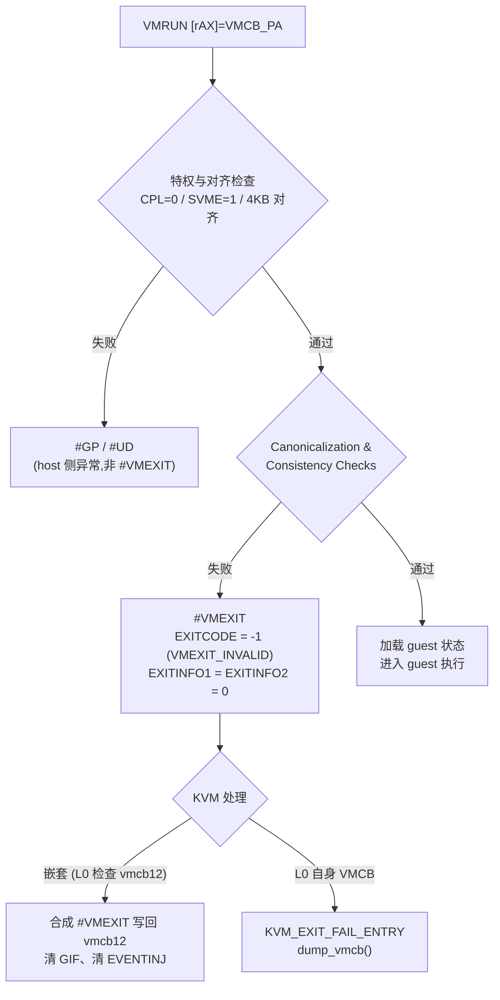

## 3. VMCB 与拦截机制

第 2 章给出的 VMRUN/#VMEXIT 状态切换流程中,VMCB(Virtual Machine Control Block,虚拟机控制块)是 VMRUN 唯一的隐式操作数,也是 SVM 全部虚拟化语义的载体:hypervisor 在它里面声明"拦截什么",硬件在它里面回报"为什么退出"。与 Intel VMCS 的不透明设计(软件必须经 VMREAD/VMWRITE 间接访问、字段编码不公开)不同,VMCB 是一个布局完全公开、由 hypervisor 以普通内存方式直接读写的数据结构——这一"显式软件契约"使 hypervisor 代码更薄,但也把正确性责任转移到了 VMCB 的构造与解析路径上(详见 3.3.3 的一致性检查与安全案例)。本章依据 AMD64 APM Vol.2(Pub. 24593)第 15 章、Appendix B(VMCB Layout)与 Appendix C(SVM Intercept Codes),并结合其前身《Secure Virtual Machine Architecture Reference Manual》(Pub. 33047,2005-12,Rev 3.02)与 KVM `arch/x86/include/asm/svm.h` 的字段级实现展开。[^2^][^1^][^49^]

### 3.1 VMCB 布局

#### 3.1.1 4KB 对齐单页:控制区 + 状态保存区

VMCB 恰好占据一个 4KB 物理页,且必须 **4KB 边界对齐**;VMRUN 以 `rAX` 中的**物理地址**引用它,对齐违规时 VMRUN 以 `#GP` 失败(VMLOAD/VMSAVE 对同一地址施加同样约束)。VMCB 应映射为写回(WB)内存;VMRUN 自身只能在 CPL=0、保护模式且 `EFER.SVME=1` 时执行,否则分别触发 `#GP`/`#UD`。[^1^] 结构体层面,各语言实现普遍以编译期断言固化这一布局,例如 Rust 实现的 `#[repr(C, align(4096))]` 加 `assert!(size_of::<VmcbRaw>() == 0x1000)`。[^50^]

页内空间划分为两个功能区,边界固定在偏移 400h:[^33^][^43^][^1^]

- **控制区(0x000–0x3FF)**:起始于页内偏移 0,**填充(padded)至 1024 字节**;所有未用字节必须为 0(MBZ,为将来扩展保留),手册建议对新分配的 VMCB 整体清零。控制区容纳拦截向量、权限位图指针、ASID/TLB 控制、虚拟中断字段、事件注入字段以及退出信息回写区。[^33^][^1^]
- **状态保存区(0x400–0xFFF)**:起始于页内偏移 400h,保存 guest 跨 VMEXIT 的 CPU 状态。注意 APM Appendix B Table B-2 列出的偏移是**相对于状态保存区自身**的,换算为 VMCB 页内偏移需加 0x400——FreeBSD bhyve 头文件中的宏 `VMCB_OFF_STATE(x) = (x) + 0x400` 表达的正是这一约定。[^1^][^51^]

图 3-1:VMCB 页内布局(示意,块高不代表字节数)。控制区字段为页内偏移,保存区字段为保存区相对偏移(页内偏移 = 手册值 + 0x400);字段偏移与命名依据 APM Vol.2 Appendix B Table B-1/B-2 及 33047,并与 KVM `struct vmcb_control_area`/`vmcb_save_area` 对齐。[^33^][^1^][^49^]

这一两分结构在 SEV-ES 时代获得新的安全语义:控制区保持明文(hypervisor 可读写),状态保存区则被加密并完整性保护、改称 VMSA,控制区 108h 偏移新增指向 VMSA 页的指针——VMCB 由此在机密计算下"分裂"为信任级别不同的两半,该机制将在第 9 章展开。[^52^]

#### 3.1.2 与 KVM `svm.h` 的逐字段对应

KVM 在 `arch/x86/include/asm/svm.h` 中以 `struct vmcb { struct vmcb_control_area control; struct vmcb_save_area save; }` 复刻硬件布局,成员名与 APM 字段几乎一一对应:`intercept_cr_read/write`(u16)、`intercept_dr_read/write`、`intercept_exceptions`(u32)、`iopm_base_pa`、`msrpm_base_pa`、`tsc_offset`、`asid`、`tlb_ctl`、`int_ctl`/`int_vector`/`int_state`、`exit_code(_hi)`、`exit_info_1/2`、`exit_int_info(_err)`、`nested_ctl`、`event_inj(_err)`、`nested_cr3`、`lbr_ctl`、`clean`、`next_rip`、`insn_len`/`insn_bytes[15]`。[^49^][^53^] 2020 年 AMD 侧补丁将原本拼合的 64 位 `intercept` 字段重构为 `u32 intercepts[MAX_VECTORS]` 数组,枚举值 `CR_VECTOR=0`、`DR_VECTOR=1`、`EXCEPTION_VECTOR=2`、`INTERCEPT_VECTOR_3`、`INTERCEPT_VECTOR_4` 与硬件 000h/004h/008h/00Ch/010h 五个 dword 的布局严格一致。[^54^]

状态保存区按 APM Table B-2 组织(下表偏移为相对保存区的手册值,页内偏移需 +0x400):[^1^][^49^][^55^]

| 偏移(保存区) | 字段 | 大小/格式 | 说明 |
|---|---|---|---|
| 000h–098h | ES/CS/SS/DS/FS/GS/GDTR/LDTR/IDTR/TR | 每段 16 字节:`selector`(u16,+0)、`attrib`(u16,+2)、`limit`(u32,+4)、`base`(u64,+8) | 含描述符缓存"隐藏部分";GDTR/IDTR 的 selector/attrib 保留,limit 仅低 16 位有效 [^1^][^49^] |
| 0CBh | CPL | u8 | 当前特权级;实模式强制 0,v86 模式强制 3 [^1^] |
| 0D0h | EFER | u64 | 扩展特性使能寄存器 [^1^] |
| 148h/150h/158h | CR4 / CR3 / CR0 | u64 | 分页控制寄存器 [^1^] |
| 160h/168h | DR7 / DR6 | u64 | 调试寄存器 [^1^] |
| 170h/178h | RFLAGS / RIP | u64 | 标志与指令指针 [^1^] |
| 1D8h / 1F8h | RSP / RAX | u64 | RAX 是唯一保存在 VMCB 的通用寄存器,其余 GPR 由 hypervisor 软件自行切换 [^1^][^42^] |
| 200h–238h | STAR/LSTAR/CSTAR/SFMASK/KernelGsBase/SYSENTER_CS/ESP/EIP | u64 × 8 | 系统调用 MSR 组;VMLOAD/VMSAVE 亦覆盖此组 [^1^][^46^] |
| 240h | CR2 | u64 | 页故障线性地址 [^1^] |
| 268h | G_PAT | u64 | guest PAT,仅 `NP_ENABLE=1` 时换入 [^56^] |
| 270h–288h | DBGCTL/BR_FROM/BR_TO/LASTEXCP_FROM/LASTEXCP_TO | u64 × 5 | 仅 LBR 虚拟化启用时有效 [^1^] |
| 2E0h 等 | SPEC_CTRL、VMPL、S_CET/SSP/ISST_ADDR | — | 后续扩展:SPEC_CTRL 抑制、SEV-SNP 的 VMPL(0CAh)、CET 影子栈字段(1E0h–1F0h) [^49^][^55^] |

这张表的两个结构性特征值得强调。其一,**段寄存器保存的是完整的 base/limit/attrib 而非仅 selector**——这正是普通软件无法完整读写、必须借助 VMRUN/#VMEXIT 或 VMLOAD/VMSAVE 才能切换的"隐藏段状态";VMRUN 与 #VMEXIT 在加载/保存段基址时会做规范化(canonicalize,符号扩展到 bit 63)。[^57^][^1^] `attrib` 的编码为 bit 3:0=TYPE、bit 4=S、bit 5:6=DPL、bit 7=P、bit 8=AVL、bit 9=L、bit 10=D/B、bit 11=G,判定段是否为空应测 P 位(CS 与 TR 永不为空),而 CPL 一律从独立的 VMCB CPL 字段读取而非 SS.DPL。[^53^][^58^] 其二,**GPR 只保存 RAX**:这一设计把上下文切换成本显式化——#VMEXIT 硬件只写回与 VMRUN 加载同一子集的状态(段、GDTR/IDTR、EFER、CR0/2/3/4、NPT 时的 gPAT、RFLAGS、RIP、RSP、RAX、DR6/7、CPL、INTERRUPT_SHADOW 及退出信息字段),其余寄存器交由软件按需保存,使轻量 hypervisor 可以精确控制切换开销。[^1^][^46^]

### 3.2 控制区详解

下表汇总控制区关键字段(偏移为 VMCB 页内偏移),随后逐组展开:[^33^][^1^][^59^]

| 偏移 | 字段 | 位宽 | 功能 |
|---|---|---|---|
| 000h–013h | 拦截向量 0–4 | 5 × u32 | CR/DR 读写、异常、杂项指令、SVM 指令拦截(3.2.1)[^33^] |
| 040h / 048h | IOPM_BASE_PA / MSRPM_BASE_PA | u64 | I/O 端口与 MSR 权限位图物理基址(3.2.2)[^1^] |
| 050h | TSC_OFFSET | u64 | 加在 RDTSC/RDTSCP 返回值上的偏移;#VMEXIT 时硬件清零 [^1^] |
| 058h / 05Ch | Guest ASID / TLB_CONTROL | u32 / u8 | 地址空间标识;VMRUN 时的 TLB 命令(3.2.4)[^59^] |
| 060h / 064h / 068h | INT_CTL / INT_VECTOR / INT_STATE | u32 / u32 / u8 | 虚拟中断控制(V_TPR/V_IRQ/…)、注入向量、中断阴影(3.2.3)[^59^] |
| 070h–088h | EXITCODE / EXITINFO1 / EXITINFO2 / EXITINTINFO | u64 × 4 | 退出原因与事件附加信息(3.3)[^1^] |
| 090h | NP_ENABLE(bit 0,高位为 SEV 控制) | u64 | 嵌套分页使能;SEV/SEV-ES 使能位同处此 qword [^59^][^52^] |
| 0A0h | GHCB GPA | u64 | SEV-ES 的 GHCB 页物理地址 [^52^] |
| 0A8h | EVENTINJ | u64 | 事件注入(3.2.3)[^1^] |
| 0B0h | n_CR3 | u64 | NPT 二级页表根(机制见第 4 章)[^60^] |
| 0C0h | VMCB clean bits | u32 | 状态组缓存标记(3.2.4)[^61^] |
| 0C8h / 0D0h | NRIP(next_rip)/ insn_len、insn_bytes[15] | u64 / — | #VMEXIT 保存的下一条指令 RIP;Decode Assists 的指令字节(3.2.4)[^53^][^62^] |
| 108h | VMSA 指针 | u64 | SEV-ES/SNP 下指向加密保存区页 [^52^] |
| 014h–03Fh 等空档 | 保留 | — | MBZ [^33^] |

控制区的设计呈现明显的"地址即接口"风格:字段即 ABI,偏移二十年保持向后兼容(2005 年 33047 定义的 000h–0B0h 布局至今有效),新能力(SEV、AVIC、CET)通过占用保留空档扩展。对 hypervisor 开发者而言,直接后果是控制区解析代码必须显式处理 MBZ 约束——硬件对保留位的容忍策略并非统一(见 3.3.3),依赖"硬件会拒绝非法值"是已被证伪的假设。[^1^][^63^]

#### 3.2.1 五组拦截向量(000h–013h)

控制区前 20 字节是五个 32 位拦截向量,构成 SVM 拦截体系的主干:[^33^][^1^][^45^]

- **向量 0(000h)**:CR 访问拦截,低 16 位(bit 15:0)对应 CR0–15 的**读**,高 16 位对应**写**;向量 1(004h)以同样"读 16 位 + 写 16 位"编码覆盖 DR0–15。LMSW、SMSW、CLTS 等间接改写 CR0 的指令同样触发 CR0 拦截。[^33^][^57^][^1^]
- **向量 2(008h)**:异常拦截,32 位一对一映射异常向量 0–31(#DE 至 #XF)。向量 2(NMI 位置)保留,应改用专用 NMI 拦截位;外部中断与软件中断不能经此向量拦截。[^1^]
- **向量 3(00Ch)**:中断与杂项指令——bit 0–4 为 INTR/NMI/SMI/INIT/VINTR;bit 5 为 selective CR0(仅拦截改变 CR0.TS/MP 以外位的 CR0 写);bit 6–13 为 IDTR/GDTR/LDTR/TR 的读(6–9)与写(10–13);bit 14–26 覆盖 RDTSC、RDPMC、PUSHF、POPF、CPUID、RSM、IRET、INTn、INVD、PAUSE、HLT、INVLPG、INVLPGA;bit 27–31 为 IOIO_PROT、MSR_PROT、任务切换、FERR_FREEZE 与 shutdown。[^33^][^59^]
- **向量 4(010h)**:SVM 指令族与系统指令——VMRUN、VMMCALL、VMLOAD、VMSAVE、STGI、CLGI、SKINIT、RDTSCP、ICEBP、WBINVD、MONITOR/MWAIT 等。[^33^][^53^]

两个细节容易踩坑。其一,ICEBP(`int1`)虽经 IDT 向量 1 派发,但**不能**用 #DB 异常拦截位拦截,必须使用专用 ICEBP 拦截位——这是异常向量与拦截位并非总可互换的显式反例。其二,拦截的触发点在"结果提交之前",但按拦截特定优先级相对异常检查排序:一般晚于 CPL/#UD 类简单异常、早于内存访问异常(如 #PF);当前指令的指令断点与上一条指令遗留的数据断点陷阱优先于指令拦截检查。[^1^]

KVM 的默认拦截集(`init_vmcb()`)可作为工程参照:拦截 CR0/CR3/CR4 读写、CR8 写(无 APICv 时)、全部 DR 访问、#PF/#UD/#MC/#AC/#DB、INTR/NMI、selective CR0、RDPMC、CPUID、INVD、INVLPG(A)、IOIO_PROT、MSR_PROT、任务切换、shutdown、全部 SVM 指令、WBINVD、XSETBV、RDPRU 与 RSM;启用 NPT 时则**清除** INVLPG、#PF 与 CR3 读写拦截,把这三类事件还给 guest/二级页表硬件处理。[^58^]

#### 3.2.2 IOPM 与 MSRPM:按端口/MSR 粒度的权限位图

`IOIO_PROT` 与 `MSR_PROT` 两个总开关置位后,具体拦截哪些端口/MSR 由两张独立分配的权限位图决定,其物理基址分别由 040h/048h 字段给出,地址低 12 位被硬件忽略(隐含 4KB 对齐):[^1^]

- **IOPM(I/O Permissions Map,12KB)**:64K+3 位的线性数组(两个整页加第三页的前 3 位),每位对应一个 I/O 端口,可按端口粒度拦截 IN/OUT/INS/OUTS。[^1^][^42^]
- **MSRPM(MSR Permissions Map,8KB)**:每个 MSR 占两位,分别控制 RDMSR 与 WRMSR 拦截。覆盖三个 MSR 区间:`0000_0000h–0000_1FFFh`(位图 000h–7FFh 字节)、`C000_0000h–C000_1FFFh`(800h–FFFh)、`C001_0000h–C001_1FFFh`(1000h–17FFh),1800h–1FFFh 保留。[^1^][^42^]

位图本身也是一致性检查的对象:若位图最后一字节的地址达到或超过处理器支持的最大物理地址,VMRUN 判定 VMCB 非法并以 `VMEXIT_INVALID` 退出;KVM 嵌套虚拟化在 `nested_vmcb_check_controls()` 中对 L1 提供的 iopm/msrpm GPA 复刻了同一检查。[^1^][^64^] 实践上,教学与最小实现常直接分配 16KB(IO)+ 8KB(MSR)的页对齐缓冲区。[^53^][^42^]

#### 3.2.3 INT_CTL 虚拟中断字段与 EVENTINJ 事件注入

060h 起的 qword 是 SVM 虚拟中断机制的核心(后续扩展在同一 qword 内追加了 V_GIF_ENABLE/V_GIF/V_NMI 等位):[^59^][^64^]

- **V_TPR**(bit 0–7,实际用 3:0):虚拟 TPR,guest 对 CR8 的访问可重定向到此字段;
- **V_IRQ**(bit 8):置位表示有虚拟 INTR 待处理;**V_INTR_PRIO**(bit 16–19)给出其优先级,**V_IGN_TPR**(bit 20)表示该虚拟中断忽略 V_TPR;**V_INTR_VECTOR**(064h,即 KVM 的 `int_vector`)为注入向量号;
- **V_INTR_MASKING**(bit 24):虚拟化 INTR 屏蔽。置位后 guest 的 RFLAGS.IF 控制**虚拟**中断的屏蔽,而 host 侧物理中断不依赖 guest IF 即保持挂起——配合 VINTR 拦截即可实现"中断窗口"(guest 开中断瞬间注入)语义。KVM 在 `init_vmcb()` 中默认置位此位。[^59^][^65^][^61^]
- **INT_STATE**(068h)bit 0 为 INTERRUPT_SHADOW,记录 guest 处于 STI/MOV SS 之后的中断阴影期。[^59^]

事件注入经 **EVENTINJ**(0A8h)完成,格式为 `VECTOR[7:0]`、`TYPE[10:8]`、`EV`(bit 11,携错误码)、`V`(bit 31,有效)、`ERRORCODE[63:32]`:TYPE=2 注入 NMI(忽略 VECTOR),TYPE=3 注入硬件异常。VMRUN 对该字段做合法性检查——保留 TYPE 值、或 TYPE=3 而向量不是异常(含向量 2)时以 `VMEXIT_INVALID` 退出;#VMEXIT 时硬件清除该字段。[^1^][^40^] 与之镜像的 **EXITINTINFO**(088h)采用同一格式,记录拦截发生瞬间 guest 正在经 IDT 投递的事件;多重异常场景下它保存聚合信息——例如 #DF 投递期间拦截到 #PF 时,EXITINTINFO 表明"正在投递 #DF",被拦截的 #PF 本身由 EXITCODE/EXITINFO1/2 描述。[^51^][^1^]

#### 3.2.4 ASID、TLB_CONTROL、VMCB clean bits 与 NRIP

**ASID**(058h,u32)是 guest 地址空间标识:TLB 查找同时匹配 ASID 标签,使不同 guest 与 host 的 TLB 项跨上下文切换共存,免除 VM 切换时的全量刷新。ASID 0 保留给 host,guest 使用 ASID 0 属非法组合,VMRUN 一致性检查直接拒绝;CPU 支持的 ASID 数量由 `CPUID Fn8000_000A EBX`(NASID)报告。[^66^][^67^][^47^]

**TLB_CONTROL**(058h 高字节,即 KVM 视角的 05Ch)在每次 VMRUN 时被硬件读取(但不修改),指定本次进入要执行的 TLB 命令:[^50^][^67^]

| 编码 | 名称(内核宏) | 语义 | 引入 |
|---|---|---|---|
| 0x0 | `TLB_CONTROL_DO_NOTHING` | 不刷新 | 初代 SVM(33047 已定义 0/1)[^1^] |
| 0x1 | `TLB_CONTROL_FLUSH_ALL_ASID` | 刷新所有 ASID 的全部 TLB 项(全局+非全局) | 初代 SVM;APM 注明应仅用于 legacy 硬件 [^1^][^68^] |
| 0x3 | `TLB_CONTROL_FLUSH_ASID` | 刷新该 guest ASID 的项 | FlushByAsid(Fam15h,CPUID EDX[6])[^68^] |
| 0x7 | `TLB_CONTROL_FLUSH_ASID_LOCAL` | 刷新该 ASID 的非全局项 | FlushByAsid [^67^][^69^] |

编码语义上有一个对嵌套虚拟化至关重要的架构事实:APM 仅把不支持的 TLB_CONTROL 编码标注为"保留",**并未规定 VMRUN 必须检查其合法性**;KVM 曾自行添加嵌套路径的 TLB_CONTROL 一致性检查,2024 年上游按"除非 APM 在一致性检查清单中点名或标注 MBZ,否则硬件通常放任软件自食其果"的裁决将其回滚。这提示 hypervisor 开发者:VMCB 各字段的校验强度并不均匀,一致性强制的边界以 APM 清单为唯一权威。[^63^]

**VMCB clean bits**(0C0h,u32)配合硬件的 VMCB State Caching(CPUID Fn8000_000A EDX[5],VMCBCLEAN)工作:每一位声明一组状态自上次 VMRUN 以来未被修改,硬件据此跳过相应状态组的重新加载。可缓存组包括拦截向量/TSC offset/pause filter、IOPM/MSRPM、ASID、NPT(nCR3/gPAT)、CR/DR、IDTR/GDTR、段寄存器与 CPL、LBR、AVIC;**不缓存** TLB_CONTROL、INTERRUPT_SHADOW、VMCB 状态字段、EVENTINJ 与 RFLAGS/RIP/RSP/RAX。修改任一字段后必须清对应 clean 位,否则硬件可能使用过期缓存状态。[^61^][^70^] KVM 的枚举(`VMCB_INTERCEPTS/PERM_MAP/ASID/INTR/NPT/CR/DR/DT/SEG/CR2/LBR/AVIC`)中 V_TPR 与 CR2 属"恒脏"(`VMCB_ALWAYS_DIRTY_MASK`),且 clean bits 的缓存效力是**按逻辑 CPU** 的——VMCB 迁移到另一物理 CPU 时必须全部标脏并重新分配 ASID。[^71^][^72^]

**NRIP**(0C8h,u64):具备 NRIP Save 特性(CPUID Fn8000_000A EDX[3],NRIPS)的处理器在 #VMEXIT 时把下一条顺序指令的 RIP 存入此字段,VMM 推进 guest 指令指针时无需自行译码计算指令长度;其后的 0D0h 起为 Decode Assists(EDX[7])提供的 `insn_len` 与 `insn_bytes[15]`,硬件直接给出已译码的指令字节,两者共同构成现代 VMM 指令模拟的基础设施。[^62^][^70^][^53^]

### 3.3 拦截语义与退出信息

#### 3.3.1 退出码体系与 EXITCODE 的 64 位语义

被拦截事件发生时,硬件以 #VMEXIT 回到 host,并在控制区 070h 写入 **EXITCODE**。SVM 退出码的编码有一条简洁的构造规则:**指令类拦截的退出码在数值上等于对应拦截位在拦截向量中的位序**——CR 读 00h–0Fh、CR 写 10h–1Fh、DR 读 20h–2Fh、DR 写 30h–3Fh、异常 40h–5Fh(EXCP_BASE=40h),杂项与系统指令紧随其后。[^45^]

图 3-2:EXITCODE 数值空间。区间划分与指令码依据 APM Vol.2 Appendix C Table C-1,并经 VirtualBox `hwacc_svm.h`、illumos/bhyve 探针表交叉核对;0x403(SEV-ES 的 VMGEXIT)见 GHCB 规范 56421 的 Automatic Exits 清单。[^45^][^73^][^74^][^75^]

关键退出码包括:VINTR 64h、CR0_SEL_WRITE 65h、RDTSC 6Eh、**CPUID 72h**、SWINT 75h、PAUSE 77h、HLT 78h、INVLPG 79h、**IOIO 7Bh**、**MSR 7Ch**、TASK_SWITCH 7Dh、SHUTDOWN 7Fh、VMRUN 80h、**VMMCALL 81h**、VMLOAD 82h、VMSAVE 83h、STGI 84h、CLGI 85h、SKINIT 86h、RDTSCP 87h、ICEBP 88h、WBINVD 89h、MONITOR 8Ah、MWAIT 8Bh;嵌套分页故障 **NPF=400h**,AVIC 引入 401h(AVIC_INCOMPLETE_IPI)与 402h(AVIC_NOACCEL)。[^1^][^45^][^73^] SEV-ES 增加 **VMGEXIT=403h**:guest 执行带 REP 前缀的 VMMCALL 操作码(`F3/F2 0F 01 D9`)触发,属 Automatic Exit——不先抛 #VC 而直接退出到 hypervisor,是 guest 经 GHCB 协议主动请求服务的通道(详见第 9 章)。[^76^][^75^]

EXITCODE 是 **070h 处的单一 64 位值**,这一点的工程后果直到近年才完全落地:错误类退出使用全 64 位负值——−1 = `VMEXIT_INVALID`、−2 = `VMEXIT_BUSY`、−3 = `VMEXIT_IDLE_REQUIRED`、−4 = `VMEXIT_INVALID_PMC`。KVM 曾长期把 exit code 截断为 32 位处理(−1 与 0xFFFFFFFF 无法区分),上游修复时通过在 Milan 与 Turin 上给 CR0[63:32] 置位、人为触发 VMEXIT_INVALID 来验证硬件确实写满 64 位。[^77^]

#### 3.3.2 EXITINFO1/EXITINFO2 的按事件编码

EXITCODE 回答"发生了什么",**EXITINFO1**(078h)与 **EXITINFO2**(080h)回答"具体参数";两者的解释完全依事件类型而定:[^1^]

| EXITCODE | 事件 | EXITINFO1 | EXITINFO2 |
|---|---|---|---|
| 40h–5Fh(带错误码异常) | #GP/#PF/#AC 等被拦截 | 原本应压栈的错误码(#PF 为页错误码) | #PF:出错线性地址;其余未定义 [^1^] |
| 7Bh | IOIO | bit0=IN(0=OUT)、bit2=STR(串操作)、bit3=REP、bit 4–6=操作数大小、bit 7–9=地址大小、bit 16–31=端口号 | 下一条指令的 RIP [^58^][^78^] |
| 7Ch | MSR | bit0=1 表示 WRMSR,0 表示 RDMSR | 未定义 [^58^] |
| 400h | NPF | 类 #PF 错误码:bit0 P、bit1 RW、bit2 U/S(恒 1)、bit3 RSV、bit4 ID;**bit32=1 表示故障发生在翻译 guest 最终 GPA 时,bit33=1 表示发生在遍历 guest 页表时**(后续扩展 bit37=影子栈) | 出错的 guest physical address [^1^][^60^][^51^] |
| 其余(#UD/#BP/#NM/#DF 等) | — | 未定义(#DF 的 RIP 亦未定义) | 未定义 [^1^] |

三组编码各有需要留意的语义边界。异常类:#PF 的拦截检查发生在 **CR2 写入之前**,因此 VMM 必须从 EXITINFO2 取故障线性地址而不能读 guest CR2。IOIO:EXITINFO2 直接给出下一条指令 RIP,使不具备 NRIPS 的旧硬件也能推进指令指针;KVM 合成嵌套 IOIO 退出、Xen 解析 IOIO 退出均按同一 bit 布局构造/解码,侧面验证了该编码的稳定性。NPF:bit2(U/S)恒为 1 是因为 host 级对所有 guest 访问的遍历均视为 user 态,且 host 级查 guest 页表的 walk 一律视为数据写;bit32/33 的区分对实现"按需取指/写时复制"类内存虚拟化策略至关重要——bit33 置位意味着是 guest 页表自身的 GPA 翻译失败,而非 guest 数据访问失败,两者的处理路径(以及能否向 guest 反射 #PF)完全不同。[^1^][^60^][^58^]

#### 3.3.3 VMRUN 一致性检查与 VMEXIT_INVALID:非法 VMCB 的硬件拒绝路径

VMRUN 在加载 guest 状态前执行一组 Canonicalization and Consistency Checks,任一失败立即 #VMEXIT 且 `EXITCODE=VMEXIT_INVALID`(−1,KVM 称 `SVM_EXIT_ERR`),此时 guest 从未开始执行:[^1^][^66^]

- `EFER.SVME=0`;`CR0.CD=0` 且 `CR0.NW=1`;`CR0[63:32]` 非零;CR3 的 MBZ 位置位(PAE 模式下还会读取 4 个 PDPE 并检查保留位);`CR4[63:11]` 非零;`DR6[63:32]`/`DR7[63:32]` 非零;`EFER[63:15]` 非零;[^1^][^77^]
- IOPM/MSRPM 位图延伸达到或超过最大物理地址;[^1^]
- 非法 EVENTINJ(保留 TYPE;TYPE=3 而向量非异常);[^1^][^40^]
- 实现相关约束:未置 INTERCEPT_VMRUN、guest ASID=0 同样按非法 guest 状态拒绝——硬件上并不存在"不拦截 VMRUN"的合法配置。[^66^][^13^]
- 明确**不在**检查之列:guest RIP 超出 CS limit 或非规范形式不属于非法状态,而是在 guest 内投递 #GP;CR0.PE=0 且 CR0.PG=1(paged real mode)允许加载。[^1^]

KVM 在两个层级上对应这条硬件路径。嵌套虚拟化中,L0 必须以软件复刻硬件检查:`nested_vmcb_check_controls()` 检查 INTERCEPT_VMRUN 置位、asid≠0、NP_ENABLE 与 npt 使能一致、位图 GPA 合法等,`nested_vmcb_check_save()` 检查 EFER.SVME、CR0.CD/NW 及各控制寄存器合法性;失败时向 vmcb12 写入 `exit_code = SVM_EXIT_ERR, exit_info_1 = exit_info_2 = 0` 并清 GIF、清 EVENTINJ,合成一次最小 #VMEXIT。[^64^][^79^][^40^] 2026 年的 nSVM 加固系列进一步补齐了 nCR3 合法性、EFER.LME/CR0.PG/CR4.PAE/CS.L/CS.D 联动(全为非零的非法组合)、EVENTINJ 三项此前缺失的检查。[^79^][^80^] L0 自身 VMCB 被拒时,`svm_handle_exit()` 见到 `SVM_EXIT_ERR` 返回 `KVM_EXIT_FAIL_ENTRY` 并在 `kvm_amd.dump_invalid_vmcb=1` 时经 `dump_vmcb()` 打印整个控制区与保存区;无法识别的退出码则走 `KVM_EXIT_INTERNAL_ERROR`。[^58^][^81^]

这条拒绝路径同时是已被实证的攻击面,其根源正是本章开篇提到的"显式软件契约":vmcb12 位于 L1 guest 可写的普通内存中,L0 的"读取—校验—使用"序列存在 TOCTOU 窗口。Google Project Zero 的 EPYC 逃逸(CVE-2021-29657)正是利用对 INTERCEPT_VMRUN/ASID 校验的竞态绕过——检查通过后在硬件读取前篡改 VMCB12 字段。[^13^] 上游的最终对策是把 vmcb12 全部使用字段**先缓存到 host 私有结构**(`svm->nested.{ctl,save}`)再校验与使用,并对 TLB_CONTROL、INT/EVENTINJ 字段做清理、对位图 GPA 施 `PAGE_MASK`;后续审计确认该"字段级复制→校验→装载 vmcb02"的次序消除了双重读取(double-fetch)。[^79^][^82^] 对开发者的直接教训:VMCB 语义的一半在硬件,另一半在 hypervisor 的解析代码里——后者必须按"输入不可信且可变"来设计。
