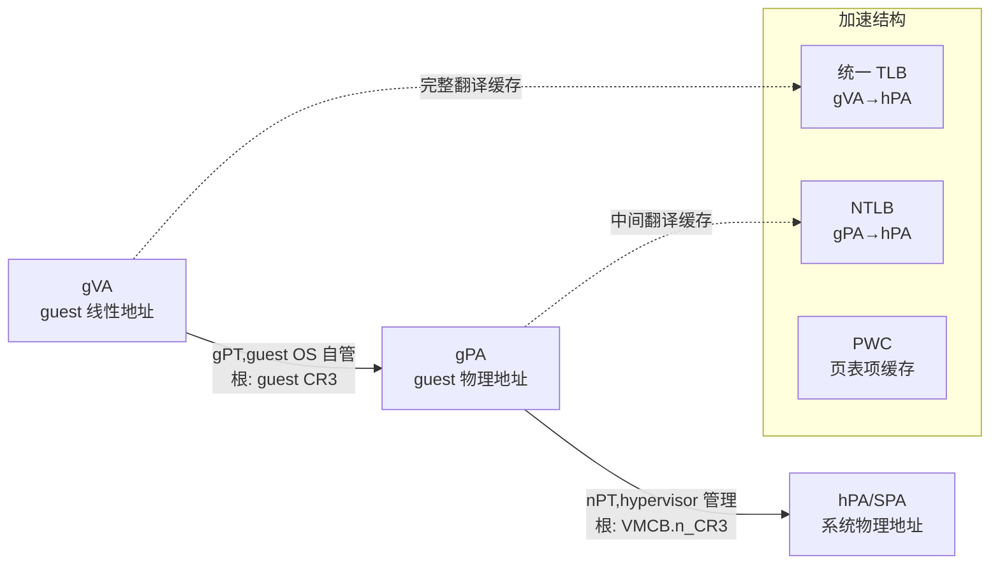

## 4. NPT 嵌套分页与内存虚拟化

内存虚拟化的核心问题是为每个虚拟机再造一层"物理地址"。在硬件二级地址翻译(Second Level Address Translation,SLAT)出现之前,hypervisor 只能以影子页表(shadow page tables)在软件中合成 gVA→hPA 的直接映射,并为此拦截 guest 的全部页表操作。AMD 的嵌套分页(Nested Page Tables,NPT,后更名 Rapid Virtualization Indexing,RVI)把这一合成过程硬件化:它是 SVM 的可选扩展,提供两级地址翻译,从而免除 VMM 维护影子页表的需要[^83^][^83^]。本章按"转换机制 → 遍历与缓存 → 性能证据"的顺序展开;VMCB 中 `NP_ENABLE`、`N_CR3`、`ASID` 字段的布局定义见第 3 章,本章聚焦其运行时语义。

### 4.1 两级地址转换

#### 4.1.1 gVA→gPA→hPA:guest 自管页表与启用路径

启用 NPT 后,地址翻译被拆分为两个正交的阶段:guest 线性地址(gVA)先经 **guest 页表(gPT)** 译为 guest 物理地址(gPA),gPT 完全由 guest OS 自管;gPA 再经 **嵌套页表(nPT)** 译为系统物理地址(hPA/SPA),nPT 由 hypervisor 管理;完整的 gVA→SPA 翻译最终被缓存进 TLB[^84^][^85^][^86^]。嵌套遍历内部有一个容易误解的语义细节:nPT 遍历时,gPA 被当作 host 虚拟地址(hVA)经 nPT 翻译为 SPA;`nCR3` 保存的是 nPT 的**系统物理地址**,而 guest 的 `CR3` 保存的是 gPT 的 **guest 物理地址**——后者自身也需经 nPT 翻译才能落到内存上[^86^]。



*图 4-1 NPT 两级地址转换链与三层硬件加速结构。虚线为缓存路径:统一 TLB 缓存端到端翻译,NTLB 缓存嵌套维翻译,PWC 缓存各级页表项。机制依据:AMD NPT 白皮书与 APM Vol 2 §15.25[^85^][^86^]。*

AMD 自 Barcelona(K10,2007)起提供嵌套分页并命名 RVI,是首家在 x86 上引入硬件二级地址翻译的厂商;Intel 到 Core i7(Nehalem,2008)才加入对等的 EPT[^84^]。启用方式是在 VMCB 控制区置 `NP_ENABLE`(offset `0x90` bit 0)= 1,并将 `N_CR3` 填充为 nPT 基址;VMRUN 在 `NP_ENABLE`=1 时进入嵌套分页模式[^87^][^1^]。教学 hypervisor 与生产实现的代码形态一致:

```c
vmcb->control.nested_cr3 = ncr3;
vmcb->control.nested_ctl |= SVM_NESTED_CTL_NP_ENABLE;
```

在 KVM 的术语体系中,NPT 与 EPT 被统一抽象为 **TDP(Two-Dimensional Paging,二维分页)**,`Documentation/virtual/kvm/mmu.txt` 将其翻译链规范表述为 `gva->gpa->hpa`;该文档同时给出嵌套虚拟化下的扩展链 `ngva->ngpa->gpa->hpa`,即每多嵌套一层 hypervisor,翻译维度就再加一维[^88^]。这一厂商中立的抽象是 KVM 能用同一套 MMU 代码同时驱动 NPT 与 EPT 的概念基础。

与之配套的是**复制状态(Replicated State)**机制:启用 NPT 后,所有影响分页的寄存器——`CR0`、`CR3`、`CR4`、`EFER`、`PAT`——都存在 host 与 guest 两份。VMRUN 时 host `CR3` 被存入 host state-save area,处理器从 VMCB 的 `N_CR3` 字段装入嵌套页表根;#VMEXIT 时反向恢复 host `CR3`,而 `nCR3` 不写回 VMCB[^89^][^1^]。KVM 的实际装载路径(`svm_load_mmu_pgd()` 中 `svm->vmcb->control.nested_cr3 = __sme_set(root_hpa)`)与此一一对应[^58^]。

#### 4.1.2 NPT 表项格式:与 AMD64 长模式页表完全同构

AMD NPT 在格式设计上做了一个影响深远的决定:**nPT 表项与传统 AMD64 长模式页表项完全相同**,即直接复用长模式 PML4E/PDPE/PDE/PTE 的字段布局(P、RW、US、PWT、PCD、A、D、PS、NX 等),而非发明一套新格式[^8^][^90^]。这使 NPT 成为"自描述"的:hypervisor 可以原样复用标准分页代码、遍历逻辑与调试工具,nPT 的构造与普通页表无异。对照之下,Intel EPT 使用**专用表项格式**:独立的 R/W/X 三个权限位(标准 x86 分页只有 W 与 NX 两个维度)、EPT 存储类型字段(bits 3–5)、Ignore PAT、可选的 Accessed/Dirty 位与 Suppress #VE 位,且 EPT 不设 U/S 区分[^90^]。两种设计各有取舍:EPT 的显式 R/W/X 粒度支持更细的嵌套层保护(例如无读权限的可执行页),NPT 的同构格式则换来软件栈的零学习成本[^90^]。

**表 4-1 NPT 与 EPT 页表项格式及控制面对比**

| 维度 | AMD NPT/RVI | Intel EPT |
|---|---|---|
| 页表项格式 | 与 AMD64 长模式 PTE **完全相同**(P/RW/US/PWT/PCD/A/D/PS/NX)[^8^][^90^] | **专用格式**:独立 R/W/X 位、EPT MT(bits 3–5)、Ignore PAT、A/D 可选、Suppress #VE[^90^] |
| 权限模型 | 标准 Present/RW/US/NX 模型,沿用法定的 U/S 语义[^90^] | 无 U/S 位;R/W/X 三权限可独立组合[^90^] |
| 二级页表根 | VMCB `N_CR3` + `NP_ENABLE` 位[^87^][^90^] | VMCS `EPTP`(编码根地址、walk 长度与存储类型)+ secondary exec control[^90^] |
| 大页支持 | 4KB/2MB/1GB(PS 位),嵌套页尺寸可与 guest 不同且可运行中改变[^85^][^91^] | 4KB/2MB/1GB |
| TLB 打标机制 | ASID(VMCB 字段),ASID 刷新连带失效 NPT 的 gPA→hPA 翻译[^92^] | VPID,与 EPT 派生映射分离(INVVPID 不刷 EPT 翻译,需 INVEPT)[^92^] |
| 选择性失效指令 | `INVLPGA`(rAX=虚拟页,ECX=ASID)+ `TLB_CONTROL` 0/1/3/7[^1^][^49^] | `INVEPT` / `INVVPID` |
| 故障事件 | #VMEXIT(NPF):EXITINFO1 错误码 + EXITINFO2 故障 GPA,不报告 guest 线性地址[^60^][^93^] | EPT violation/misconfiguration:exit qualification + GPA/GLA |
| 首次引入 | Barcelona/K10(2007)[^84^] | Nehalem(2008)[^84^] |

表 4-1 揭示的两点本质差异值得展开。其一是**格式复用的生态复利**:由于 nPT 与 AMD64 原生页表逐位兼容,而 AMD IOMMU 的 I/O 页表同样兼容长模式格式,KVM 的 MMU 代码、`amd_iommu` 驱动与 guest OS 页表代码得以共享同一套格式语义与遍历逻辑,大页与 TLB 的调优知识在 CPU 虚拟化、IOMMU、机密计算三条线上直接通用;SEV-SNP 能用单一 RMP 结构同时约束 CPU walker 与 IOMMU walker,前提也正是两侧页表语义同构(跨维度洞察 3)。Intel 侧 IA-32e、EPT、VT-d 三种格式长期割裂,每个子系统需各自实现遍历与缓存逻辑。其二是**失效语义的耦合度**:SVM 没有 VPID/EPT 那样的分离失效机制,一次 ASID 刷新同时覆盖 gVA→hPA 与 gPA→hPA 两类翻译——KVM 提交记录明确指出"unlike nested EPT, SVM's ASID management can invalidate nested NPT guest-physical mappings on VMRUN",嵌套虚拟化场景下必须同步重建嵌套 NPT MMU 状态[^92^]。这一耦合使 AMD 侧的 TLB 失效粒度天然粗于 Intel,是 4.2.2 节失效管理设计取舍的根源。
### 4.2 嵌套页遍历与缓存

#### 4.2.1 二维页遍历:最坏 24 次内存访问的核算

NPT 免除 VM-exit 的代价在 TLB miss 路径上显形。此时页表 walker 不仅要遍历 gPT 的四级结构,还要为遍历过程中遇到的**每一个** guest 物理地址——包括 guest `CR3` 本身和各级 gPT 表项的地址——执行一次完整的 nPT 遍历,将其落到系统物理地址上[^85^][^90^]。AMD NPT 白皮书给出权威核算:一次 4 级 guest 页表遍历最多触发嵌套 walker **5 次**(4 级页表项地址 + 最终数据页的 gPA),每次嵌套遍历最多 4 次内存访问读表项加 1 次读项,因此一次 TLB miss 的代价从非嵌套场景的 4 次内存引用膨胀到最坏 **24 次**[^85^]。按嵌套遍历次数组织,该核算可写为:

$$
(4+1) \times 5 - 1 = 24
$$

其中 $4+1$ 是 guest 维的 4 级表项加数据页,$5$ 是嵌套维的 4 级表项加 1,末项 $-1$ 因为最终数据页的访问不再嵌套。学术界对该结论反复引用:Mitosis(ASPLOS'20)即以"x86-64 嵌套页表遍历最坏需 24 次内存访问"立论[^94^][^95^]。需要说明的是,文献中还存在另一种等价表述——"4(guest)× 4(nested) + 4 + 4 = 24"(按页表层级组织)——交叉验证已裁定两者数学等价、仅计数视角不同,并非数据冲突。 AnandTech 的 Johan De Gelas 早在 2008 年就以"原生 4 次查表变成 16 次"概括过这一膨胀,并指出 TLB miss 由此从"性能受损"变为"性能灾难",只能靠更大的 TLB 与页行走缓存缓解[^96^]。

大页是压缩二维遍历深度的直接手段。guest 与 host 双侧使用 2MB 页时,guest 维与嵌套维各少一级,最坏访问数降为 $(3+1)\times4-1=15$ 次,较 24 次减少约 37%;双侧 1GB 页时约为 8 次[^95^][^90^]。AMD Family 15h 软件优化指南(§12.5)进一步给出工程建议:VMM 应尽可能在 nPT 中使用 2MB/1GB 大页,且 nPT 表项尺寸应不小于对应 guest 页——每个 2MB nPT 大页可省掉一整张 4KB 末级页表,每个 1GB 大页可省掉一张页目录及最多 512 张末级页表[^91^]。

这一核算在现代硬件上依然可测。云厂商对 gVisor 冷启动路径的实测(2026 年,AMD EPYC 9R14)显示,嵌套 guest 中一次 TLB miss 的代价约为 **150 cycles**(两级 walk);将 host 侧透明大页(THP)置为 always 后,冷启动 cycles 下降 14%、page-fault 数下降 48%、data page walks 下降 42%——印证了"guest 维 walk 越短,沿途触发的嵌套 walk 越少"的复合收益机制[^97^]。另一个影响 walk 深度的变量是 guest 寻址宽度:ICAC'11 的测量指出,32 位 guest 的 gPT 至多两级,嵌套 walk 显著短于 64 位 guest 的四级结构,嵌套分页因此在 32 位场景下相对影子分页更有利[^98^]。

嵌套翻译失败时,硬件产生 **#VMEXIT(NPF)**,退出码为 `VMEXIT_NPF`(0x400):`EXITINFO1` 携带类 #PF 风格的错误码(not-present、RW、US、RSVD、ID 等),`EXITINFO2` 携带导致故障的 guest 物理地址;AMD 不报告 guest 线性地址(Intel EPT 会报告 GLA)[^60^][^93^]。`EXITINFO1` 的高位区分故障语境:bit 32 表示翻译最终 gPA 时出错,bit 33 表示在遍历 guest 页表(嵌套遍历中途)时出错[^60^]。故障路由语义上,guest 页表层自身的缺页由 guest 直接处理、不产生 exit,只有嵌套层失败才上报 #NPF——VMM 的典型处理是更新 nPT 后让 guest 重试,或对 MMIO 区域做指令模拟[^95^][^93^]。

#### 4.2.2 硬件三层加速:统一 TLB、NTLB、PWC 与 ASID 失效管理

为摊薄 24 次访问的最坏代价,AMD 处理器为 NPT 配备三层缓存结构[^85^][^86^]:

- **统一 TLB**:缓存 gVA→SPA 的端到端翻译,guest 与 host 共用同一 TLB,命中时两级转换零额外开销;
- **Nested TLB(NTLB)**:按页缓存 gPA→SPA 翻译,利用 guest 页表结构的高局部性获得高命中率,直接加速嵌套维遍历;
- **Page Walk Cache(PWC)**:以物理地址打标,缓存频繁使用的 guest 与 nested 各级页表项。

AMD 团队在 ASPLOS'08(Bhargava 等)首次公开了 Opteron 上 PWC 的微架构设计并给出模拟测量:无任何页表项缓存时,24 个嵌套与 guest 页表项全部需访问内存层次,虚拟化负载比非虚拟化慢 20%–70%,嵌套 walk 平均比原生 walk 慢 **3.9–4.6 倍**;将 PWC 扩展到嵌套维可提升 guest 性能 **15%–38%**,加入 NTLB 再提升 **3%–7%**(合计最多约 46%,即消除一半以上的二维遍历开销),hypervisor 使用大页再叠加 **3%–22%**[^99^][^99^]。

第二层机制是 ASID(Address Space Identifier)对 TLB 的打标。自 64-bit Opteron Rev-F 起,hypervisor 可为每个 guest 分配唯一 ASID,TLB 查找同时匹配 ASID 标签与线性页帧号,不同 guest 与 hypervisor 的 TLB 项因此可跨上下文切换共存,无需在 VM 切换时全量刷新[^85^]。ASID 存于 VMCB 控制区(offset `0x58`),ASID 0 保留给 host;#VMEXIT 时硬件将 ASID 清零返回 host[^49^][^1^]。CPU 支持的 ASID 数量由 `CPUID Fn8000_000A_EBX`(NASID)报告[^48^]。33047 手册明确了失效语义:guest 内触发 TLB 刷新的操作(如 `MOV CR3`)只影响**该 guest 自己的 ASID**;若 VMM 拦截了这些操作,则 TLB 不被刷新,改由 VMM 负责[^1^]。

VMM 侧的主失效手段是 VMCB 的 `TLB_CONTROL` 字段(offset `0x5C`),每次 VMRUN 时由硬件读取执行。Linux `arch/x86/include/asm/svm.h` 定义的架构编码为四档:**0 = 不刷新;1 = 刷新所有 ASID 的全部 TLB(`FLUSH_ALL_ASID`);3 = 刷新当前 guest ASID(`FLUSH_ASID`);7 = 刷新当前 ASID 的非全局项(`FLUSH_ASID_LOCAL`)**[^49^]。其中编码 3/7 依赖 Fam15h 引入的 FlushByAsid 特性(`CPUID Fn8000_000A_EDX[6]`);Xen 的补丁记录指出,连 ASID 0(host)一起刷是不必要的大锤,支持 FlushByAsid 时应优先按 ASID 刷新,Fam17h 上实测页遍历测试提速约 0.6s/22s[^68^]。AMD 优化指南(§12.7)也明确建议尽可能避免将 `TLB_CONTROL` 置 1[^91^]。更细粒度的是 `INVLPGA` 指令(opcode `0F 01 DF`),可按"rAX 中虚拟页 × ECX 中 ASID"选择性失效单条 TLB 映射[^44^][^1^],KVM 曾以 `svm_flush_tlb_gva()` 包装使用[^100^];但 **INVLPGA 在 Genoa 与 Turin 上存在勘误**,旧代际在 Hyper-V tlbflush 场景也有 Windows BSOD 报告,KVM 已改为 NPT 启用时弃用 INVLPGA、退化为整 ASID 刷新,仅影子分页路径保留该指令[^101^]。这是"架构特性存在 ≠ 生产路径可用"的典型案例,开发者在自研 VMM 中应直接以整 ASID 刷新为基线。
### 4.3 性能与对比

#### 4.3.1 NPT vs 影子页表:量化证据

影子分页的固有开销来自软件合成:写保护 gPT 以拦截每次页表编辑、拦截 INVLPG 与 CR3 切换、区分 guest 缺页与 hypervisor 缺页、回写同步 A/D 位;AMD 白皮书估计特定负载下影子分页可占 hypervisor 总开销的 **75%**[^85^][^85^]。NPT 把这些负担整体移出软件:guest 自主管理页表、页表更新无需拦截模拟,A/D 位由硬件直接写入 gPT;且单一 nPT 实例即可服务 SMP guest 的全部 vCPU(影子分页需每 vCPU 实例或加锁共享),nPT 的内存占用通常远小于等价影子页表[^85^][^85^]。其代价即 4.2 节所述:TLB miss 的二维遍历更深(最坏 24 次 vs 影子的 4 次)——本质是**以更高的 miss 延迟换更少的 exit**,盈亏平衡点出现在 TLB miss 率极高而页表修改极少的负载[^85^][^90^]。

**表 4-2 NPT/RVI 相对影子分页的性能数据汇总**

| 来源(年份/平台) | 测量对象 | 结果 | 引用 |
|---|---|---|---|
| AMD NPT 白皮书(2008,Barcelona Model 2350 双路 + 实验性 VMware ESX) | SQL DB Hammer / MS Terminal Services | **+14% / +58%** | [^85^] |
| AMD NPT 白皮书(2008,Xen 3.1 + RHEL4.4) | Oracle 10g OLTP | **+94%**(叠加 PV 驱动后 +349%) | [^85^] |
| VMware 实验室(2009 转述,ESX 3.5 U2) | MMU 密集基准 / 微基准 / Citrix XenApp | **+42% / +500% / +29%** | [^102^] |
| AnandTech/De Gelas 分析(2008,引 AMD 官方数据) | 综合负载 | 最高约 **+23%**;vCPU 越多影子同步代价越大 | [^96^] |
| Bhargava 等 ASPLOS'08(AMD Opteron 模拟) | PWC / NTLB / 大页对嵌套 walk 的挽回 | **+15–38% / +3–7% / +3–22%** | [^99^] |
| Bae 等 ICAC'11(Northwestern/Pitt) | SPEC 类负载,嵌套 vs 影子 | **互有胜负,无一致优胜者**;32 位 guest 嵌套 walk 更短、更有利 | [^98^] |
| Wang 等 Selective HW/SW(实测) | HAP 与 SP 逐基准对比 | 个别基准差距达 **34%**,无绝对赢家 | [^103^] |
| Ahn 等 ISCA'12(KAIST) | flat NPT vs PWC+NTLB 的 2D walker | 平均 **+7%**(SpecISP 达 14%) | [^104^] |
| Gandhi 等 ISCA'16(Agile Paging) | 影子+嵌套混合 vs 两者较优者 | 平均再 **+12%**,最坏仅慢于 native 4% | [^105^] |
| gVisor 冷启动实测(2026,EPYC 9R14) | 嵌套 guest 单次 TLB miss 代价;host THP=always 效果 | 约 **150 cycles**;大页后 cycles −14%、page-fault −48% | [^97^] |

表 4-2 的数据跨度近二十年,三点解读值得注意。第一,厂商首发数字(+14% ~ +94%)来自 2007–2009 年的 Barcelona 平台与实验性 hypervisor,AMD 白皮书自行声明其可能偏保守;VMware 的 +500% 是 MMU 密集**微基准**的极端值,不应外推到应用层[^85^][^102^]。第二,学术测量系统性地修正了"NPT 恒胜"的直觉:ICAC'11 与 Selective HW/SW 均发现嵌套与影子**互有胜负**,个别基准差距可达 34%,根因正是 4.2 节的 miss 延迟与 exit 消除之间的权衡[^98^][^103^]。第三,后续研究(ISCA'12 flat NPT、ISCA'16 Agile Paging)的增量收益都只有 7%–14%,说明在 PWC/NTLB/大页成熟之后,嵌套维 walk 的残余开销已被压缩到个位数百分比量级[^104^][^105^]。社区运维口径与此吻合:无 SLAT 时每个 VM 多耗 10–30MB 内存、CPU 利用率约高 10%,RDS 类负载 SLAT 可提升约 40% 会话密度[^106^]。


*图 4-2 NPT/RVI 相对影子分页的实测性能提升(百分比)。数据来源:AMD NPT 白皮书(2008,Barcelona 2350 + ESX/Xen)[^85^]、VMware 实验室转述(2009)[^102^]、AnandTech/De Gelas(2008)[^96^]。度量范围均为 2008–2009 年平台,微基准极值(+500%)未列入柱状图以避免刻度失真。*

从图 4-2 可见,应用层收益集中在 +14% ~ +94% 区间,且与负载的页表更新强度正相关:Terminal Services 与 Oracle OLTP 这类高并发、页表操作密集的负载收益最大,恰是影子分页拦截成本最高的场景。结合表 4-2 中 PWC/NTLB/大页的挽回数据(+15–38%/+3–7%/+3–22%),可以得出一个操作性结论:**NPT 的净收益 = exit 消除收益 − 二维 walk 代价,而后者由硬件缓存与大页配置决定**——这也是第 13 章性能调优将 hugepages 列为 NPT 场景第一旋钮的依据。

#### 4.3.2 NPT vs EPT 机制与生态对比;Agile Paging 混合思路

在最坏 walk 开销上,NPT 与 EPT 同构(均为 4+4 级下 24 次内存访问),两家的真实分野在表 4-1 已列出的三个层面:格式(自描述 vs 专用)、失效机制(ASID 耦合失效 vs VPID/EPT 分离失效)、故障报告面(EXITINFO1/2 无 GLA vs exit qualification 含 GLA)[^8^][^92^][^60^]。失效语义的差异有直接的工程后果:Intel 的 `INVVPID` 只刷 gVA→hPA 翻译、`INVEPT` 单独处理 EPT 派生映射,VMM 可按需选择失效域;AMD 的 ASID 刷新一刀切地覆盖两类翻译,嵌套虚拟化(nSVM)场景下 KVM 必须在 VMRUN 刷 ASID 时同步嵌套 NPT MMU,否则将使用到已失效的 gPA→hPA 映射[^92^]。安全面上,Intel EPT 有 CVE-2018-3646(L1TF)相关顾虑,AMD 侧则出现过利用 NPT walk 故障语义攻击 SEV 的 CrossLine(构造 nPT 使 guest walk 前三级通过、末级才触发 #NPF,以此逐字节提取加密内存)与 ASID 碰撞类 CVE,说明对 walk 与故障路由语义的精确理解在攻防两侧都具现实价值[^107^][^86^][^86^]。

性能生态方面,KVM 中 NPT 由 `kvm-amd.npt` 内核参数控制,默认开启(硬件不支持时自动禁用),KVM 初始化即以 `PG_LEVEL_1G` 配置 MMU,原生支持 1GB nPT 大页[^108^][^58^];VirtualBox 文档亦指出嵌套分页消除 VM-exit 与页表访问开销,启用大页可再提速约 5%[^84^]。运维侧的大页收益口径为:内存密集负载(≥8GB)典型提升 10%–30%,TLB miss 约降一个数量级[^109^]。

学术界对"嵌套 vs 影子"之争给出的最终答案是混合。ISCA'16 的 Agile Paging(威斯康星 + VMware 系)观察到:影子分页的 TLB miss 处理更快(单层 walk),仅当 guest 页表变更时才劣于嵌套分页;因此对静态内存区域使用影子分页、动态区域使用嵌套分页的混合策略,较"嵌套与影子中的较优者"平均再提速 **12%**,最坏情况仅比未虚拟化的 native 慢 4%[^105^]。ISCA'12 的 flat NPT 则从另一方向出发,把嵌套维 walk 简化为一次内存引用,较带 PWC+NTLB 的 2D walker 平均提速 7%[^104^]。两条路线共同表明:在硬件缓存成熟之后,剩余的性能空间已不在"是否启用 NPT",而在**按页表区域与访问模式选择翻译策略**。对生产 hypervisor 而言,NPT 默认开启 + 双侧大页 + 按 ASID 失效(FlushByAsid 平台)已是事实标准配置;Agile Paging 式混合目前仍停留在研究原型阶段,尚无主流 hypervisor 实现。
