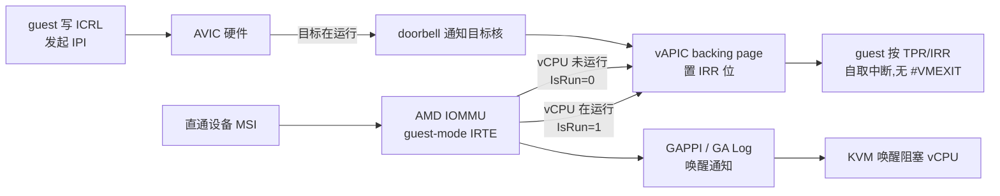

## 5. 高级硬件辅助特性

第 2、3 章给出的 VMRUN/#VMEXIT 与 VMCB 框架只是 SVM 的基线能力。在此之上,AMD 以"特性位 + VMCB 增量字段"的方式逐代叠加硬件辅助:每一项特性由 `CPUID Fn8000_000A` 的 EDX 中一个特性位宣告存在性,由 VMCB 控制区若干字段控制启用与参数[^43^]。这种"能力位先行、字段后随"的契约使 hypervisor 可以按位探测、按位降级,也是 KVM `svm_hardware_setup()` 实际执行的探测路径[^110^]。下表汇总本章涉及特性的 CPUID 位与对应 VMCB 字段,作为后续各节的索引。

**表 5-1 特性–CPUID 位–VMCB 字段对照表**(CPUID 叶均为 Fn8000_000A EDX;偏移为 VMCB 内偏移)

| 特性 | CPUID 位 | VMCB 字段/偏移 | 核心作用 |
|---|---|---|---|
| AVIC | bit 13 | offset 60h bit 31(使能);`V_APIC_BAR`、`AVIC_BACKING_PAGE`、`AVIC_LOGICAL_PAGE`、`AVIC_PHYSICAL_PAGE` | 虚拟中断控制器,guest 直接访问 vAPIC[^111^][^43^] |
| x2AVIC | bit 18 | offset 60h bit 30(x2APIC 模式) | x2APIC 模式下的 AVIC 加速,可运行时切换[^3^] |
| vGIF | bit 16 | offset 60h bit 9(VGIF 值)、bit 25(vGIF 使能) | guest 自主控制 GIF,免拦截[^43^] |
| NRIPS | bit 3 | 保存区 `NEXT_RIP` | #VMEXIT 时硬件保存下一条指令 RIP[^43^] |
| Decode Assists | bit 7 | EXITINFO1/2 携带已译码信息 | 拦截模拟免译码[^43^] |
| VMCB Clean Bits | bit 5 | 控制区 clean 位图 | VMRUN 跳过未修改的状态分组加载[^43^] |
| Pause Filter | bit 10 | offset 03Eh,16 位 PAUSE Filter Count | PAUSE 计数节流退出[^43^] |
| Pause Filter Threshold | bit 12 | offset 03Ch,16 位周期阈值 | 区分正常节拍与密集自旋[^43^] |

从布局可见两类设计取向:中断类特性(AVIC/x2AVIC/vGIF)集中在 offset 60h 的 `INT_CTL` 字内以位开关控制,而节流类特性(Pause Filter 对)占据独立 16 位字段以携带数值参数;NRIPS、Decode Assists、Clean Bits 则没有开关字段——它们一经 CPUID 宣告即由硬件无条件生效,hypervisor 只需"知情使用"(如维护 dirty 标记),不增加每次 VMRUN 的配置成本[^43^]。bit 13(AVIC)单独缺席于任何默认开启路径,这一例外背后的 erratum 故事见 5.1.2 节。

### 5.1 中断虚拟化

#### 5.1.1 AVIC:vAPIC backing page、APIC ID 表、doorbell 与 IOMMU GA 协同

无硬件加速时,VMM 必须拦截 guest 对本地 APIC(LAPIC)寄存器的所有访问并纯软件模拟;AMD 在 AVIC 设计文档中明确指出,现代系统中设备中断与处理器间中断(IPI)速率极高,LAPIC 模拟构成 VMM 的重大负担[^3^]。AVIC(Advanced Virtual Interrupt Controller)由 APM Vol.2 §15.29 定义(该节于 2013 年 5 月的 Rev 3.23 首次加入手册),用硬件加速三条热路径:TPR 读写、EOI 写、ICRL(IPI 发起)写[^3^][^111^]。

AVIC 体系结构由四个组件构成,各解决一个问题[^111^]:其一,**vAPIC backing page**——每个 vCPU 一页 4KB 内存,由 hypervisor 分配初始化,存放该 vCPU 的 guest APIC 状态并映射进 guest 物理地址空间,guest 对 APIC 寄存器的访问由此落在真实内存上;其二,**Physical/Logical APIC ID 表**——维护 vCPU 与物理核的映射,支撑调度与迁移场景下的中断寻址;其三,**doorbell 机制**——向指定物理核投递"目标 vCPU 有挂起中断"的通知;其四,**IOMMU 扩展(GA 模式)**——把 I/O 设备中断直接投递进 guest。硬件对 guest vAPIC 访问定义了四种行为:`ALLOWED`(不退出,直接读/更新)、`ACCELERATED`(不退出,硬件进一步动作如发 IPI)、`TRAP`(更新后立即 #VMEXIT)、`FAULT`(不更新即退出);无法由硬件完成的操作经两个新增退出码上报——`SVM_EXIT_AVIC_INCOMPLETE_IPI = 0x401`(IPI 未完成投递,附失败原因)与 `SVM_EXIT_AVIC_UNACCELERATED_ACCESS = 0x402`(访问未加速寄存器,附偏移与读写方向)[^111^][^76^][^112^]。

doorbell 有三个来源:AVIC 硬件响应 guest ICRL 写、IOMMU 重映射 I/O 中断、系统软件写 doorbell MSR(`MSR C001_011B AVIC Doorbell`)[^111^][^113^]。其中 IOMMU 侧即 **Guest Virtual APIC(GA)模式**(AMD IOMMU 规范 Pub. 48882,Rev 2.62 起):设备中断经 guest-mode IRTE 重映射后,由 IOMMU 直接写入目标 vCPU backing page 的 IRR 位,目标 vCPU 正在运行时全程无 #VMEXIT[^9^][^114^]。Linux 以 `amd_iommu_intr=vapic` 启用该模式(要求 `kvm-amd.avic=1`,有 IOMMU 硬件支持时为默认)[^108^]。

vCPU 被换出(IRTE[IsRun]=0)时的唤醒通知经历了三代演进,这是 GA 协同中工程迭代最密集的部分:**GA Log**(IOMMU 把 vCPU tag 追加到共享 log buffer 并触发单个中断,重负载下所有唤醒汇聚到一条中断与一个共享 buffer,增加延迟且可能溢出)→ **GAPPI**(Guest APIC Physical Processor Interrupt,Genoa 起;IOMMU 照常更新 guest IRR,但直接向 IRTE[Destination] 投递物理中断,向量取 IRTE[GATag][7:0],唤醒通知因而分散到各 CPU;经 `amd_iommu=gappi` 启用)→ **per-CPU 唤醒链表**(KVM 侧对齐 Intel posted-interrupt 模型)[^115^][^116^]。规范特别约定 IRTE 的 Destination/IsRun/GATag 字段不被 IRTCache 缓存,vCPU load/put 的快速更新无需 IRT invalidation——这是 vCPU 迁移高频路径上的关键设计[^116^]。

上图中值得注意的设计分工是"数据面与通知面分离":中断数据(IRR 位置位)总是直接写入 backing page,无论目标 vCPU 是否在运行;需要跨核/跨子系统协调的只是"通知"——doorbell 解决 vCPU-to-vCPU,GAPPI/GA Log 解决 device-to-vCPU。这一分工使 vCPU 迁移时 hypervisor 只需更新 Physical APIC ID 表项与 IRTE 的 IsRun/Destination 字段,而不必搬移任何中断状态——状态始终在 backing page 里,这是 AVIC 与纯软件 LAPIC 模拟在可迁移性上的本质差异[^111^][^116^]。可观测性方面,KVM 为 AVIC 提供了专用 tracepoint(`kvm:kvm_avic_incomplete_ipi`、`kvm:kvm_avic_unaccelerated_access`、`kvm:kvm_avic_ga_log`、`kvm:kvm_avic_doorbell` 等),调试 IPI 丢失类问题时可直接统计硬件回退路径的触发频率[^117^]。

早期 AVIC 只支持 xAPIC 模式,guest 必须关闭 x2APIC;**x2AVIC**(CPUID Fn8000_000A EDX[18])允许 guest 在 x2APIC 模式下获得硬件加速,通过 VMCB offset 60h 的 bit 31(AVIC 使能)与 bit 30(x2APIC 模式)激活,运行时可在两种模式间动态切换[^3^]。需要指出,2022 年的 x2AVIC 补丁信原写作 EDX[14],现行 APM 已修订为 bit 18(bit 14 reserved),引用历史文献时应注意该笔误[^3^]。

**表 5-2 AVIC 组件与 Intel APICv 对照表**(KVM 以统一 `enable_apicv` 抽象两侧)[^118^]

| 能力 | AMD AVIC | Intel APICv |
|---|---|---|
| 虚拟 APIC 页(免退出寄存器访问) | vAPIC backing page(每 vCPU 4KB) | Virtual-APIC page / APIC-register virtualization |
| 中断直接投递(无需 VMM) | doorbell + IOMMU GA 模式 | Posted Interrupts(PI 描述符 + posted-interrupt vector) |
| vCPU 未运行唤醒 | GA Log → GAPPI(Genoa 起) | posted-interrupt notification vector |
| x2APIC 加速 | x2AVIC(EDX[18],2022 年接入 KVM) | APICv 原生支持 |
| KVM 开关 | `kvm_amd.avic`(`enable_apicv` 别名) | `kvm_intel.enable_apicv` |
| 硬件落地时间 | EPYC Zen 1(2017) | Haswell(2013)[^118^] |

对照可见两家机制在功能层一一对应,差异在落地时序与默认策略:Intel 侧 APICv 自 Haswell 起即默认启用并稳定至今,AMD 侧则从规范(2013)到上片(2017)再到默认启用(2025)跨越约十二年,且唤醒通知路径直到 2026 年的 GAPPI 系列才在模型上与 Intel posted-interrupt 对齐[^115^][^23^]。面向 SEV-SNP 机密虚拟机,AMD 进一步推出 **Secure AVIC**:每个 vCPU 使用 guest 私有、guest 拥有的 backing page,配合 `ALLOWED_IRR` 字段限定 hypervisor 可注入的向量,防止恶意 hypervisor 生成非预期中断;guest 内 ICR/TPR/EOI 访问经 #VC 处理,IPI 以 0x401 退出码上报给 guest 自行投递;该特性于 EPYC 8005(Turin)代引入,guest 侧支持在 Linux 6.18 合入,Hyper-V 平台亦有对应补丁集[^113^][^119^][^120^]。

#### 5.1.2 erratum #1235 与默认启用史

AVIC 在 KVM 中长期默认关闭,直接原因是 AMD Family 17h(Zen 1/Zen 2)的 **erratum #1235**:ICR 写模拟期间硬件可能读到陈旧的 `IsRunning=1` 位,从而不发出 `AVIC_IPI_FAILURE_TARGET_NOT_RUNNING` 退出,KVM 因此漏掉对阻塞目标 vCPU 的唤醒,表现为 vCPU 挂起[^121^]。上游 workaround 是禁用 IPI 虚拟化(不在 Physical ID 表设 IsRunning,所有非 self-IPI 走退出模拟);该 erratum 同样影响衍生自 Zen 1 的 Hygon Family 18h(关联 CVE-2026-64172,漏洞细节见第 11 章)[^121^]。

默认状态的表述必须带时间戳——交叉验证裁定这是"时间演化"而非真实分歧:2024 年 3 月 Oracle Linux 文档仍明确 `avic` 参数默认关闭[^114^];2025 年 6 月,AMD Naveen N Rao 的 RFC 指出"AVIC(和 x2AVIC)自 Zen 4 起功能完整",提议 Zen 4+ 默认 `enable_apicv=1`,更早 CPU 需显式 `force_avic=1`,并把 `kvm_amd` 的 `avic` 参数统一为 `enable_apicv` 别名[^23^];同期的 62 补丁大系列全面重构 KVM/IOMMU 的 posted IRQ 路径,修复 AVIC 拒绝大 VM 等问题,并把 `enable_ipiv` 与 erratum #1235 workaround 正确接线[^122^]。Zen 3 处于灰色地带:无 erratum #1235,但 IOMMU 侧不可用且 CPUID 位常被固件屏蔽,上游策略仍在演进[^23^]。事实上固件可以单独关闭 AVIC 位——Zen 4 平台(Ryzen 7 7840U)实测出现过 AVIC=false 而 x2AVIC=true 的组合,内核打印 `[Firmware Bug]: Cannot enable x2AVIC, AVIC is unsupported`[^123^],因此部署时应以 `cpuid -l 0x8000000a` 实测为准而非假定代际能力。

收益侧的数据解释了为何 2025 年上游急于翻转默认值:Oracle 在 OCI Genoa 平台上的实测(sysbench threads 负载)显示,启用 AVIC 后中断类 VM-Exit 数下降 96%,IPI 投递延迟从 5708 cycles 降至 3027 cycles(−47%);原作者同时提醒"exit 降 96% ≠ 性能升 96%",该数据为单一平台单一负载(单一来源,Medium 级),不应直接外推到所有工作负载[^114^]。

*图 5-1 AVIC 启用前后的中断路径开销。度量范围:OCI Genoa(EPYC 9004)平台,sysbench threads 负载,2024 年 3 月;VM-Exit 数为相对归一值。来源:Oracle Linux Blog[^114^](单一来源)*

把规范、上片、默认启用与安全化四个里程碑排在同一时间轴上,可以直观看到中断虚拟化是 AMD-V 中"功能化—安全化"时间差最大的子系统:硬件 2017 年上片却因一个 erratum 被默认关闭约八年,而安全化版本(Secure AVIC)迟至 2024–2025 年才出现。

*图 5-2 AVIC 关键事件时间线(2013–2026)。来源:APM 修订史与上游补丁档案[^3^][^23^][^119^][^115^]*

### 5.2 执行效率特性

#### 5.2.1 vGIF:guest 自主控制 GIF

GIF(Global Interrupt Flag)是 SVM 特有的全局中断开关:`CLGI` 清 GIF 屏蔽一切中断(含 NMI/SMI/INIT),`STGI` 置位恢复[^3^]。无 vGIF 时,guest(典型为嵌套 hypervisor)执行 STGI/CLGI 必须被拦截模拟,而这两条指令常出现在关中断临界区热路径上。vGIF 机制(APM §15.33.2,CPUID EDX[16])在 VMCB offset 60h 增加两位:bit 9 为 VGIF 值,bit 25 为本 guest 的 vGIF 使能;guest 内执行 STGI/CLGI 直接置/清 bit 9,**不再产生 #VMEXIT**,物理中断仍由 hypervisor 拦截,STGI/CLGI 拦截控制位不受影响可继续叠加使用[^43^]。KVM 的实现极为薄:`init_vmcb()` 中检测 vgif 后清除 STGI/CLGI 拦截并置 `V_GIF_ENABLE_MASK`;清除拦截时若存在被 GIF 屏蔽的挂起事件,发 `KVM_REQ_EVENT` 重新评估注入窗口[^124^]。该特性在 KVM 中与 NRIPS 一样默认开启(`int __ro_after_init vgif = true`)[^125^]。vGIF 的主要受益场景是嵌套虚拟化:L1 hypervisor 在自身临界区中频繁执行 STGI/CLGI,无 vGIF 时每次执行都触发到 L0 的退出,临界区越短,退出占比越高;vGIF 把这条路径完全留在硬件内,同时保留了 L0 对物理中断的拦截权——"虚拟 GIF"与"物理 GIF"由此成为两个独立的屏蔽层,guest 的 STGI 不再能意外放开 host 层面的中断屏蔽语义[^43^]。

#### 5.2.2 Pause Filter/Threshold:spinlock 场景 PAUSE 节流

guest 自旋锁长自旋会劫持物理 CPU,Pause Filter 对(APM §15.14.4)是其节流机制[^43^]。**Pause Filter**(EDX[10])提供 16 位计数(offset 03Eh):VMRUN 时装入内部计数器,guest 每执行一条 PAUSE 计数减一,归零且 PAUSE 拦截使能时 #VMEXIT;Count=0 退化为每条 PAUSE 都退出。**Pause Filter Threshold**(EDX[12])在 offset 03Ch 增加 16 位周期阈值,每条 PAUSE 时比较"距上一条 PAUSE 的已逝周期数":大于阈值视为正常节拍,重载计数继续执行;小于阈值才递减计数——即只惩罚密集自旋,不误伤偶发 PAUSE;Threshold=0 时退化为简单计数模式[^43^][^43^]。KVM 以 `pause_filter_count`/`pause_filter_thresh` 参数暴露(Pause Loop Exiting,PLE),退出后的 "on spin" 逻辑可让出物理 CPU 给可能持锁的其他 vCPU,把 PAUSE 拦截从节流手段升级为调度提示[^125^][^126^]。嵌套虚拟化下 KVM 明确"L2 运行时绝不使用 L0 的 PLE 控制",按 L1 自身能力配置 vmcb02,因为 L1/L2 不共享锁域,yield 没有意义[^126^]。

Filter 与 Threshold 的组合实质上是一个简单的频度分类器:计数器决定"容忍多少条密集 PAUSE",阈值决定"多密才算密集"。这一设计针对的是 spinlock 的两种病态——持锁 vCPU 被调度换出(lock holder preemption)时,等锁 vCPU 的 PAUSE 自旋纯属浪费物理 CPU;而偶发的、节拍稀疏的 PAUSE(如短暂的 cache-line 等待)若也被计数惩罚,则会引入不必要的退出抖动。Threshold 用周期数把这两种情形分开,是硬件替 hypervisor 完成的第一级分类[^43^][^43^]。

#### 5.2.3 NRIPS、Decode Assists、VMCB Clean Bits

这三项是现代 VMM 的隐性基础设施。**NRIPS**(NRIP save,EDX[3]):#VMEXIT 时硬件把下一条 guest 指令的 RIP 存入 VMCB 的 `NEXT_RIP`,VMM 推进指令指针时无需自行译码计算指令长度——无此特性时模拟器"不知道如何推进 RIP"[^43^]。**Decode Assists**(EDX[7]):对 MOV-CR/DR、INVLPG、字符串 I/O 等拦截,硬件在 EXITINFO 中直接提供已译码的指令信息(有效地址、目的寄存器等),VMM 不必回读 guest 指令字节自行译码[^43^]。**VMCB Clean Bits**(EDX[5]):控制区 clean 位图指示各状态分组自上次 #VMEXIT 以来是否被 hypervisor 修改,VMRUN 时处理器跳过加载"干净"分组(段寄存器、LDR、拦截位图指针等),避免每次 VMRUN 全量恢复状态;代价是 hypervisor 每次改 VMCB 必须正确维护 dirty 标记(KVM 用 `vmcb_mark_dirty` 与 `VMCB_ALWAYS_DIRTY_MASK`,TPR 与 CR2 恒为脏)[^43^][^70^]。三者的共同点是"零配置生效":不存在对应模块开关,KVM 仅以 CPUID 探测决定是否依赖其行为,这也是它们较少出现在调优文档中的原因[^125^]。

### 5.3 信任启动

#### 5.3.1 SKINIT 与 DRTM:TPM 度量、SL_DEV 与 Secure Launch

SKINIT(APM §15.27)是 AMD 的**动态信任根度量(DRTM,Dynamic Root of Trust for Measurement)**原语,对应 Intel TXT/SINIT 但不需要 SINIT ACM——签名验证可由 TPM/PSP(ASP)完成[^3^][^127^]。SKINIT 以 EAX=SLB(Secure Loader Block,64KB、64KB 对齐、4GB 以下)物理基址为唯一操作数,执行序列为:

1. 类似 INIT 信号地重初始化处理器,进入平坦 32 位保护模式(分页关闭),通用寄存器清零,仅保留 EAX(SL 起始)、EDX(family/model/stepping)、ESP(初始栈);
2. EFER 清零,VM_CR 的 `DPD`、`R_INIT`、`DIS_A20M` 三个标志无条件置 1;
3. 以 EAX 页对齐地址为基启用 **SL_DEV 保护**,使 64KB SLB 免受 DMA/设备访问;
4. 经专用总线事务把 SL 镜像传给 TPM 度量——该事务软件无法模拟,TPM 据此鉴别真实执行;
5. **清 GIF**,屏蔽包括 NMI/SMI/INIT 在内的一切中断,保证 SL 原子执行;
6. ESP 置为 SLB 顶端,跳转至 SL 入口[^3^]。

SLB 头部第一个字为入口偏移、第二个字为镜像长度(≤65535);SL 度量后扩展 PCR17/18,再验证并启动"安全内核"(如可信 VMM)[^3^][^127^]。整个机制的价值在于无需可信启动链前置:系统运行中可动态重建信任根,把 BIOS/固件排除在 TCB 之外。生态侧,TrenchBoot 项目已为 GRUB 与 Linux 实现 AMD SKINIT Secure Launch(`grub-core/loader/slaunch/skinit.c`),Linux 支持"SKINIT 单独使用"与"SKINIT + PSP/ASP 上 DRTM 服务"两种形态;与 TXT 路径的差异包括无 TXT 式寄存器传参、不同的 SLRT 表项、需重新使能 GIF、不向 AP 发 #INIT、TPM 事件日志兼容 TXT 格式等[^127^][^128^]。SKINIT 完成后,`R_INIT`(INIT 重定向为 #SX 异常)等 VM_CR 状态需由安全内核清除,这一清理动作已写入 Secure Launch 内核代码[^128^]。

与 SRTM(Static Root of Trust for Measurement,由 BIOS/固件从复位起逐极度量)相比,SKINIT 代表的 DRTM 路线有两个结构性差异:其一,信任根在系统运行中动态重建,此前执行的固件与 bootloader 代码不进入 TCB,度量链短且可重复触发;其二,SKINIT 的原子性由硬件保证——SL_DEV 挡住 DMA、清 GIF 挡住包括 SMI 在内的全部中断,度量与跳转之间不存在软件可介入的窗口[^3^]。对虚拟化的意义在于,它是 SVM 安全章节中与 VM 生命周期正交的"信任构建块":可信 VMM 可以经 Secure Launch 在已运行的系统上启动,而不依赖出厂固件的可信度[^127^][^128^]。
