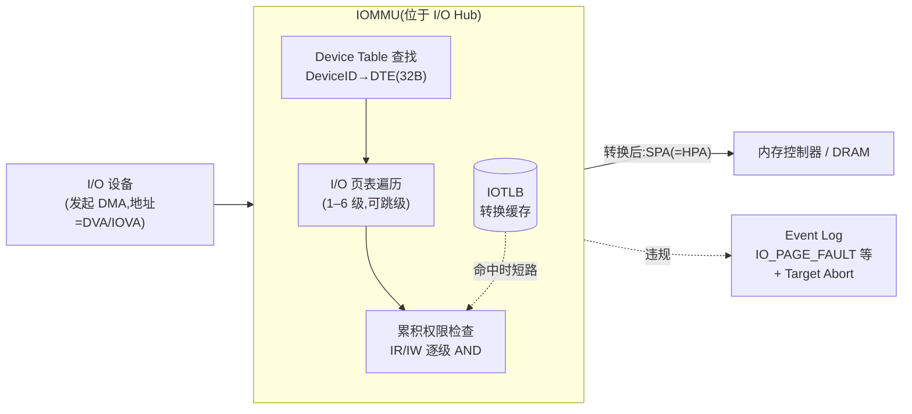

## 6. AMD-Vi:IOMMU 硬件架构

第 4 章讨论的 NPT 解决的是"CPU 侧"的二级地址转换;本章讨论与之对偶的"设备侧"问题:DMA 事务携带的地址如何被转换与约束。AMD 的对应硬件是 I/O Memory Management Unit(IOMMU),对外品牌为 AMD-Vi,其公开规范为 *AMD I/O Virtualization Technology (IOMMU) Specification*(文档号 48882;内核文档当前指向 48882_3.10_PUB,公开修订版已到 Rev 3.11,2026-04)[^129^][^130^]。第 5 章中 AVIC 的 GA 日志即由本章的 IOMMU 硬件产生;中断重映射(IRTE)的字段细节与 VFIO 直通实践则留待第 7 章,本章只覆盖硬件架构与固件接口。

### 6.1 架构定位

#### 6.1.1 I/O Hub 数据通路中的 DMA 权限检查与 IOVA→SPA 转换

48882 规范将 IOMMU 定义为"一种芯片组功能,对 DMA 事务使用的地址进行转换,并保护内存免受 I/O 设备的非法访问",并将其类比为"处理器 MMU 的外设版本"——区别仅在于它服务的是外设发起的内存访问,并额外提供中断重映射能力[^9^]。在经典 AMD64 平台拓扑中,DRAM 挂在 CPU 内存控制器上,I/O 设备经 HyperTransport 链路接入 I/O Hub(承担传统"北桥"角色的 I/O 枢纽),IOMMU 及其转换缓存(TLB)就集成在 I/O Hub 内部、位于下行设备与上游内存通路之间。IOMMU 使能后,它拦截来自下游设备的请求,执行权限检查与地址转换,再把转换后的事务经 HyperTransport 链路上行至系统内存空间[^9^]。由于 IOMMU 只能看到并转换流经其所在节点的内存流量,多 I/O 链路的系统需要多个 IOMMU;在现代 Ryzen/EPYC 平台上,每个 IOMMU 在 PCI 配置空间中可见,形如 `00:00.2 IOMMU [0806]`(class=0x08、subclass=0x06、progif=0x00)[^9^][^130^]。

请求处理规则按事务类型分流(规范 §3.1.1):来自下游的内存读写事务,经 Device Table 查找 DomainID 并定位 I/O 页表,完成地址转换与权限检查后转发上游;来自下游的中断,经 Device Table 与中断重映射表查找后重映射;端口 I/O 事务仅做 Device Table 查找以判定是否允许;IOMMU 自身产生的读写与中断事务不被转换[^9^]。转换语义上,设备发出的 DMA 地址称为 Device Virtual Address(DVA,OS 侧习惯称 IOVA),经 I/O 页表转换为 System Physical Address(SPA)[^130^]。在设备直通场景中 IOVA 即 guest physical address(GPA),因此 IOMMU 完成的是 GPA→HPA 的第二级转换,与 NPT 的 gVA→gPA→hPA 链条在语义上拼合为完整的两级翻译。

*图 6-1* IOMMU 在 I/O Hub 数据通路中的位置与 DMA 请求处理流程。设备发起的 DMA 事务(DVA/IOVA)在 IOMMU 内经 Device Table 查找、I/O 页表遍历与累积权限检查后转换为 SPA 上行至内存;IOTLB 命中可短路页表遍历,违例事务写入 Event Log 并以 Target Abort 回应。依据 AMD IOMMU 规范(48882)§3.1 的请求处理规则绘制[^9^][^130^]。

与 CPU MMU 同理,IOMMU 在内部缓存内存中各表项的内容(转换结果缓存于 IOTLB);规范明确要求系统软件在更新表项后发送相应的失效命令,否则硬件缓存与内存视图不一致[^9^]。当设备侧启用 ATS(Address Translation Services)时,设备本地还存在 DevTLB,`INVALIDATE_IOTLB_PAGES` 命令需触发设备侧的 ATS Invalidate Request/Completion 协议才能清除[^130^][^131^]。失效路径的完整性因此横跨"内存页表—IOTLB—DevTLB"三层,是后续章节讨论 lazy/strict 失效策略安全折中的硬件基础。

### 6.2 核心数据结构

#### 6.2.1 Device Table 与 256-bit DTE 全字段

Device Table 是系统内存中的一张单级表,"把 DeviceID 映射到 DomainID 与页表根指针";DeviceID 为 16 位,由 PCI Bus/Device/Function 号组成,因此每个 PCI segment 最多 65536 项、每项 32 字节(256 bit),整块表最大 2 MiB,在内存中默认连续,其基址由 MMIO 0x0000 的 Device Table Base Address Register 指定[^9^][^130^]。新版硬件另支持分段(segmented)Device Table,经 MMIO 0x0100–0x0130 的 Segment 1–7 Base Address Register 配置[^130^]。Linux 内核以 `struct dev_table_entry`(内含 `u64 data[4]` / `u128 data128[2]` 联合体)表示 DTE,驱动用原子 128 位操作(`amd_iommu_atomic128_set`)分上下两半更新 DTE,以保证硬件在并发读取时看到一致的表项[^132^][^133^]。

**表 6-1 256-bit DTE 字段布局(按 48882 Rev 3.11,8 个 Dword)**[^130^]

| Dword 偏移 | 字段(高位→低位) |
|---|---|
| +0 | Host Page Table Root Pointer[31:12];Mode[11:9];HAD;TV;**V** |
| +4 | IW;IR;GCR3 TRP[14:12];GLX;GV;GIoV;GPRP;**PPR**;Host Page Table Root Pointer[51:32] |
| +8 | GCR3 Table Root Pointer[30:15];**DomainID[15:0]** |
| +12 | GCR3 Table Root Pointer[51:31];SATS;SysMgt;EX;SD;Cache;IoCtl;SA;SE;I |
| +16 | Interrupt Table Root Pointer[31:6];IG;IntTabLen;**IV** |
| +20 | Lint1Pass;Lint0Pass;**IntCtl**;HPTMode;NMIPass;EIntPass;InitPass;GuestPagingMode;Interrupt Table Root Pointer[51:32] |
| +24 | GDeviceID[15:0];vImuEn(vIOMMU) |
| +28 | SnoopAttribute;Mode0FC;AttrV;GuestID[15:0] |

布局上值得注意三点。其一,转换控制由 **V**(表项有效)与 **TV**(转换信息有效)分离表达:V=1、TV=0 时地址直通,访问仅受 DTE 内 IR/IW 默认权限约束;Mode=000b 亦表示"转换禁用(访问由 IR/IW 位控制)"[^134^]。其二,**DomainID[15:0]** 是软件选定的 16 位保护域标识,"保护域"被规范定义为一组可被多个设备共享的地址映射与访问权限集合——同一台 VM 的多个直通设备可共享 DomainID,从而在 IOTLB 中共享转换表项[^9^]。其三,**IR/IW** 并非最终权限,而是累积权限的起点:页表遍历中各级取到的 IR/IW 位与 Device Table 中的 IR/IW 逐位逻辑 AND,形成本次转换的最终 I/O 读写权限[^134^]。其余字段按功能分为三簇:中断重映射簇(IV、IntTabLen、Interrupt Table Root Pointer、IntCtl,IntCtl 编码 00b=目标中止/01b=直通/10b=查表重映射;48882 规定目标 IRTE 的 RemapEm=0 时中断被 Target Abort)[^130^][^135^][^9^];PASID/嵌套簇(GV=Guest Valid、GLX=GCR3 表层级、GIoV、GPRP、GuestPagingMode、GCR3 Table Root Pointer,见 6.3.2)[^130^][^136^];以及固定中断直通簇(InitPass/NMIPass/EIntPass/Lint0Pass/Lint1Pass,固件可经 IVRS 要求置位)[^130^][^135^]。任何 DTE 修改之后,驱动必须向命令缓冲区发送 `INVALIDATE_DEVTAB_ENTRY` 命令冲刷硬件缓存(`iommu_flush_dte_sync`),否则设备侧可能继续使用旧表项[^133^][^134^]。

#### 6.2.2 I/O 页表:1–6 级可跳级与 CPU 页表兼容

AMD 的 I/O 页表(v1 格式)是"AMD64 long mode 页表的推广":一棵由 4 KiB 表构成的多级树,每级用 9 位虚拟地址索引;每个表项要么是指向下一级 4 KiB 表的页目录项(PDE),要么是指定系统物理页地址的页转换项(PTE)[^134^]。表项位布局与 CPU 页表基本一致:PTE 的 bit0 为 P(present)、bit5 为 A、bit6 为 D、bits[11:9] 为 Next Level、bits[51:12] 为物理地址、bit61 为 IR、bit62 为 IW、bit60 为 FC(Force Coherent)、bit59 为 U;物理地址的架构上限为 52 位[^130^][^134^]。FC=1 时 IOMMU 对目标页的访问强制一致性(清除 PCI No-Snoop 语义),Linux 的 v1 域默认设置 `PT_FEAT_AMDV1_FORCE_COHERENCE`[^134^][^137^]。

与 CPU 页表的关键差异是 **Next Level 字段**带来的跳级(level skipping)能力:PDE 的 Next Level 指明下一级查找使用的地址位组,使 IOMMU 可以跳过页表层级,这是 CPU 页表遍历器不具备的行为;Next Level=0h 或 7h 表示叶子 PTE,其中 7h 同时用于编码大于默认尺寸的页——"页大小由页地址中从 bit 12 起的第一个零位决定"[^134^]。DTE 的 Mode[11:9] 选择页表级数:001b=1 级(21 位 DVA 空间)、010b=2 级(30 位)、011b=3 级(39 位)、100b=4 级(48 位)、101b=5 级(57 位)、110b=6 级(64 位)、111b 保留[^134^][^131^]。规范 Table 8 给出各级默认页尺寸:L1(bits 20:12)=4 KiB、L2(29:21)=2 MiB、L3(38:30)=1 GiB,L4–L6 依此类推——常说的"4K/2M/1G 页"即对应默认前三级[^134^][^131^]。

*图 6-2* DTE Mode 编码(001b–110b)对应的 DVA 地址空间宽度与各级默认页大小。数据来源:AMD IOMMU 规范(48882)§3.2 及 Table 8 的编码定义,为架构常量而非实测值[^134^][^131^]。每增加一级页表,地址空间扩展 9 位(57→64 位的第 6 级仅 7 位);跳级机制允许在稀疏地址区间上以浅层树覆盖大范围,减少遍历级数。

规范明确,该格式选择的目的即"让 IOMMU 可以直接使用 AMD64 long mode CPU 页表——只要 Next Level 字段(占据 AMD64 处理器忽略的位)被正确初始化"[^134^];OSDev 同样确认"I/O 页表与 long-mode 页表兼容"[^130^]。两者的残余差异在于:CPU 要求 canonical 地址(bit 63:48 等于 bit 47),IOMMU 则支持完整 64 位 PCI 地址空间;当页表少于 6 级时,超出页表覆盖范围的高位必须为 0,从而"软件总能向页表追加层级而不改变设备所见的地址空间"[^134^]。这一格式统一具有超出本章范围的生态含义(研究洞察 3):KVM 的 NPT mmu 代码、amd_iommu 驱动与 guest OS 页表代码共享同一套格式语义与遍历逻辑,大页与 TLB 调优知识可在 CPU 虚拟化、IOMMU 两条线上直接迁移;也正是两侧页表语义同构,SEV-SNP 才能用单一 RMP 结构同时约束 CPU 与 IOMMU 的 table-walker[^11^]。除 v1 外,内核还定义了 v2 页表(`IOMMU_PT_X86_64`,纯 x86-64 格式)用于 PASID 场景——"v2 页表使用最终将(在通用代码中)与 VT-d 共享的 x86 实现";v2 表在 PASID≠0 时执行与 CPU 一致的符号扩展检查,PASID=0 时不执行,内核因此把域可用地址截掉最高位以兼容两种挂载方式[^137^]。

#### 6.2.3 Command Buffer、Event Log、PPR/GA Log 与 MMIO 寄存器

**命令缓冲区(Command Buffer)** 是系统内存中的环形队列:软件在尾部写入命令并推进 Command Buffer Tail Pointer Register(MMIO 0x2008),IOMMU 从头部(MMIO 0x2000)取命令;"IOMMU 按 FIFO 顺序从命令缓冲区取命令……但可以并发执行,软件在需要同步时使用 COMPLETION_WAIT 命令"[^9^]。Command Buffer Base Address Register(MMIO 0x0008)含 ComBase(按长度对齐的 SPA)与 ComLen,长度编码 8=256 项(4 KiB)至 15=32768 项(512 KiB);写基址寄存器会复位头/尾指针;仅当 IOMMU Control Register(MMIO 0x0018)的 CmdBufRun=1 时处理命令[^130^][^9^]。每个命令项 128 位,bits[63:60] 为 Opcode[^130^]。主要命令包括:COMPLETION_WAIT、INVALIDATE_DEVTAB_ENTRY、INVALIDATE_IOMMU_PAGES(按 DomainID+地址范围失效 IOMMU 页缓存,S 位可整域失效)、INVALIDATE_IOTLB_PAGES(向 ATS 设备发失效请求)、INVALIDATE_INTERRUPT_TABLE、PREFETCH_IOMMU_PAGES、COMPLETE_PPR_REQUEST、INVALIDATE_IOMMU_ALL、INSERT_GUEST_EVENT、RESET_VMMIO(vIOMMU)[^130^][^138^]。两类失效命令的分工是:`INVALIDATE_IOMMU_PAGES` 针对 IOMMU 自身的转换缓存,`INVALIDATE_IOTLB_PAGES` 则"向设备发送请求以冲刷其本地转换缓存(IOTLB/DevTLB)"[^139^]。

**事件日志(Event Log)** 是 IOMMU 向软件报告异步错误的通道:"当 IOMMU 检测到任何类型的错误且事件日志已使能时,它在位于系统内存的事件日志中写入相应错误表项,并可选择发出中断";日志基址由 Event Log Base Address Register(MMIO 0x0010)指定,头/尾指针在 MMIO 0x2010/0x2018[^9^][^130^]。

**表 6-2 Event Log 事件类型编码(Linux `amd_iommu_types.h`,共 14 种)**[^140^][^130^]

| 编码 | 事件 | 含义 |
|---|---|---|
| 0x1 | ILLEGAL_DEV_TABLE_ENTRY | DTE 非法(保留位/非法组合) |
| 0x2 | IO_PAGE_FAULT | I/O 页表遍历失败或权限违例 |
| 0x3 | DEV_TAB_HARDWARE_ERROR | 读 Device Table 时硬件错误 |
| 0x4 | PAGE_TAB_HARDWARE_ERROR | 读 I/O 页表时硬件错误 |
| 0x5 | ILLEGAL_COMMAND_ERROR | 命令缓冲区中命令非法 |
| 0x6 | COMMAND_HARDWARE_ERROR | 取命令时硬件错误 |
| 0x7 | IOTLB_INV_TIMEOUT | IOTLB/DevTLB 失效超时 |
| 0x8 | INVALID_DEVICE_REQUEST | 设备请求被禁用(如 I=0 时发起事务) |
| 0x9 | INVALID_PPR_REQUEST | PPR 请求非法 |
| 0xA | EVENT_COUNTER_ZERO | 事件计数器归零 |
| 0xB | GUEST_EVENT_FAULT | INSERT_GUEST_EVENT 相关故障 |
| 0xC | VIOMMU_HARDWARE_ERROR | vIOMMU 硬件错误 |
| 0xD | RMP_PAGE_FAULT | SEV-SNP RMP 检查违例 |
| 0xE | RMP_HARDWARE_ERROR | RMP 访问硬件错误 |

从编码序列可以看出硬件能力的演进轨迹:0x1–0x8 覆盖初代 AMD-Vi 的转换与命令路径错误,0x9/0xB/0xC 随 PPR 与 vIOMMU 加入,0xD/0xE 则是 SEV-SNP 时代的产物——RMP 由 CPU 与 IOMMU 两侧的 table-walker 共同检查,DMA 路径上的 RMP 违例不再体现为通用 IO_PAGE_FAULT 而是独立的 RMP_PAGE_FAULT,这使内核日志可以直接区分"映射缺失"与"内存归属违例"两类故障[^11^][^140^]。IO_PAGE_FAULT 表项记录 DeviceID、DomainID/PASID、故障地址与读/写标志;触发条件包括页表项无效、保留位非零、读被保护页(IR=0)、写被保护页(IW=0)、TV 未置位等,对未转换请求通常以 Target Abort 回应[^134^]。内核打印形如 `AMD-Vi: Event logged [IO_PAGE_FAULT device=07:00.0 domain=0x0007 address=0xffffc02000 flags=0x0000]`[^141^]。须强调故障不可恢复:"由于 IOMMU 不提供重启设备访问未映射或受保护地址的手段,设备可能访问的所有页都必须以适当权限映射"——非 ATS 场景下 DMA 失败即事务被终止(UR/CA 或丢弃写)[^9^][^142^]。

**PPR 日志(Peripheral Page Request Log)** 配合 ATS/PRI 实现按需分页:"IOMMU 可支持面向使用 ATS 的外设的 PPR,从而建立一种机制,使外设与软件减少 I/O 期间钉住(pinned)页面的需求"[^143^]。设备页请求写入 PPR Log(基址 MMIO 0x0038,头/尾 MMIO 0x2030/0x2038;另有 PPR Log B),内核 IRQ 线程处理后以 COMPLETE_PPR_REQUEST 命令回复设备;Linux 经 IOPF(I/O Page Fault)层衔接 SVA 缺页服务[^144^][^140^]。**GA 日志(Guest vAPIC Log)** 服务于 AVIC 的门铃记录(见第 5 章);三个日志均为一致性内存中的生产者/消费者环:"IOMMU 在尾部写入,驱动的 IRQ 线程在头部读取";现代实现(x2APIC 模式)为三个日志分配独立 MSI 向量,`/proc/interrupts` 中可见 `AMD-Vi<x>-[Evt/PPR/GA]`[^144^][^145^]。

**MMIO 寄存器映射**:IOMMU 不使用常规 BAR,而是通过 PCI 配置空间中 Capability ID=0x0F 的安全能力块暴露 IOMMU Base Address Low/High Register(定义 14 KiB MMIO 窗口的 SPA)、Range Register 与 Miscellaneous Information Register;配置空间访问必须 32 位对齐[^130^]。

**表 6-3 IOMMU MMIO 窗口主要寄存器(48882 Rev 3.11)**[^130^]

| 偏移 | 寄存器 | 功能 |
|---|---|---|
| 0x0000 | Device Table Base Address Register | Device Table 的 SPA |
| 0x0008 | Command Buffer Base Address Register | 命令环基址与长度编码 |
| 0x0010 | Event Log Base Address Register | 事件日志环基址 |
| 0x0018 | IOMMU Control Register | IommuEn/CmdBufEn/EventLogEn/PprEn |
| 0x0020/0x0028 | Exclusion Base/Limit Register | DMA 排除范围 |
| 0x0030 | Extended Feature Register(EFR) | ATS/PPR/GT/GAv2/NestTrans 能力位 |
| 0x0038 / 0x00E0 | PPR Log / GA Log Base Register | 两日志环基址 |
| 0x0100–0x0130 | Segment 1–7 Base Address Register | 分段 Device Table |
| 0x01A0 | Extended Feature 2 Register(EFR2) | 扩展能力位 |
| 0x2000/0x2008 | Command Buffer Head/Tail | 命令环头/尾指针 |
| 0x2010/0x2018 | Event Log Head/Tail | 事件环头/尾指针 |
| 0x2020 | IOMMU Status Register | 运行状态 |
| 0x2030/0x2038 | PPR Log Head/Tail | PPR 环头/尾指针 |
| 0x2040/0x2048 | GA Log Head/Tail | GA 环头/尾指针 |

MMIO 窗口的组织呈明显的"两段式":0x0000–0x1FFF 为配置区,存放各内存结构的基址与全局控制/能力寄存器,只在初始化与能力探测阶段被访问;0x2000 起为指针/状态区,是运行期热路径——命令提交、事件收割都表现为对该区头/尾指针的读写。这一划分直接解释了硬件加速 vIOMMU 的拦截边界(6.3.2):硬件只接管 8K–12K(0x2000–0x2FFF)的指针区,而 0K–4K 的配置区继续由 hypervisor 模拟,从而把"高频、语义简单"的环操作与"低频、语义复杂"的配置操作分流到两条成本截然不同的路径上[^146^]。使能序列为:初始化 Device Table、命令缓冲区与事件日志的基址及头尾指针后,"写 IOMMU Control Register 置 EventLogEn=1b(若使用)、CmdBufEn=1b、IommuEn=1b……IOMMU 随即进入运行状态"[^9^]。调试方面,内核 debugfs 支持转储每个 IOMMU 的 MMIO/能力寄存器、命令缓冲区、DTE 与中断重映射表项(`/sys/kernel/debug/iommu/amd/iommu00/{mmio,capability,cmdbuf}` 等)[^147^]。

### 6.3 固件接口

#### 6.3.1 IVRS ACPI 表与 Linux amd_iommu 枚举流程

固件经 ACPI 表向 OS 描述平台 IOMMU 拓扑:"架构定义了一种 ACPI 兼容的数据结构 I/O Virtualization Reporting Structure(IVRS),用于向系统软件传达 I/O 虚拟化相关信息;IVRS 描述平台中各 IOMMU 的配置与能力,以及每个 IOMMU 所虚拟化的设备信息",并报告无法以其它方式枚举的外设、SMI/SMM 与固件使用的内存区域(排除范围)[^141^]。IVRS 由若干 IVDB(I/O Virtualization Definition Block)组成,分两类:IVHD 描述 IOMMU 硬件能力/配置与系统 I/O 拓扑,IVMD 描述特定设备的特殊内存约束[^131^]。

**表 6-4 IVRS 条目类型(IVHD 类型与 IVHD 内设备范围条目)**[^148^][^138^]

| 类别 | 类型编码 | 条目 | 语义 |
|---|---|---|---|
| IVHD | 10h | 全功能 IVHD | 含 IOMMU Feature Report |
| IVHD | 11h | 扩展 IVHD | 附加 EFR/EFR2 能力字段 |
| IVHD | 40h | maximum performance IVHD | 布局同 11h |
| 设备条目 | 1(01h) | ALL | 该 segment 全部设备 |
| 设备条目 | 2(02h) | SELECT | 单个 BDF |
| 设备条目 | 3/4 | START_OF_RANGE / END_OF_RANGE | BDF 连续范围 |
| 设备条目 | 42h/43h | ALIAS_SELECT / ALIAS_START_OF_RANGE | 桥后设备用别名 DeviceIDb |
| 设备条目 | 48h | SPECIAL_DEVICE | IOAPIC(Variety=1)/HPET(=2)等中断源 |
| IVMD | — | Unity Map(标志 0x01)/ Exclusion(0x08) | 恒等映射或 DMA 排除范围 |

IVHD 头部(type 10h/11h)携带:Flags(HtTunEn、IoTlbSup、PrefSup、PPRSup 等)、IOMMU 自身 DeviceID、Capability Offset(指向 0x0F 能力块)、Base Address(MMIO 基址)、PCI Segment、IOMMU Info(MSI 号/单元号)、Feature Report(XTSup、GTSup、GLXSup、GASup 及 guest/host 页表级数 GATS/HATS),11h/40h 再附 EFR/EFR2[^148^][^138^]。设备条目声明"哪些设备受该 IOMMU 管辖"(device scope),每个条目带 DTE Setting 字节,给出固件要求的 InitPass/NMIPass/EIntPass 等固定中断直通属性;SPECIAL_DEVICE 为无标准 BDF 的中断源(IOAPIC/HPET)分配重映射句柄[^148^][^138^]。IVMD 描述需特殊处理的物理内存范围:Unity Map(1:1 恒等映射)或 Exclusion Range(排除 DMA),语义类比 Intel VT-d 的 RMRR——"OS 被期望为这些区域建立 unity 映射,使相应设备可访问它们"[^141^][^149^]。实践中固件瑕疵多发于别名与范围条目:桥后设备若未被 ALIAS 条目正确覆盖,其 DMA 将以未映射的 DeviceID 进入 IOMMU 并触发 INVALID_DEVICE_REQUEST,这也是消费级主板上直通故障的常见根因之一。

Linux 侧的枚举流程(`drivers/iommu/amd/`)为:启动早期以 `acpi_table_parse("IVRS", …)` 探测,无 IVRS 则跳过整个初始化[^131^][^150^];`init.c` 解析 IVRS,按 IVHD 枚举各 IOMMU 单元(MMIO 基址、EFR 能力),按设备条目/别名建立 DeviceID→IOMMU 映射并处理 IVMD unity/exclusion 范围[^133^];随后分配 Device Table、命令缓冲区与事件日志,编程 MMIO 基址与控制寄存器并置 IommuEn,注册 `amd_iommu_ops`,再按默认域策略(Translated/Passthrough)建域[^151^][^152^]。与枚举流程配套的内核命令行开关也直接面向本章的硬件机制:`amd_iommu=off | force_enable | force_isolation` 控制驱动整体使能与是否强制所有设备隔离(不允许驱动降级隔离要求),中断重映射模式由 `amd_iommu_intr=legacy|vapic` 选择[^153^][^154^]。虚拟化侧,QEMU 以 `-device amd-iommu` 仿真 AMD-Vi,`dma-remap=on` 才启用 v1 I/O 页表 DMA 转换,`intremap`、`xtsup`(128 位 IRTE、32 位目标)等需显式开启,并由 QEMU 为 guest 生成 IVRS[^155^][^130^]。

#### 6.3.2 PASID/GCR3 多地址空间与硬件加速 vIOMMU 动向

DTE 的 PASID/嵌套簇(GV、GLX、GCR3 Table Root Pointer)使单个设备可以携带多个地址空间:GCR3 表"由设备请求关联的 PASID 值索引",每项给出该 PASID 对应进程的 guest 页表根(GVA→GPA,即 v2/第一阶段表);宿主 v1 表再完成 GPA→SPA,构成两级(嵌套)转换[^136^][^131^]。三者的分工可概括为:PASID 提供进程身份,ATS 提供性能,转换表强制保护策略[^156^]。Linux 经 `IOMMU_HWPT_ALLOC_PASID` 为 SVA(Shared Virtual Addressing)分配 v2 页表域,GCR3 表由 `init_gcr3_table()`/`update_gcr3()` 管理,并配合 mmu_notifier 与进程 mm 同步[^137^]。2024–2025 年主线合入的嵌套翻译支持进一步把控制权交给 guest:"AMD IOMMU 驱动以宿主(v1)页表根指针配置 DTE,而 guest 页表与 GCR3 表由 Guest OS 管理",VMM 经 `iommu_hwpt_amd_guest` 把 gDTE 传给宿主驱动解析后编程进宿主 DTE[^157^][^158^]。

最新动向是 2026 年的硬件加速 vIOMMU:当 guest 访问命令缓冲区/事件日志/PPR 日志头尾指针所在的 MMIO 区域(偏移 8K–12K)时,由 IOMMU 硬件直接服务并直接访问 guest 物理内存,消除 hypervisor 拦截开销;HV/VMM 继续拦截模拟 0K–4K 的配置寄存器;配套机制包括 GPA→SPA 转换 DTE、DeviceID/DomainID 映射表与 vIOMMU 私有地址区[^146^]。这一设计与 6.2.2 的格式统一一脉相承:正因 guest 的 v2 页表与宿主 v1 页表在语义上同构,硬件才能在不引入第三种格式的前提下,把"guest 操作 vIOMMU"下沉为"guest 操作真实 IOMMU 的受控视图"。
