## 7. 中断重映射、SR-IOV 与设备直通实践

第 6 章已定义 AMD-Vi 的 DTE/IRTE 数据结构与硬件转换流程,本章落到操作层:中断重映射(Interrupt Remapping)如何与 AVIC 协同、IOMMU groups 如何划定直通的安全边界、以及 Linux/KVM 栈上从内核参数到 QEMU 命令行的完整直通路径。AMD 平台的实践要点集中在三处:`amd_iommu=on iommu=pt` 的推荐组合[^159^][^160^]、Radeon GPU 的功能级复位(Function Level Reset,FLR)缺陷与社区修复[^159^][^161^]、以及 Windows 基于虚拟化的安全性(Virtualization-Based Security,VBS)对 AMD-Vi 的硬性依赖[^162^][^163^]。

### 7.1 中断重映射

#### 7.1.1 IRTE 与 RemapEm:防 MSI 伪造攻击;与 AVIC guest-mode 协同的三代唤醒机制

AMD-Vi 使能后拦截下游设备请求,执行权限检查、地址转换与中断重映射:设备发出的 MSI 消息,其 data 字段被 IOMMU 用作内存中 Interrupt Remapping Table 的索引,取出对应 IRTE(Interrupt Remapping Table Entry,中断重映射表项)后由 IOMMU 重新生成中断消息[^9^]。48882 规范定义的 legacy IRTE 关键字段包括:`Vector`(位 23:16,中断向量)、`Destination`(位 15:8,目标 APIC 的逻辑或物理地址)、`DM`(位 6,目标模式,1=逻辑/0=物理)[^9^]。安全模型的关键一环是 `RemapEm` 位:规范规定"目标 IRTE 的 RemapEm=0 的中断请求将被 Target Abort",即未获重映射许可的中断被硬件直接中止,不会送达任何 CPU[^9^]。固件通过 ACPI 的 IVRS(I/O Virtualization Reporting Structure)表向 OS 描述平台 IOMMU 的能力、管辖设备与固件保留内存区间;若 BIOS 中未开启 IOMMU,则不存在 IVRS 表,内核 amd_iommu 驱动直接跳过初始化[^141^][^131^]。

这一硬件中止语义正是对 MSI 伪造攻击的对策。Invisible Things Lab 对 VT-d 的攻击研究表明:未启用中断重映射时,被恶意控制的设备可伪造 MSI 消息、伪装成任意中断向量(如 SIPI、syscall 中断、#AC 异常)攻击 hypervisor 与内核;启用重映射后,系统软件须为每个设备域显式填写重映射表,逐设备列出允许的中断向量与格式,越界者被阻断[^164^]。AMD 侧的对应物即上述 RemapEm 检查。由此也解释了 VFIO 的一个实践细节:在缺少中断重映射能力的平台上(多为消费级主板固件缺陷),VFIO 默认拒绝设备直通,须显式加载 `vfio_iommu_type1 allow_unsafe_interrupts=1` 才放行——"unsafe" 一词正是指失去了这层 MSI 防护[^165^]。

与中断重映射深度耦合的是 AVIC(Advanced Virtual Interrupt Controller)。AVIC 为每个 vCPU 提供 4 KB 的 vAPIC backing page,使绝大多数 APIC 访问与中断注入无需 VM-Exit,其组成包括 vAPIC backing page、物理/逻辑 APIC ID 表、doorbell 中断与 IOMMU 扩展[^111^][^166^]。其中 IOMMU 部分即 guest-mode 中断重映射(IOMMU AVIC):直通设备(含 SR-IOV VF)的中断由 IOMMU 按 guest-mode IRTE 直接写入目标 vCPU 的 vAPIC backing page 的 IRR 位图,目标 vCPU 正在运行时全程无 VM-Exit[^114^][^167^]。Linux 内核以 `amd_iommu_intr=` 选择模式:`legacy` 为传统重映射;`vapic` 允许 IOMMU 直接向 guest 注入中断,要求 `kvm-amd.avic=1`,且在 IOMMU 硬件支持时为默认[^108^][^168^]。

难点在于目标 vCPU 恰好被调度换出(IRTE[IsRun]=0)的情形:中断已写入 guest 内存中的 IRR,但无人触发注入,宿主机必须得到通知并唤醒该 vCPU。该通知机制经历了三代演进:

```mermaid
flowchart LR
    subgraph G1[第一代:GA Log]
        A1[设备中断到达] --> B1[IOMMU 写 vAPIC backing page IRR]
        B1 --> C1[vCPU tag 追加到共享 GA log buffer<br/>触发单个 GA log 中断]
        C1 --> D1[KVM notifier 扫描 buffer<br/>批量唤醒 vCPU]
    end
    subgraph G2[第二代:GAPPI]
        A2[设备中断到达] --> B2[IOMMU 写 vAPIC backing page IRR]
        B2 --> C2[直接向 IRTE&#91;Destination&#93; 投递物理 APIC 中断<br/>向量取 IRTE&#91;GATag&#93;&#91;7:0&#93;]
        C2 --> D2[唤醒通知分散到各 CPU]
    end
    subgraph G3[第三代:per-CPU 唤醒链表]
        A3[POSTED_INTR_WAKEUP_VECTOR 到达] --> B3[扫描该 pCPU 链表中<br/>有 pending IRR 的阻塞 vCPU]
        B3 --> C3[逐一唤醒]
    end
    G1 --> G2 --> G3
```



第一代 GA Log(GALOG)把 vCPU tag 追加到共享 buffer 并触发单个中断,KVM 注册 notifier 扫描后决定唤醒对象;中断密集负载下所有唤醒汇聚到一个中断与一个共享 log,既增加延迟又可能溢出 buffer[^115^]。第二代 GAPPI(Guest APIC Physical Processor Interrupt,48882 §2.2.5.4)仍更新 IRR,但可"直接向 IRTE[Destination] 投递物理 APIC 中断,以 IRTE[GATag][7:0] 作为向量",把唤醒通知从集中式 log 分散到各 CPU;在支持的硬件上经内核命令行 `amd_iommu=gappi` 启用,并可用 IRTE[GAPPIDis] 位按设备抑制(硬件特性 FEATURE_GAPPIDISSUP)[^115^][^116^]。第三代在 KVM/SVM 侧对齐 Intel posted-interrupt 的 per-CPU wakeup list 模型:`POSTED_INTR_WAKEUP_VECTOR` 到达时,唤醒该 pCPU 链表上所有存在 pending LAPIC IRR 的阻塞 vCPU[^115^][^169^]。支撑这一动态路径的硬件设计是:规范约定 IRTE 的 Destination、IsRun、GATag 与 GAPPIDis 字段不被硬件缓存,vCPU load/put 时的快速更新无需发出 IRT invalidation[^116^]。作为对照,IRTE 其余字段在新硬件上由 IRTCache 缓存以避免内存读取;但在大规模系统(大量 vCPU、多个 VFIO 直通设备、中断密集负载)上,AVIC 驱动跟踪 vCPU 调度而频繁更新 IRTE,失效命令开销可能超过缓存收益,内核为此提供 `amd_iommu=irtcachedis` 选项整体禁用 IRT 缓存[^170^]。

需要把 guest-mode 重映射视为攻击面的一部分:CVE-2021-3653 表明 KVM AMD SVM 嵌套代码对 L1 提供的 VMCB `int_ctl` 字段校验不当,恶意 L1 可为 L2 启用 AVIC,导致 L2 读写宿主机物理页,构成潜在 guest-to-host 逃逸(影响 5.14-rc7 之前的内核)[^171^]。

### 7.2 SR-IOV 与隔离分组

#### 7.2.1 IOMMU groups 与 ACS:分组粒度决定直通安全边界,pcie_acs_override 的风险

SR-IOV(Single Root I/O Virtualization)由 PCI-SIG 制定,原生地把单个 PCIe 设备共享给多个 guest,提供独立的内存空间、中断与 DMA 流,数据传输不经 hypervisor 介入[^172^]。PF(Physical Function,物理功能)是包含 SR-IOV 能力的完整 PCIe 设备,负责发现、管理与配置 VF;VF(Virtual Function,虚拟功能)是由 PF 派生的轻量 function,"仅处理 I/O",数量受硬件限制[^172^]。Linux 下经 sysfs 开启:

```bash
# 在 PF 上启用 N 个 VF;禁止 VF 自动绑定宿主机驱动(直通前置)
echo 0 > /sys/bus/pci/devices/<BDF>/sriov_drivers_autoprobe
echo N > /sys/bus/pci/devices/<BDF>/sriov_numvfs
```

[^173^]

VFIO 直通的安全模型建立在 IOMMU group 之上。Red Hat 的定义是该模型的基石:"IOMMU group 是从 IOMMU 视角可以认为相互隔离的最小设备集合……VFIO 用这一信息为用户态实施设备的安全所有权;除桥、root port 与 switch 外,组内所有设备都必须绑定到 VFIO 驱动或已知安全的 stub 驱动"[^174^]。分组由两个因素决定。其一,请求者 ID(requester ID)粒度:无法被 IOMMU 区分的设备必须同组,典型例子是 PCIe-to-PCI 桥后的所有 conventional PCI 设备共享桥的 requester ID,整组不可拆分[^174^]。其二,P2P(peer-to-peer)重定向可达性:PCIe 允许事务在互联 fabric 内部被重路由(下游端口之间、switch 端口之间、多功能设备的 function 之间),这类 P2P DMA 不经过 IOMMU 转换,会破坏不同 IOVA 空间的隔离;ACS(Access Control Services)正是用来"对这些重定向提供可见性与控制"的——"从设备到 IOMMU 的每一级若缺少 ACS 支持,就必须假定重定向可能发生,该点之下所有设备的隔离随之失效,IOMMU groups 会把能够进行未转换 P2P DMA 的设备并入同一组"[^174^]。VFIO 与 IOMMU groups 机制于 2012 年由 Alex Williamson 的补丁系列引入,同时覆盖 VT-d 与 AMD-Vi,并包含 `pci_acs_enabled()` 校验与 requester-ID quirk 处理[^175^]。

实践推论有三。第一,每个 VF 应独占一个 IOMMU group,才能单独直通给不同 VM 且 DMA 隔离有保证;SR-IOV 本身依赖 IOMMU 为每个 VF 提供独立的映射域[^176^]。第二,大规模 VF(64 个以上)依赖 ARI(Alternative Routing-ID Interpretation)把 function 编号扩展到 8 bit;在不支持 ACS 的 switch 之下,PF 与 VF 可能落入同一组[^177^]。第三,消费级主板(部分 AMD B 系列芯片组尤甚)常把多个插槽、USB 控制器与 NVMe 合并为一组,只能整组直通;社区常用的绕行手段 `pcie_acs_override` 会"在内核中覆盖 PCIe ACS 支持,让命令行选项虚报隔离能力……未经厂商确认,无法确定设备是否真的隔离",即实质上削弱了 DMA 隔离保证,生产环境应避免[^178^][^179^]。验证手段为 `find /sys/kernel/iommu_groups/ -type l | sort -V` 列出分组,`lspci -vv | grep ACS` 检查 ACSCap/ACSCtl 中的 SrcValid、TransBlk、ReqRedir、CmpltRedir 与 P2P 相关位[^178^][^160^]。另需注意 PF FLR 与直通中 VF 的相互作用是设备相关的:设计良好的 PF 复位至多让 VF 停顿直至复位完成,设计不良者行为不可预期[^180^]。
### 7.3 VFIO 直通实战

#### 7.3.1 amd_iommu=on、iommu=pt vs strict 的性能语义;vfio-pci 绑定与 QEMU -device vfio-pci

AMD 平台的直通准备分两层:BIOS/UEFI 中显式开启 IOMMU(常见路径为 AMD CBS → NBIO Common Options → IOMMU=Enabled),再向内核命令行追加 `amd_iommu=on` 并重建引导配置[^181^][^163^]。内核侧与 IOMMU 语义直接相关的参数语义汇总如下。

| 参数 | 语义 | 典型用途与注意事项 |
|---|---|---|
| `amd_iommu=on` | 启用 amd_iommu 驱动(以固件 IVRS 表为前提) | 直通与 SR-IOV 的前置条件;BIOS 未开 IOMMU 时驱动跳过初始化[^181^][^131^] |
| `iommu=pt` | 直通模式:IOMMU 硬件开启,未被 VFIO 绑定的宿主设备使用 1:1 恒等映射,仅直通设备获得完整转换与隔离 | 直通主机推荐;避免全设备建域带来的转换开销与 DMA 地址空间碎片[^182^][^183^] |
| 默认(非 pt,strict 行为) | 所有设备 DMA 均经 IOMMU 转换;`iommu.strict=1` 要求每次 unmap 立即失效 IOTLB(AMD 默认严格,`=0` 为惰性批量失效) | 隔离覆盖最全,但全设备转换有约 5% 的 DMA 开销,且 IOTLB 失效频率更高[^176^][^108^] |
| `iommu=off` / `amd_iommu=off` | 关闭 IOMMU | 无 DMA 隔离,不可用于直通[^176^] |
| `amd_iommu_intr=legacy/vapic` | 中断重映射模式;`vapic` 允许 IOMMU 直接向 guest 注入中断,要求 `kvm-amd.avic=1`,硬件支持时为默认 | guest-mode 重映射的总开关,可退回 `legacy` 单独关闭 IOMMU AVIC[^108^][^168^] |
| `amd_iommu=gappi` | 在支持的硬件上启用 GAPPI 唤醒通知(48882 §2.2.5.4) | 中断密集负载下把唤醒从中断汇聚的 GA Log 分散到各 CPU[^115^] |
| `amd_iommu=irtcachedis` | 禁用 IRTE 缓存 | 大规模系统上 IRT invalidation 开销超过缓存收益时使用[^170^] |
| `amd_iommu=fullflush` / `force_isolation` / `nohugepages` / `v2_pgsizes_only` | 分别:unmap 时立即全量刷 IOTLB;强制每设备隔离(不覆盖 `iommu=pt`);v1 页表限 4 KiB;页尺寸限 4 KiB/2 MiB/1 GiB | 调试与缺陷规避用[^108^] |

上表呈现了 AMD 平台 IOMMU 策略的三档取舍:全转换(strict)以约 5% 的 DMA 开销换取最大隔离覆盖面,`iommu=pt` 把转换面收缩到真正直通的设备、宿主设备回到原生性能,`iommu=off` 则完全放弃隔离。对以直通为目的的主机,`iommu=pt` 是多方一致的推荐:AMD 官方 HPC 调优指南(58002)明确建议以 `iommu=pt` 作为内核启动参数,云基础设施最佳实践文档(58004)进一步指出 passthrough 模式"对网络密集型用例有显著影响"[^184^][^185^]。这一推荐还有实测故障作反面印证:在 EPYC 7003 + Supermicro H12SSL-i 平台上,缺少 `iommu=pt` 时即便有 64 GB 内存也会出现 `vfio: IOMMU_MAP_DMA failed: -12`——全设备建域使连续的 DMA 可寻址空间碎片化,加上 pt 后错误在 EPYC 系统上稳定消失[^183^]。同时注意参数间的相互作用:`force_isolation` 不覆盖 `pt` 语义,`nohugepages`/`v2_pgsizes_only` 只约束 IOMMU 页表(而非 NPT)的页尺寸[^108^]。

VFIO 的用户态模型为 container/group/device 三层:设备从宿主机驱动解绑并绑定到 vfio-pci 后出现 `/dev/vfio/$GROUP`($GROUP 即 IOMMU group 号);组内多设备须全部绑定 VFIO 后才允许对 group 操作;随后经 `VFIO_GROUP_SET_CONTAINER` 加入 container、`VFIO_SET_IOMMU` 选定后端(x86 上为 vfio_iommu_type1)、`VFIO_IOMMU_MAP_DMA` 建立 DMA 映射、`VFIO_GROUP_GET_DEVICE_FD` 取得设备 fd,结束时 `VFIO_DEVICE_RESET` 复位[^186^]。完整的宿主机到 guest 操作流程如下。

| 步骤 | 命令/操作 | 目的与验证 |
|---|---|---|
| 1. 固件与内核参数 | BIOS 开 IOMMU;GRUB 追加 `amd_iommu=on iommu=pt`,重建配置并重启 | `dmesg \| grep -e AMD-Vi -e IOMMU`;`ls /sys/kernel/iommu_groups/` 非空[^181^][^159^] |
| 2. 加载模块 | `/etc/modules-load.d/vfio.conf` 写入 `vfio`、`vfio_iommu_type1`、`vfio_pci` | 新内核中 vfio_virqfd 已并入 vfio 核心,不必单独加载[^160^] |
| 3. 按 ID 抢占绑定 | `echo 'options vfio-pci ids=1002:73bf,1002:ab28' > /etc/modprobe.d/vfio.conf` | GPU 须同时给出音频 function 的 ID[^179^][^182^] |
| 4. 屏蔽宿主驱动 | `blacklist amdgpu`(或 `softdep amdgpu pre: vfio-pci` 排序) | 防止宿主机驱动先于 vfio-pci 抢占设备[^179^] |
| 5. 重建 initramfs 并重启 | `update-initramfs -u -k all && reboot` | 使早启动加载顺序生效[^160^] |
| 6. 验证绑定 | `lspci -nnk -s <B:D>` | 期望输出 `Kernel driver in use: vfio-pci`[^179^] |
| 7. QEMU 传入 guest | `-device vfio-pci,host=<BDF>` | QEMU 负责 config 空间选择性模拟/透传、BAR 映射与 eventfd/irqfd 中断注入[^187^] |

流程中失败率最高的是第 3–5 步:GPU 的音频 function 若漏配 `ids=`,会被 snd_hda_intel 抢占而留在宿主;initramfs 未重建时 modprobe 配置在早启动阶段不生效,重启后绑定"神秘失效"。动态场景下也可不重启完成切换:先 `echo 0000:41:00.0 > /sys/bus/pci/devices/.../driver/unbind`,再 `echo "1002 73bf" > /sys/bus/pci/drivers/vfio-pci/new_id`[^179^]。QEMU 侧另有两条演进线值得跟踪:其一,iommufd 新后端(`/dev/iommu` + `BIND_IOMMUFD`/`ATTACH_IOAS`)正在替代 legacy container 的 `SET_CONTAINER/SET_IOMMU` 路径[^188^];其二,若要在 guest 内再暴露 vIOMMU,QEMU 的 `amd-iommu` 设备模型需显式开启各项能力(`-device amd-iommu,dma-remap=on`,中断重映射与 IOTLB 亦需单独打开),且当前 AMD vIOMMU 模型尚不同时支持 VFIO 与 x2APIC——Oracle 的实测建议因此暂用 Intel vIOMMU 模型并配合 split irqchip[^130^][^114^]。

#### 7.3.2 GPU 直通:FLR reset bug、vendor-reset、IVRS Unity Map 陷阱、NPT 大页收益

大量 Radeon GPU(Polaris、Vega 及早期 Navi)没有实现可用的 FLR:guest 关机后卡处于宿主机无法恢复的状态,第二次启动 VM 即挂起,典型日志为 `Unable to change power state from D3cold to D0, device inaccessible`,唯一可靠的恢复方式是整机重启[^159^]。社区修复是 out-of-tree 的 vendor-reset 内核模块,为各 ASIC 实现厂商特定复位序列;需以 DKMS 方式安装以跟上内核升级,并用 `reset_method=device_specific` 指定复位方式,支持范围按代际划分[^159^][^189^]。复位问题在 RX 7000(RDNA3)代出现"回归":该代 GPU 无法正常复位,后果之一是 GPU 一旦被主板 BIOS 或 VM BIOS POST 过一次,再次 POST 会损坏卡状态,常需冷启动宿主机才能恢复;Linux 6.15/6.16 内核上亦有 RDNA3 单卡直通复位缺陷回归的报告(kernel bugzilla 220471)[^161^][^190^]。数据中心卡(Instinct 系列)的复位行为与 SR-IOV 支持通常优于消费卡,消费卡的 reset bug 不适用于服务器 ASIC[^159^]。

第二类陷阱位于固件层。X870E/AGESA 1.2.2.x 平台上出现一类新故障:主板 ACPI IVRS 表为 GPU 声明了 Unity Map(`IOMMU_RESV_DIRECT`)保留区,强制该设备走恒等域;6.10 及之后内核执行更严格,VFIO 的 translated 域请求被拒绝,VM 无法启动并报 "Firmware has requested this device have a 1:1 IOMMU mapping";处理方向在固件设置(Above 4G Decoding、Resizable BAR、IOMMU 相关选项)而非 hypervisor 配置[^191^][^192^]。

性能侧,直通场景下 guest 的 GVA→GPA→HPA 两级转换由 NPT(Nested Page Tables,AMD 文档亦称 RVI)完成,页尺寸是首要调优项:以 4 KiB 页支撑 4 GiB VM 需要 1,048,576 个页表项,换用 2 MiB 大页降至 2,048 项,1 GiB 大页仅需 4 项[^193^][^194^]。


*图 7-1:4 GiB 虚拟机内存分别由 4 KiB/2 MiB/1 GiB 页支撑时所需的页表(等价于嵌套 TLB 覆盖)项数,对数坐标;数值引自公开大页配置分析,适用于 EPT/NPT 两级转换场景[^193^][^194^]。*

项数缩减直接降低嵌套 walk 的 TLB 压力,在 EPT/NPT 两级转换中同时生效[^194^]:AMD 研究院在 ASPLOS 2008 的测量表明,hypervisor 侧使用大页可为 guest 带来 3–22% 的性能提升(在 PWC/NTLB 优化基础上叠加)[^99^]。SUSE/AMD 虚拟化调优指南据此推荐 KVM guest 使用 1 GB 静态大页,并在宿主机侧关闭 THP,避免 khugepaged 后台合并干扰 vCPU 执行[^195^]。配置方式为启动参数 `default_hugepagesz=1G hugepagesz=1G hugepages=16`(1 GiB 页只能启动期预留,且需 `grep pdpe1gb /proc/cpuinfo` 确认 CPU 支持),或运行期 `echo 8192 > /proc/sys/vm/nr_hugepages`(8192×2 MiB = 16 GiB),libvirt 侧经 `<memoryBacking><hugepages>` 指定[^196^][^197^]。收益预期应务实:Red Hat 基准显示静态大页相对 THP 的额外收益一般不超过约 2%,多数场景 THP 已足够,大页的价值在大内存、TLB 密集负载上才充分兑现[^197^]。

#### 7.3.3 Windows VBS/Credential Guard 对 AMD-Vi 的硬依赖

VBS 的硬件要求在 AMD 侧构成一个三元组:AMD-V(SVM)、SLAT(即 AMD RVI/NPT)与 AMD-Vi IOMMU。微软官方文档列明虚拟化扩展须为"Intel VT-x or AMD-V;Second Level Address Translation",并要求"A VT-d or AMD-Vi IOMMU",且"在 Windows 10 中,IOMMU 增强系统对内存攻击的韧性"[^198^];SLAT 在 AMD 平台的具体对应即"AMD-V with Rapid Virtualization Indexing (RVI)"[^199^]。依赖强度按功能分层:Credential Guard(把 LSA 机密移入 VTL1 的 `LsaIso.exe`)与 Device Guard 要求"Intel VT-x、AMD-V 与扩展页表",其中 Credential Guard 明确要求"VT-D or AMD-Vi IOMMU"[^200^];HVCI(Hypervisor-protected Code Integrity,内存完整性)的高安全档位则要求"任何具备 DMA 能力的 I/O 设备都必须位于 IOMMU 之后"[^201^]。Device Guard 的策略语义把这层依赖表达得最直白:"配有 IOMMU 的计算机将获得带 DMA 保护的 Secure Boot;没有 IOMMU 的计算机只有普通的 Secure Boot"——DMA 保护档位只在 IOMMU 存在时可用[^162^]。部署侧的完整链路是:BIOS 中开启 IOMMU(AMD CBS → NBIO Common Options → IOMMU=Enabled,并建议打开 Pre-boot/Kernel DMA Protection 指示),Windows 侧经 msinfo32 确认 "Kernel DMA Protection" 为 On[^163^][^163^]。在 QEMU/KVM guest 内嵌套启用 VBS 则受限于 OVMF 暴露的固件能力,DMA Protection 档位通常无法获得[^202^]。这一硬依赖的实质,是把 7.1.1 节的中断/DMA 重映射从"性能与直通特性"升格为 Windows 安全体系信任链的一环:没有 AMD-Vi,Credential Guard 的 DMA 保护档位在硬件上无从谈起[^162^][^200^]。
