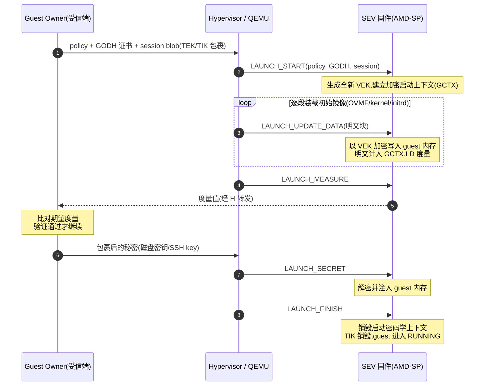

## 8. SME 与 SEV:第一代机密计算

第 2–7 章讨论的虚拟化机制本身有一个共同前提:hypervisor 仍是可信的管理者;从本章起,主角变为一个连 hypervisor 都不再信任的架构。

AMD 于 2016 年发布 SME(Secure Memory Encryption,安全内存加密)与 SEV(Secure Encrypted Virtualization,安全加密虚拟化)架构,白皮书作者为 David Kaplan、Jeremy Powell 与 Tom Woller;硬件实现迟至 2017 年随第一代 EPYC 7001 "Naples"(Zen 1)落地[^24^][^12^]。两者构成一个递进关系:SME 在内存控制器内联加密全部或部分系统内存,防御冷启动、DRAM 总线嗅探、NVDIMM 拔取等**物理攻击**;SEV 在 SME 的加密基座上把威胁模型扩展到**恶意或被攻破的 hypervisor**,使机密性不再依赖特权级隔离而改由密码学隔离(cryptographic isolation)承载,是"VM 无需信任 host"这一机密计算范式的第一代工业实现[^10^]。本章按"机制 → 密钥体系 → 软件接口 → 启动证明 → 局限"的顺序展开,其中 8.3 的攻击面分析直接构成第 9 章(SEV-ES)与第 10 章(SEV-SNP)的立项动机。

### 8.1 SME 内存加密

#### 8.1.1 内联 AES、C-bit、TSME 与 PSP 信任根

SME 的加解密发生在**片上(on-die)内存控制器内的专用高性能 AES 引擎**:数据写入 DRAM 时加密、读出时解密,因此 CPU 缓存内为明文、DRAM 颗粒与内存总线上为密文,攻击者无论是嗅探总线还是拔取 DIMM 都只得密文[^10^]。加密使用 128-bit 密钥与**基于物理地址的 tweak**(可调整分组加密),tweak 使同一明文页位于不同物理地址时产生不同密文,用以抵御密文块搬运(ciphertext block-move)攻击[^10^][^203^]。加密模式随代际升级:Milan(Zen 3)及以前为 AES-128-XEX,Genoa(Zen 4)起升级为 AES-256-XTS[^204^]。学术研究逆向表明,早期实现(Zen 1)使用 XE/XEX 模式且 tweak 为静态低熵值,后期版本改用随机化 tweak;**所有 SME/SEV 代际的加密模式均不提供完整性保护**——这一事实将在 8.3 节成为主线[^24^][^205^]。

密钥管理的信任根是 **AMD Secure Processor(AMD-SP,亦称 PSP,Platform Security Processor)**:一颗集成在 SoC 内的 32-bit ARM Cortex-A5 微控制器。SME 密钥在每次系统复位时由板载 NIST SP 800-90 兼容硬件随机数生成器重新产生,存于专用硬件寄存器,**对 CPU 上运行的任何软件(包括 ring 0 与 hypervisor)不可见**,SME 模式下密钥管理完全不需要 CPU 侧软件参与[^10^]。这意味着 SME 的信任边界从第一行代码起就不包含宿主操作系统。

页粒度的加密选择由页表项(PTE)中的 **C-bit(enCrypted bit)** 控制:Naples/Rome/Milan 上为物理地址 bit 47,Zen 4/Zen 5(Genoa 及以后)上移至 bit 51,对应 QEMU 参数 `cbitpos=51,reduced-phys-bits=1`[^10^][^206^][^207^]。C-bit 占用物理地址空间,造成物理地址位缩减(reduced-phys-bits),只影响系统物理地址,不影响 guest 物理地址[^208^]。两个工程细节值得开发者注意:其一,硬件**不维护同一物理页加密副本与非加密副本之间的一致性**,修改某页 C-bit 前必须先将该页刷出 CPU cache,否则将读到陈旧视图[^10^];其二,DMA 可以访问加密内存,但设备必须发出带 C-bit 的地址,不具备该能力的 32-bit legacy 设备由 IOMMU 将其地址重映射到带 C-bit 的形式[^10^]。

枚举与启用路径由内核文档固化:CPUID `0x8000001f[EAX]` bit 0 表示 SME 支持,`[EBX]` bits[5:0] 给出页表加密位编号、bits[11:6] 给出物理地址缩减位数;MSR `0xC0010010`(`MSR_AMD64_SYSCFG`)bit 23 为内存加密使能位,由 BIOS 设置,Linux 不会自行置位——BIOS 未开则 SME 不可用;内核经 `mem_encrypt=on` 激活,整体呈 Supported → Enabled → Active 三态[^208^]。SEV 侧的枚举共用同一 CPUID 叶:bit 1 表示 SEV 支持,`[ECX]` 给出同时支持的加密 guest 数(即可用加密 ASID 上限),VMCB offset `0x90` bit 1 为 SEV 使能位[^209^]。

**TSME(Transparent SME,透明内存加密)** 是固件/BIOS 级选项:无论各页 C-bit 取值如何,全部系统内存都被加密,OS 与 hypervisor 零参与,主要面向冷启动与物理攻击防护[^10^]。AMD 官方说明 TSME 使用单一密钥、由 AMD Secure Processor 在启动时生成[^12^]。TSME 的开关完全由 AGESA/固件控制——2026 年 AMD 曾通过 AGESA 1.2.7.0 在消费级非 PRO Ryzen 上屏蔽该选项,在社区反弹后宣布恢复,这一插曲佐证了 `tsme_status` 等固件标志决定 OS 可见性的实现结构[^210^]。

### 8.2 SEV 架构

#### 8.2.1 ASID↔VEK 密钥绑定、密钥层次与官方威胁模型

SEV 是 AMD-V 的扩展而非独立子系统:启用后,**硬件为 VM 的所有代码和数据打上 ASID(Address Space Identifier)标签**,该标签在 SoC 内部全程跟随数据,使同一片上缓存中的多 VM 数据互不混淆;数据离开 SoC 时由内存控制器 AES 引擎按该 ASID 对应的密钥加密,进入 SoC 时解密[^10^]。内存控制器维护**每 ASID 一个密钥槽**,hypervisor 在 VMCB 中设置 ASID 后执行 `VMRUN`,硬件保证该 guest 的全部内存访问携带该 ASID 直至内存控制器,据此选取 VEK(VM Encryption Key,虚拟机加密密钥)[^204^]。值得注意的是,hypervisor 控制 ASID 分配并不构成新的攻击面:若加载了错误密钥或用错 ASID,"该 guest 的第一次取指就会失败,因为内存被用错误密钥解密,得到的是垃圾数据"(白皮书原文),错误配置以立即崩溃的形式暴露而非静默泄露[^10^]。Guest 自身通过页表 C-bit 划分 private 页(guest 密钥加密)与 shared 页(与 hypervisor 通信,用 HV/SME 密钥),**指令页与页表页必须恒为 private**[^10^]。

密钥槽数量直接决定可同时运行的加密 guest 数,随代际快速扩展:

*图 8-1:可同时运行的加密 guest 数(= 内存控制器密钥槽数)按 EPYC 代际的演进。数据来源为 AMD 官方 SEV 开发者页代际能力表,数值为硬件密钥槽上限,纵轴取对数刻度[^12^]。*

三个代际间密钥槽从 15 增至 1006,增幅约 67 倍:Naples 的 15 个密钥使 SEV 只能承载小规模机密 VM 部署,这是第一代 SEV 云产品长期停留在"单实例级"形态的重要硬件约束;Rome 的 509 个使机架级密度首次可用,Genoa 的 1006 个则与该平台的核心数规模(最高 128 核/256 线程以上,官方表标注 512 线程)相匹配,密钥槽不再是容量规划的首要瓶颈[^12^]。同一张官方能力表还记录了加密强度的同步升级:AES-128-XEX(7001/7002/7003)→ AES-256-XTS(8004/9004 起)并支持 CXL 附加内存加密[^12^]。

SEV 的密钥体系分两层:**平台层**证明"这是真实 AMD 硬件、属于声明的所有者",**会话层**保护 guest owner 与固件之间的秘密传输,底层才是每 VM 的 VEK。55766 规范 §2.1 与学术梳理给出的完整层次如下[^211^][^212^][^213^]:

| 密钥 | 全称 / 类型 | 生成与持有 | 用途 | 生命周期 |
|---|---|---|---|---|
| ARK | AMD Root Key,自签根 | AMD 内部 CA | 证书链根,签发 ASK | 长期,按产品线区分 |
| ASK | AMD SEV Key | AMD,由 ARK 签发 | 签发每芯片 CEK | 长期;ARK/ASK 可从 AMD KDS 获取[^213^][^214^] |
| CEK | Chip Endorsement Key | 每芯片唯一,ARK→ASK→CEK 链背书 | 证明平台为真实 AMD SEV 硬件 | 与芯片同寿 |
| OCA | Owner Certificate Authority | 固件自生成自签,或由平台所有者外部生成 | 平台所有者信任根,背书 PEK | 所有者重置可更换 |
| PEK | Platform Endorsement Key | 平台级,由 CEK 与 OCA 共同背书 | 签名 PDH、绑定平台身份;签名运行期 ATTESTATION 报告 | 平台级长期 |
| PDH | Platform Diffie-Hellman Key | 固件生成,PEK 签名 | 与 guest owner 的 GODH 做 ECDH 协商 master secret | 平台级,可重新生成 |
| KEK / KIK | Key Encryption Key(AES-128)/ Key Integrity Key(HMAC-SHA-256) | 由 master secret 经 KDF 派生,固件与 owner 两端各自计算 | 包裹(wrap)TEK/TIK | 单次会话 |
| TEK / TIK | Transport Encryption Key(AES-128)/ Transport Integrity Key(HMAC-SHA-256) | 由 guest owner 选取,经 KEK/KIK 包裹后交付固件 | 保护启动/迁移中秘密数据的机密性与完整性;TIK 是度量值的签名密钥 | 单次 launch/send/receive 会话,`FINISH` 命令后销毁[^211^] |
| VEK | VM Encryption Key | 固件生成并装载到内存控制器密钥槽 | guest 内存的实际加密密钥 | 单个 guest 生命周期 |

*表 8-1:SEV 密钥层次(依据 AMD 55766 §2.1、证书链验证文档与形式化分析整理[^211^][^212^][^213^][^214^])。*

这张表揭示了三条设计原则。第一,**信任收敛于两点**:AMD 的 CA 链(ARK→ASK→CEK)证明硬件真实性,所有者的 OCA 链(OCA→PEK)证明平台归属,验证方向为 `ARK→ASK→CEK→PEK→PDH` 与 `OCA→PEK`,两条链在 PEK 交汇[^213^][^214^]。第二,**长期密钥与短期密钥严格分离**:VEK 永不离开硬件,会话密钥(TEK/TIK/KEK/KIK)按次生成、用完即毁,`LAUNCH_FINISH`/`SEND_FINISH`/`RECEIVE_FINISH` 任一被调用后 TIK 即销毁,把密钥暴露窗口压缩到单次操作[^211^]。第三,**hypervisor 全程只见密文与证书**:它经手 session blob 与迁移密文,但 master secret 由 ECDH 在固件与 owner 两端各自算出,传输密钥由 KEK/KIK 包裹,VEK 更是固件私有——这是"恶意 HV 拿不到密钥"这一核心承诺的协议实现[^211^][^215^]。

官方威胁模型的表述值得逐字对待:"SEV 技术围绕这样一种威胁模型构建:攻击者被假定不仅能在目标机器上执行用户级特权代码,还可能以更高特权的 hypervisor 级别执行恶意软件;攻击者还可能物理接触机器,包括 DRAM 芯片本身。"(白皮书原文)[^10^]同时白皮书明确排除:"SEV 不防护针对 guest 的拒绝服务攻击"[^10^]。这里有一个常被忽视的解读分层:虽然白皮书的攻击者模型写到了"恶意 hypervisor",但第一代 SEV 的实际设计仍把 hypervisor 当作"**可能脆弱但良性(vulnerable but benign)**"——它仍被信任去管理 NPT 映射与 guest 资源,加密只保证它"读不到明文",不保证它"换不掉密文";直到 SEV-SNP 才正式将 hypervisor 建模为恶意[^216^]。8.3 节的全部攻击都落在这一落差上。

#### 8.2.2 固件 API(55766)、/dev/sev 与 KVM 命令面

SEV 固件 API 的权威定义是 AMD Publication **#55766**《Secure Encrypted Virtualization API Version》(当前公开版 Rev 3.24,2020-04,对应 API v0.24;早期内核驱动引用 v0.14)[^211^][^217^]。规范章节结构为:§1 操作模型、§2 密钥管理、§3 Guest Policy、§4 Mailbox/Ring Buffer 命令协议、§5 平台管理 API、§6 Guest 管理 API、§7 调试 API,附录 A 给出使用流程、附录 B/C 定义证书格式[^211^]。全部命令按族归类如下:

| 命令族 | 主要命令 | 规范章节 | 功能定位 |
|---|---|---|---|
| 平台管理 | `INIT` / `INIT_EX` / `SHUTDOWN` / `PLATFORM_RESET` / `PLATFORM_STATUS` / `PEK_GEN` / `PEK_CSR` / `PEK_CERT_IMPORT` / `PDH_GEN` / `PDH_CERT_EXPORT` / `DOWNLOAD_FIRMWARE` / `GET_ID` / `NOP` / `RING_BUFFER` | §5[^211^] | 平台初始化、证书体系建立、固件更新、状态查询 |
| 启动(Launch) | `LAUNCH_START` / `LAUNCH_UPDATE_DATA` / `LAUNCH_UPDATE_VMSA` / `LAUNCH_MEASURE` / `LAUNCH_SECRET` / `LAUNCH_FINISH` | §6[^211^] | 加密启动上下文建立、镜像逐段加密并度量、秘密注入 |
| 运行期证明 | `ATTESTATION` | §6[^211^] | 返回 PEK 签名的报告(guest 初始状态 SHA-256 + MNONCE) |
| 迁移 | `SEND_START` / `SEND_UPDATE_DATA` / `SEND_UPDATE_VMSA` / `SEND_FINISH` / `SEND_CANCEL` / `RECEIVE_*` 对应四条 | §6[^211^] | 两端固件经 TEK/TIK 通道转移 guest(见 8.2.3) |
| 运行管理 | `GUEST_STATUS` / `ACTIVATE` / `ACTIVATE_EX` / `DEACTIVATE` / `DF_FLUSH` / `DECOMMISSION` / `COPY` / `SWAP_OUT` / `SWAP_IN` | §6[^211^] | ASID 绑定/解绑、数据缓存刷写、guest 注销与页拷贝/换出 |
| 调试 | `DBG_DECRYPT` / `DBG_ENCRYPT` | §7[^211^] | 仅当 guest policy 允许调试时可用 |

*表 8-2:SEV 固件 API 命令族(AMD 55766 Rev 3.24 §5–§7[^211^])。*

命令族的分层对应着清晰的权限语义:平台管理命令操作的是表 8-1 中的平台层密钥(PEK/PDH/证书),guest 管理命令操作会话层与 VEK,二者共用同一 mailbox 协议但状态机独立——guest 状态机为 `LAUNCHING / SECRET / RUNNING / RECEIVING / SENDING` 五态[^209^]。调试族是唯一可由 guest owner 主动关闭的攻击面收缩点:Guest Policy(4 字节位图,bit0 NODBG、bit1 NOKS、bit2 ES、bit3 NOSEND、bit4 DOMAIN、bit5 SEV)以明文传入固件,但被纳入启动度量,"任何对 policy 位的修改都会导致度量值不匹配",因此 policy 的完整性由度量链而非传输保密性保证[^206^]。

Linux 侧接口分两层。底层是 `drivers/crypto/ccp`(AMD Cryptographic Coprocessor 驱动)暴露的 **`/dev/sev`** 字符设备,用户态以 `struct sev_issue_cmd { __u32 cmd; __u64 data; __u32 error; }` 下发 ioctl,平台管理命令枚举为 `SEV_FACTORY_RESET / SEV_PLATFORM_STATUS / SEV_PEK_GEN / SEV_PEK_CSR / SEV_PDH_GEN / SEV_PDH_CERT_EXPORT / SEV_PEK_CERT_IMPORT / SEV_GET_ID2` 等,固件返回码含 `SEV_RET_BAD_MEASUREMENT / SEV_RET_INVALID_ASID / SEV_RET_WBINVD_REQUIRED / SEV_RET_DFFLUSH_REQUIRED`[^218^][^219^]。上层是 KVM 的 **`KVM_MEMORY_ENCRYPT_OP`**(VM fd 上的 ioctl,AMD SEV 与 Intel TDX 共用的平台内存加密命令入口),参数结构 `struct kvm_sev_cmd { __u32 id; __u64 data; __u32 error; __u32 sev_fd; }` 中的 `sev_fd` 指向已打开的 `/dev/sev`[^203^][^209^]。`enum sev_cmd_id` 与固件命令一一对应:`KVM_SEV_INIT / KVM_SEV_ES_INIT / KVM_SEV_LAUNCH_START / KVM_SEV_LAUNCH_UPDATE_DATA / KVM_SEV_LAUNCH_UPDATE_VMSA / KVM_SEV_LAUNCH_MEASURE / KVM_SEV_LAUNCH_SECRET / KVM_SEV_LAUNCH_FINISH / KVM_SEV_SEND_* / KVM_SEV_RECEIVE_*` 等[^220^][^209^]。配套 ioctl `KVM_MEMORY_ENCRYPT_REG_REGION / UNREG_REGION` 注册含加密数据的 guest 内存区;由于 SEV 密钥管理规范不提供密文页换出/迁移命令(地址相关 tweak 使密文不可整体搬移),**注册的内存区会被 pin 住**[^203^]。宿主机启用仅需 `kvm_amd.sev=1` 模块参数,dmesg 出现 `ccp …: sev enabled` 与 `amd_sev_fam17h_modelXXh.sbin` 固件加载日志即告就绪[^221^]。

启动度量链是第一代 SEV 最核心的协议流程,55766 附录 A 与 QEMU 文档给出的顺序如下:

*图 8-2:SEV 启动度量链(依据 AMD 55766 附录 A 与 QEMU 文档[^206^][^209^])。*

其中度量值的定义是 55766 §6.5.1:`HMAC(0x04 || API_MAJOR || API_MINOR || BUILD || GCTX.POLICY || GCTX.LD || MNONCE; GCTX.TIK)`,QEMU 侧 `GCTX.LD = SHA256(firmware_blob || kernel_hashes_blob || vmsas_blob)`[^206^]。度量以 **TIK** 为密钥的 HMAC 构成——TIK 只有固件与 guest owner 知晓,hypervisor 无法伪造度量值,这是整条链的密码学支点[^206^][^207^]。与度量对应的另一接口是运行期 `ATTESTATION` 命令:返回以 **PEK** 签名的报告(guest 初始状态 SHA-256 摘要与 MNONCE),用于证明 guest 启动在真实 AMD 平台上;两者的区别仅在签名密钥(TIK vs PEK)[^207^][^209^]。第一代 SEV(-ES) 的证明止步于此:不支持 guest 提供的 report data、不支持动态度量,运行期报告只能携带固定的启动摘要——这是它与第 10 章 SEV-SNP 远程证明之间的关键差距[^213^]。

#### 8.2.3 启动证明的密钥协商与 sevctl 工具链

把 8.2.2 的流程落到操作上,需要在 `LAUNCH_START` 之前完成一次跨信任域的密钥协商。步骤为:guest owner 先获取平台 PDH(`sevctl export --full host.pdh`),用证书链 `ARK→ASK→CEK→PEK→PDH` 与 `OCA→PEK` 验证平台真实性与归属(ARK/ASK 从 AMD KDS 获取)[^222^][^213^][^214^];owner 生成临时 DH 密钥对(GODH),与 PDH 经 ECDH 算出 master secret,再经 KDF 派生 KEK/KIK;owner 自选 TEK/TIK,用 KEK 加密、KIK 做 MAC,形成 session blob[^211^][^222^][^214^]。`sevctl session --name vm pdh.cert <policy>` 产出四个工件:`tik.bin` 与 `tek.bin` 留在 owner 受信端用于验证度量,`godh.b64` 与 `session.b64` 随 VM 配置交给 hypervisor[^222^][^223^]。

两条协议纪律决定该机制的实际安全性。其一,**认证比对必须在受信机器上完成**:"不可能在 hypervisor 本机安全地认证 guest,因为认证过程的目标恰恰是检测 hypervisor 是否恶意"(libvirt 文档)[^222^]。其二,**每次启动必须使用全新 session 数据**:"这些数据必须对每次 guest 启动尝试唯一,任何复用都会为 hypervisor 伪造度量打开攻击通道"[^222^]。会话机制还被迁移流程(SEND_*/RECEIVE_*)复用:源端固件用 VEK 解密 guest 页、用 TEK 加密、用 TIK 摘要,目的端固件用 TEK 解密后再用目的 guest 的 VEK 重新加密——hypervisor 全程只见 TEK 密文[^215^]。QEMU 侧的典型启动参数为 `-object sev-guest,id=sev0,cbitpos=47,reduced-phys-bits=1`(SEV-ES 加 `policy=0x5`;Genoa 上 `cbitpos=51`),libvirt 对应 `<launchSecurity type='sev'>` 元素,`kernelHashes='yes'` 可将 kernel/initrd/cmdline 的哈希纳入固件度量[^206^][^224^]。

### 8.3 时代局限

#### 8.3.1 无完整性的四类攻击面——SEV-ES/SNP 的立项动机

第一代 SEV 的结构性弱点可以归结为一句话:**加密只保证机密性,不提供完整性,而 hypervisor 完全控制 NPT(GPA→SPA 映射),可以操纵"guest 实际读到哪份密文"**[^204^][^216^]。学术综述将由此派生的攻击面清单化为四类[^204^]:

| 攻击类别 | 机制 | 代表研究与量化结果 | 后续修复 |
|---|---|---|---|
| Remapping(重映射) | 篡改 NPT 使 GPA 指向另一 SPA | SEVered(EuroSec 2018):借 guest 内网络服务回显明文,对 Apache/nginx 以 79.4 KB/s、OpenSSH 以 41.6 KB/s 提取,导出完整 2 GB 内存[^225^][^226^][^227^] | SEV-SNP RMP[^228^] |
| Replay(重放) | 用先前捕获的旧密文覆盖新密文 | Hetzelt & Buhren(VEE 2017):重放捕获页获取 SEV guest root;回滚攻击使口令可被无限次暴力尝试[^225^][^229^] | SEV-SNP RMP[^228^] |
| Aliasing(别名) | 多个 GPA 映射同一 SPA | 综述列为四类攻击面之一[^204^] | SEV-SNP RMP[^228^] |
| Corruption(破坏) | 写入随机密文造成受控数据损坏 | SEVurity(S&P 2020):逆向 tweak 函数构造加密预言机,注入任意代码[^205^][^204^] | SEV-SNP RMP[^228^] |
| 寄存器状态泄露 | VMCB save area 明文,VMEXIT 时 HV 可读全部 guest 寄存器 | Hetzelt & Buhren(2017)三类攻击之一[^225^] | SEV-ES VMSA 加密(2019,Rome)[^24^][^204^] |
| 度量置换不敏感 | `LAUNCH_UPDATE_DATA` 可按 16 字节块任意顺序装载而度量不变 | undeSErVed trust(WOOT 2021,CVE-2021-26311):重排执行流做 ROP,窃取 LAUNCH_SECRET 秘密,远程证明仍通过[^230^] | 无固件修复,AMD-SB-1004 要求迁移 SEV-SNP[^230^] |
| 密钥/tweak 层弱点 | Zen 1 tweak 低熵可构造加密预言机;密文侧信道 | Zen 2 起随机化 tweak;CIPHERLEAKs(CVE-2020-12966)字典攻击影响全代际[^205^][^231^] | 部分修复,密文侧信道家族延续至 SNP 时代 |
| DoS / 页故障受控通道 | 设计范围外 | 白皮书明确不防 DoS;SNP 白皮书同样声明页故障受控通道超范围[^10^][^232^] | 不予修复(威胁模型排除) |

*表 8-3:第一代 SEV 攻击面速查(综合学术综述与各攻击论文[^204^][^225^][^230^][^205^];修复状态见 8.3.1 末段)。*

这张表应按"防御承诺的逐层落空"来读。SEVered 证明的是**机密性承诺在工程上的落空**:它不破解任何密码学,只用页级侧信道定位存放 HTTP 响应数据的加密页,再改 NPT 把这些 GPA 重映射到存放敏感数据的物理页,借 guest 内网络服务把明文"送回"攻击者——SEV 加密了内存,却防不住"谁来解释这份密文"[^225^]。undeSErVed trust 证明的是**证明承诺的落空**:启动度量对块序不敏感(permutation-agnostic),攻击者重排装载顺序注入代码后,远程证明依然通过——度量在数学上成立,在语义上无效[^230^]。寄存器泄露则证明**隔离粒度的落空**:SEV 保护了内存却留下明文 VMCB,VMEXIT 瞬间全部 guest 寄存器对 hypervisor 可见,这正是 SEV-ES(Encrypted State,2019 年随 Rome 落地,VMSA 加密 + VMRUN 完整性校验)的直接立项动机[^24^][^204^]。AMD 官方对这些架构级缺陷的响应方式本身也构成重要事实:针对 SEVerity 与 undeSErVed trust(AMD-SB-1004,2021-05),AMD 明确表示不发布固件修复,缓解措施就是迁移到 SEV-SNP(仅 Milan 起支持),Naples/Rome 被战略性地留在修复范围之外[^233^]。

由此,第一代 SEV 的历史定位是清晰的:它把"恶意 hypervisor"写进了威胁模型,却只兑现了其中的机密性一半——防"读"不防"写、换、重放"。这一缺口的对症修复分两步走:第 9 章的 SEV-ES 以 VMSA 加密封死寄存器泄露;第 10 章的 SEV-SNP 以 RMP(Reverse Map Table)记录每物理页的所有者与 GPA 绑定,阻断未授权的重映射、重放与别名,并把 hypervisor 正式移出 TCB[^216^][^228^]。
