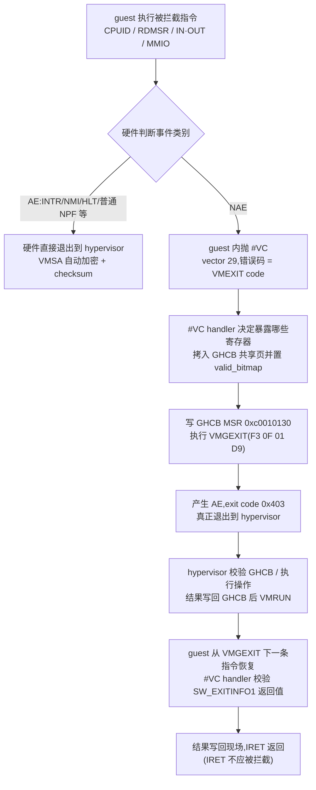

## 9. SEV-ES 与 GHCB 协议

第 8 章已指出初代 SEV 的结构性短板:内存虽加密,但每次 #VMEXIT 时 hypervisor 仍可从 VMCB 保存域读到 guest 全部通用寄存器,寄存器明文由此成为确定性泄露通道(8.3 节)。SEV-ES(Secure Encrypted Virtualization – Encrypted State)的设计目标就是把 vCPU 寄存器状态也纳入加密与完整性保护:每次 world switch 时,guest 的完整寄存器状态由硬件用 guest 密钥加密保存进独立的保存页,VMM 既读不到也改不了[^204^][^12^]。该特性由 AMD 于 2017 年 12 月公布(Thomas Lendacky 在 Linux Foundation 活动的演讲),2019 年随第二代 EPYC(Rome,Zen 2)落地,CPUID `0x8000_001F:EAX[3]` 指示支持[^234^][^24^]。软件侧的落地时间线为:Linux guest 侧支持合并于 5.10(Jörg Rödel 的 70 补丁系列),KVM host 侧(Tom Lendacky 的 34 补丁系列)合并于 5.11,OVMF 则通过 `OvmfPkg/VmgExitLib` 提供固件期支持[^235^][^236^][^237^][^238^]。

寄存器状态对 hypervisor 不可见之后,传统"拦截—读寄存器—模拟—写回"的虚拟化路径整体失效。本章分析 SEV-ES 的两层机制:9.1 节讨论寄存器状态本身的加密与校验(VMCB 分裂与 VMSA),9.2 节讨论为替代寄存器直读而引入的 #VC/VMGEXIT/GHCB 三段式通信协议,以及它对 hypervisor 行为模型的颠覆。

### 9.1 加密寄存器状态

#### 9.1.1 VMCB 分裂:明文 VMCA 与加密 VMSA

传统 SVM 中 VMCB 是单一 4 KB 页,控制信息与 guest 寄存器状态混存,#VMEXIT 时 hypervisor 可读全部寄存器(见第 3 章 VMCB 布局)。SEV-ES 将 VMCB 分裂为两部分[^234^][^239^]:

- **控制域(VMCA,control area)保持明文**:拦截位、中断注入(event_inj)、ASID、GHCB GPA 等 hypervisor 管理 VM 必需的信息仍可见;
- **保存域(VMSA,Virtual Machine Save Area)独立成页并被加密**:VMCB 偏移 `0x108` 处存放指向 VMSA 页的物理地址指针,硬件用 guest 加密密钥对 VMSA 加密。VMSA 保存段寄存器、控制寄存器、调试寄存器、系统寄存器、GPR、FPU/SSE/MMX 等全部 vCPU 状态[^240^][^241^]。

完整性保护依赖每次 world switch 重算的校验值。每次 #VMEXIT(自动退出)时硬件自动完成:保存额外状态与 GPR/FPU、对寄存器状态计算 checksum 并存放在 CPU 上软件不可访问的隔离存储中;每次 VMRUN 时先解密 VMSA、校验 checksum,通过后才恢复状态[^240^][^242^]。对该值的任何修改都会导致 VMRUN 失败——KVM 补丁文档给出的具体行为是"以 SHUTDOWN 退出码失败"(failing with a SHUTDOWN exit code)[^243^][^241^]。开启 SEV-ES 需置 VMCB 偏移 `0x90` 的 bit 2,且必须同时开启 SEV(bit 1)与 LBR 虚拟化[^240^]。

world switch 语义随之改变:VMRUN/VMEXIT 现在交换全部寄存器状态而非 VMCB 保存域子集;exit 时硬件保存 guest 全状态并从 host save area 恢复 host 状态,hypervisor 不再自行保存/恢复 guest FPU。VMSA 一旦加密,hypervisor 不得再触碰,KVM 侧改用 accessor 函数按执行阶段在 VMSA 与 GHCB(见 9.2 节)之间切换访问[^243^][^239^]。

初始状态纳入信任链度量:guest 各 vCPU 的寄存器初态由 hypervisor 构建,经 `LAUNCH_UPDATE_VMSA` 命令由 AMD-SP 加密,并计入 SEV 启动度量 `SHA256(firmware_blob || kernel_hashes_blob || vmsas_blob)`,每个 VMSA 长 4096 字节,布局即 Linux 内核的 `struct vmcb_save_area`(APM Vol.2 Table B-2)[^206^]。

需要指出的残余弱点是:加密不等于不可观测。VMSA 密文本身仍可被 hypervisor 读取,而 SEV 内存加密采用确定性的 AES-XEX 模式(同一物理地址同一明文恒产生同一密文),CipherLeaks(CVE-2020-12966,USENIX Security 2021)正是通过监控 #VMEXIT 时 VMSA 页密文的变化推断寄存器值,以 100% 准确率攻破 OpenSSL 常数时间 RSA 与 ECDSA;AMD 的回应是在 SEV-SNP 代引入 VMSA 寄存器保护硬件补丁(AMD-SB-1013,2021-08)[^231^][^244^]。即 VMSA 解决了"直读直改",但"密文可观测性"作为侧信道遗留到了更晚的硬件代际。

### 9.2 #VC/VMGEXIT/GHCB 三段式

#### 9.2.1 NAE 事件抛 #VC;VMGEXIT 显式退出

SEV-ES 开启后,VMEXIT 被分为两类(APM Vol.2 §15.35.4 / GHCB 规范 §3):**Automatic Exits(AE)** 是异步发生或不需要暴露寄存器状态的事件,硬件直接退出到 hypervisor,VMSA 自动加密;**Non-Automatic Exits(NAE)** 是其余一切需要 guest 寄存器参与模拟的事件,硬件不直接退出,而是在 guest 内抛出 #VC(VMM Communication Exception,vector 29,不可屏蔽,错误码等于该事件的 VMEXIT code)[^75^][^75^][^245^]。

**表 9-1 SEV-ES 下的退出分类(AE 清单与典型 NAE 事件)**[^75^][^246^]

| 类别 | 退出码 | 事件 | 处理路径 |
|---|---|---|---|
| AE | `0x52` | VMEXIT_MC(#MC) | 硬件直接退出,VMSA 加密 |
| AE | `0x60`/`0x61`/`0x63`/`0x64` | INTR/NMI/INIT/VINTR | 异步事件,无需寄存器状态 |
| AE | `0x77`/`0x78`/`0x7F` | PAUSE/HLT/SHUTDOWN | 直接退出 |
| AE | `0x8F` | EFER_WRITE_TRAP | 写后陷阱(替代普通拦截) |
| AE | `0x90`–`0x9F` | CR[0-15]_WRITE_TRAP | 写后陷阱(替代普通拦截) |
| AE | `0x400` | #NPF(仅当 PFCODE[3]==0) | 普通缺页,直接退出 |
| AE | `0x403` | VMGEXIT | guest 主动退出(见下文) |
| AE | `-1`/`-2` | INVALID/BUSY | 协议保留 |
| NAE | `0x72` | CPUID | guest 内抛 #VC |
| NAE | `0x7B`/`0x7C` | IOIO_PROT/MSR_PROT | #VC,需模拟 |
| NAE | `0x6E`/`0x6F` | RDTSC/RDPMC | #VC,需返回寄存器值 |
| NAE | `0x27`/`0x37` | DR7 读/写 | #VC(无 DebugVirtualization 时) |
| NAE | `0x400` | #NPF(PFCODE[3]==1,即 MMIO) | #VC,guest 自解码指令 |
| NAE | `0x41` | #DB(NMI 完成场景) | #VC,见 9.2.3 NMI 路径 |

该表揭示 SEV-ES 拦截模型的设计取舍:凡是不需要"读 guest 寄存器才能处理"的事件全部归入 AE,保持传统直通路径;凡是传统上依赖寄存器读取的模拟类事件(CPUID、IO、MSR、MMIO)一律降级为 guest 内异常。值得注意的异常值是 `0x400`(#NPF)横跨两类——hypervisor 在嵌套页表项给 MMIO 范围设置保留位(bits 51:n),使 MMIO 访问产生 PFCODE[3]==1 的 #NPF,从而落入 NAE 并转 #VC;普通缺页(PFCODE[3]==0)仍是 AE。write-trap 系列(`0x8F`/`0x90–0x9F`)则是为替代"拦截 CR/EFER 写后读寄存器"而新设的 AE 类型,因为拦截模式下 hypervisor 已读不到寄存器新值[^75^][^243^]。

#VC 之后的标准通信流程由三段构成:#VC(guest 内)→ GHCB(共享页)→ VMGEXIT(显式退出)。

**图 9-1 #VC→GHCB→VMGEXIT 三段式通信流程(GHCB 规范 56421 §3.2)**[^75^]

VMGEXIT 与 VMMCALL 操作码相同(`0F 01 D9`)但带 REP 前缀(`F3/F2 0F 01 D9`),执行后产生 AE(exit code `0x403`,Linux 中定义为 `SVM_EXIT_VMGEXIT`),不会再触发 #VC——它是 guest 主动、显式的世界切换点[^240^][^44^][^76^]。规范特别指出 #VC handler 以 IRET 返回,因此 IRET 不应被拦截(NMI 场景的处理见 9.2.3)[^75^]。

承担数据交换的 GHCB(Guest-Hypervisor Communication Block)是一个 4 KB(4,096 字节)单页,guest 必须把它映射为 decrypted/shared(C-bit=0),使双方均可读写[^75^]。其布局刻意镜像 SEV-ES VMCB 保存域(至偏移 `0x3ff`),让 hypervisor 可以把既有 VMCB save area 处理逻辑直接映射过来;但只提供处理 VMGEXIT 所需的最小字段——`sw_exit_code`(0x390)、`sw_exit_info_1/2`、`sw_scratch`、`valid_bitmap`、偏移 `0x800` 起的共享缓冲区、`protocol_version` 与 `ghcb_usage`——以实践 selective exposure:guest 每次只暴露处理当前事件所必需的寄存器,而非全部状态[^75^][^247^]。

#### 9.2.2 GHCB 页内协议与 MSR 协议

GHCB 协议的标准文本是 AMD Publication #56421《SEV-ES Guest-Hypervisor Communication Block Standardization》,当前 Rev. 2.04(2025 年 1 月);Version 1 对应 SEV-ES,Version 2 对应 SEV-SNP(新增 GPA 注册、Page State Change、受限中断注入等)[^75^][^75^]。协议实际有两层编码:GHCB 页内协议与 MSR 协议。

**最小暴露的页内协议。** `valid_bitmap`(16 字节)按"字段偏移/8 = qword 序号"编码每个字段是否有效:guest 在每次 NAE 事件前清零再为要提供的字段置位,hypervisor 返回前同样清零再置结果位。至少 guest 必须置 SW_EXITCODE/INFO1/INFO2 三位,hypervisor 返回时必须置 SW_EXITINFO1/INFO2 两位[^75^]。`SW_EXITCODE` 一般情况下直接映射到 SVM 拦截退出码(CPUID=`0x72`、IOIO=`0x7B`、MSR=`0x7C` 等,#VC 错误码即同一 code),无法用拦截码表达的事件则使用软件自定义编码[^75^][^76^]。

**表 9-2 软件自定义 SW_EXITCODE 编码(0x8000_00xx 段)**[^76^][^75^][^248^]

| SW_EXITCODE | 事件 | SW_EXITINFO 语义 |
|---|---|---|
| `0x80000001` | MMIO_READ | INFO1=MMIO 源 GPA,INFO2=字节数,SW_SCRATCH=解密缓冲区 GPA |
| `0x80000002` | MMIO_WRITE | INFO1=目的 GPA,数据经共享缓冲区 |
| `0x80000003` | NMI_COMPLETE | 告知 hypervisor 可注入下一个 NMI |
| `0x80000004` | AP_HLT_LOOP | AP 进入 HLT 等待启动 |
| `0x80000005` | AP_JUMP_TABLE | INFO1:0=set/1=get;地址经 INFO2 |
| `0x80000010` | PSC(Page State Change) | SNP 私有/共享页转换(Rev 2.03 后 ES 亦可用) |
| `0x80000011`–`0x80000013` | GUEST_REQUEST / EXT_GUEST_REQUEST / AP_CREATION | SNP 证明请求与 guest 内 AP 创建 |
| `0x8000fffd` | HV_FEATURES | hypervisor 特性位图协商 |
| `0x8000fffe` | TERM_REQUEST | guest 请求终止 |
| `0x8000ffff` | UNSUPPORTED_EVENT | 不支持的事件 |

MMIO 与 string IO 是该编码段存在的根本原因:hypervisor 读不到 guest 内存中的指令字节,无法自行解码触发指令,只能由 guest 侧解码后把操作语义(地址、方向、长度)显式编码进 GHCB,数据经 SW_SCRATCH 指向的共享缓冲区中转,大数据量可分多次 VMGEXIT[^75^]。返回值语义由规范 §4.1.1 定义:SW_EXITINFO1[31:0]=0 表示成功;1 表示 hypervisor 要求注入异常(以 SW_EXITINFO2 为 error code,Linux 侧校验只允许 #GP/#UD);2(Rev 2.01 新增)表示 malformed input,附带 `GHCB_ERR_NOT_REGISTERED(1)` 至 `GHCB_ERR_INVALID_EVENT(6)` 六个子错误码,规范明确要求"properly hardened guests should interpret any unexpected error code as a fatal error"[^75^][^249^][^75^]。

**MSR 协议(0xc0010130)。** GHCB 的 GPA 由 guest 写入 GHCB MSR `0xc001_0130`,该值由硬件在 VMRUN/VMEXIT 时经 VMCB 偏移 `0x0A0` 保存/恢复;hypervisor 不得拦截对该 MSR 的访问,从 host 态访问会 #GP[^75^][^240^]。由于 GHCB 地址须 4K 对齐,其低 12 位被复用为功能码,构成在 GHCB 页尚不能以明文写入的早期启动阶段使用的请求/响应通道。

**表 9-3 GHCB MSR 协议功能码(MSR 0xc0010130 低 12 位)**[^75^][^250^]

| GHCBInfo | 方向 | 功能 |
|---|---|---|
| `0x000` | guest→HV | 通告 GHCB GPA(页对齐) |
| `0x001`/`0x002` | HV/guest | SEV Information 响应/请求:Data[63:48]=最大协议版本,[47:32]=最小版本,[31:24]=C-bit 位置 |
| `0x004`/`0x005` | guest/HV | CPUID 请求/响应:Data[63:32]=leaf,[31:30]=寄存器编号,一次返回一个寄存器 |
| `0x006`/`0x007` | guest/HV | AP Reset Hold 请求/响应 |
| `0x010`/`0x011` | guest/HV | Preferred GHCB GPA 请求/响应 |
| `0x012`/`0x013` | guest/HV | Register GHCB GPA(SNP 必需;不匹配则 hypervisor 须终止 guest) |
| `0x014`/`0x015` | guest/HV | Page State Change(Private/Shared) |
| `0x016`/`0x017` | guest/HV | SNP Run VMPL |
| `0x018`/`0x019` | guest/HV | Unregister GHCB GPA(Rev 2.04 新增) |
| `0x080`/`0x081` | guest/HV | Hypervisor Feature 位图请求/响应 |
| `0x100` | guest→HV | Termination Request:Data[15:12]=reason set,[23:16]=reason |

MSR 协议中最能体现设计约束的是 `0x001` SEV Information:guest 正常经 CPUID `0x8000_001F` 获取 C-bit 位置,但 CPUID 本身是 NAE 会触发 #VC,而没有 C-bit 就无法把 GHCB 页标为 shared——鸡生蛋问题。因此规范要求 hypervisor 在 vCPU 首次启动前把版本范围与 C-bit 位置写入 VMCB 偏移 `0x0A0`(例:仅支持 v1、C-bit=47 时写 `0x0001_0001_2f00_0001`;支持到 v2、C-bit=51 时写 `0x0002_0001_3300_0001`)[^75^][^234^]。Linux 早期启动路径正是用 `0x004`/`0x005` 逐寄存器取 CPUID 值,直到能建立 per-CPU GHCB 页[^249^]。SNP 引入的 `0x012` GPA 注册则把 GHCB 页身份纳入硬件记账,是第 10 章 RMP 体系的协议入口。

**Linux guest 侧实现。**上述协议在 Linux 中的载体是合并于 5.10 的多级 #VC handler[^235^][^236^]:boot/compressed 阶段先用 boot_ghcb 与 MSR 协议(逐寄存器取 CPUID)支撑解压期,运行时切换到 per-CPU GHCB;现代内核已重构至 `arch/x86/coco/sev/`,GHCB 的获取/释放经 `__sev_get_ghcb`/`__sev_put_ghcb`,#VC 入口为 `kernel_exc_vmm_communication`/`user_exc_vmm_communication`[^251^]。核心调用原语 `sev_es_ghcb_hv_call()` 填入 protocol_version/ghcb_usage 与 SW_EXITCODE/INFO 后写 GHCB MSR、执行 VMGEXIT,返回后由 `verify_exception_info()` 校验 hypervisor 请求注入的异常——只允许 #GP/#UD,否则视为 VMM 错误[^249^][^246^]。运行时特性检测经 `cc_platform_has(CC_ATTR_GUEST_STATE_ENCRYPT)`(检查 `MSR_AMD64_SEV_STATUS` 的 SEV-ES 位)完成[^252^];FRED 入口架构下,早期 #VC 仍须使用 boot_ghcb 直到 per-CPU GHCB 初始化完成[^251^]。

#### 9.2.3 对 hypervisor 的颠覆

Lendacky 的 host 侧 34 补丁系列(5.11)的标题清单本身就是"哪些传统能力失效"的精确枚举[^237^][^243^]:

- **同步路径重构**:VMGEXIT 时 KVM 经 `sev_es_sync_from_ghcb()` 把 GHCB 中的有效寄存器拷进 vCPU 寄存器数组与 VMCB 控制域的 exit_code/exit_info 字段,然后复用既有 SVM 拦截 handler(`svm_invoke_exit_handler()`),返回前把脏寄存器写回 GHCB。补丁说明原话:"Much of the existing SVM intercept support can be re-used by setting the exit code information from the VMGEXIT and calling the appropriate intercept handlers."[^253^][^243^]
- **禁止指令模拟与调试**:hypervisor 无法读 guest 内存中的指令字节,也无法单步/断点;MMIO 解码责任转移到 guest 侧(Linux 复用并扩展了 UMIP 的 insn 解码器)[^243^][^75^]。
- **拦截模型改变**:CR0/CR4/CR8/EFER 写改用 write-trap(AE `0x8F`/`0x90–0x9F`),因为拦截路径已读不到寄存器新值[^243^][^75^]。
- **SMM 与嵌套虚拟化不支持**:规范 §4.6/§4.7 明确排除;QEMU 文档另记录 SEV-ES 不支持 reboot、需 in-kernel irqchip 的限制[^75^][^206^]。shutdown 后 vCPU 不能直接 reset(VMCB 不可重置)[^243^]。
- **FPU 与 AP 启动路径重写**:guest FPU 保存/恢复由硬件全包;初始 VMSA 经 `LAUNCH_UPDATE_VMSA` 加密后不可修改;AP 启动用 AP jump table / AP Reset Hold(SW_EXITCODE `0x80000004`/`0x80000005` 与 MSR `0x006`)替代 INIT-SIPI 后直接读状态[^243^][^206^]。
- **NMI 处理重写**:NMI 是 AE,但 hypervisor 无法读 guest RIP/RFLAGS 判断能否安全注入下一个 NMI(传统上靠拦截 IRET)。规范 §4.4 要求:注入 NMI 时不得拦截 IRET,但必须拦截 #DB;guest 在 IRET 前把栈上 flags 的 TF 置位,IRET 后立即触发 #DB(NAE,错误码 `0x41`)→ #VC → 以 NMI Complete 消息(`0x80000003`)告知可再注入[^75^]。

信任边界反转同时制造了新攻击面,且两个方向都已具名。host 侧:**CVE-2023-4155**——GHCB 页是 guest 可写的共享内存,多 vCPU guest 可在 hypervisor 两次读取之间篡改字段(double fetch),绕过 `sev_es_validate_vmgexit()` 校验并递归调用 VMGEXIT handler 造成栈溢出;Paolo Bonzini 的修复是只从同步后的位置取一次 GHCB 数据[^254^]。guest 侧:**WeSee(CVE-2024-25742,IEEE S&P 2024)**——hypervisor 可在任意时刻向 guest 注入 vector 29,而 Linux 的 #VC handler 不校验异常是否由真实指令触发,攻击者由此获得跳过指令、泄露/篡改寄存器、任意内存读写四个原语,演示以 2891 次 #VC 注入获得内核 root shell 并泄露 NGINX 的 kTLS 密钥;修复为 Linux 内核补丁,根治手段是 SNP 的 Restricted/Alternate Injection 模式[^245^][^245^]。这两个漏洞分别对应 GHCB 双向共享属性的两侧:共享页的内容不可信(host 须单次读取),共享页所承载的事件语义同样不可信(guest 须验证 #VC 真实性)——这也解释了规范为何持续强化 guest 侧校验义务(malformed-input 错误码、"unexpected error as fatal"条款)[^75^]。此外,针对 hypervisor 谎报 SEV 位/C-bit 位置或把加密页映为 MMIO 经 #VC 泄密的攻击(arXiv:2010.07094),Linux 在 boot/compressed 阶段加入了 CPUID sanity check 并禁止对加密内存做 MMIO[^255^]。
