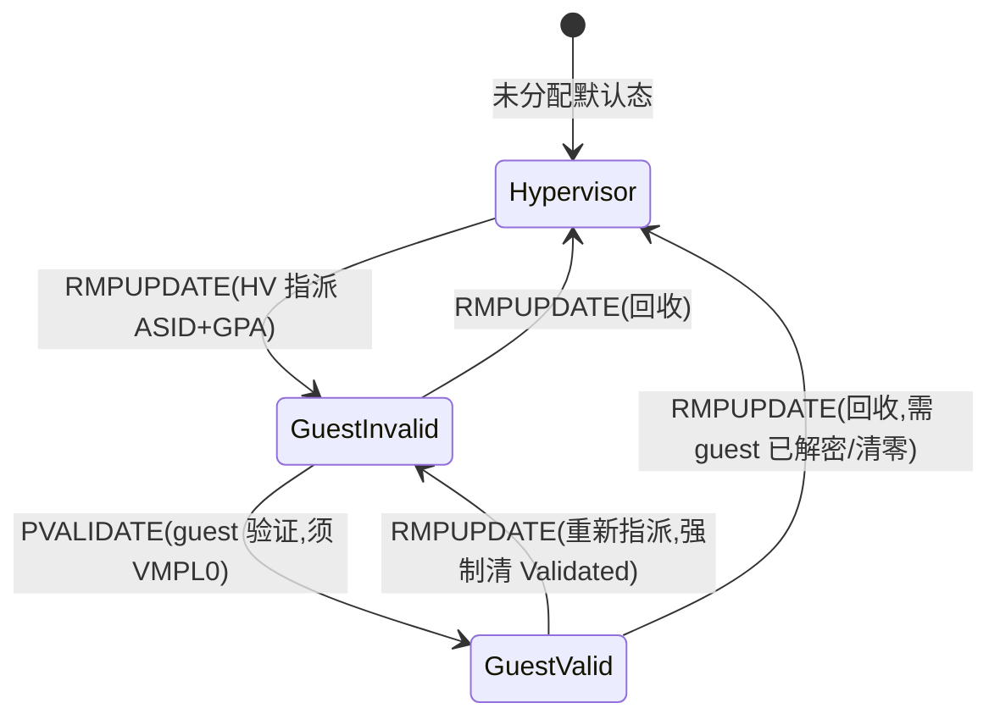
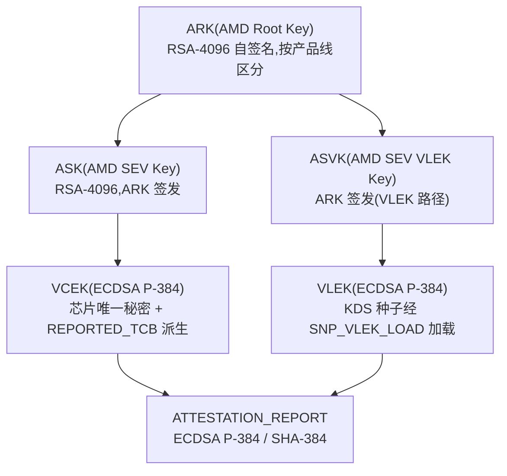

## 10. SEV-SNP 与远程证明体系

SEV-SNP(Secure Encrypted Virtualization – Secure Nested Paging)是 AMD SEV 家族的第三代机制:SEV(2017,EPYC 7001 Naples)解决内存机密性,SEV-ES(2019,EPYC 7002 Rome)增加寄存器状态加密,SEV-SNP 则在二者之上引入**硬件强制的内存完整性保护**,AMD 于 2020 年 1 月发布白皮书《AMD SEV-SNP: Strengthening VM Isolation with Integrity Protection and More》,硬件于 2021 年 3 月随 EPYC 7003 "Milan"(Zen 3)落地,Linux guest 侧支持于 5.19 内核(2022 年 7 月)合入主线[^25^][^256^][^257^]。其威胁模型将 hypervisor 正式建模为敌手,承诺为:guest 读取私有页时,"要么读到该 guest 最后写入的值,要么收到异常——绝不会读到陈旧数据、被篡改的数据或其他页的数据";可用性(DoS)、侧信道、软件缺陷与侵入式物理攻击被明确排除在保护范围之外[^204^]。从演进动力学看,SEV→SEV-ES→SEV-SNP 的每一代恰好封死上一代被实证攻破的隐式信任(页表/重放类攻击由 RMP 终结),而攻击面随即迁往 RMP 覆盖不到的微架构与物理层——本章 10.1 结尾将据此预告第 11 章的残余攻击面分析。

### 10.1 内存完整性

#### 10.1.1 RMP 与四条页验证指令

SNP 完整性的机制核心是 **RMP(Reverse Map Table,反向映射表)**:一个驻留 DRAM、全系统唯一、以系统物理地址(SPA)索引的数据结构,**每 4KB 可分配物理页对应一个 16 字节条目**[^258^][^259^]。Lenovo 技术文档对其职能的表述为:"RMP 是一个追踪每页内存所有权的庞大内存数据结构,每个 4KB 页关联一个 16 字节 RMP 条目,其中包含该系统物理页的安全属性,并指定允许写入该页的实体"[^260^]。条目记录页所有者 ASID、对应的 guest 物理地址(GPA)、Validated 标志、每 VMPL 的权限位(读/写/执行 × user/supervisor)、页大小(4K/2M)与 Immutable/VMSA 等属性[^204^][^240^]。RMP 的位置由 `RMP_BASE`(MSR `0xC0010132`)与 `RMP_END`(MSR `0xC0010133`)定义,需全核一致设置;硬件要求 8KB 对齐,SEV 固件将要求提高到 1MB;RMP 起始处为 16KB 的处理器簿记区,其后才是条目数组;Linux 仅在 RMP 覆盖全部系统内存时才启用 SEV-SNP[^258^]。RMP 由 AMD-SP(PSP)在 SNP 初始化阶段建立,条目**不能被软件直接读写**,只能经由专用 x86 指令操纵[^259^][^261^]。检查时机嵌在地址翻译路径内:CPU 页表遍历器与 IOMMU table-walker 均执行 RMP 检查——每次 nPT walk 命中 SNP 页后,硬件比对 RMP 条目中的 ASID/GPA 与实际翻译结果,不匹配即产生嵌套页故障("RMP violations result in either #PF or VMEXIT(NPF)")[^259^]。单一 RMP 同时约束 CPU 与 IOMMU 两条 walker,是 AMD 侧页表格式统一(NPT 与 IOMMU I/O 页表均兼容 AMD64 长模式)带来的安全红利,但同时也意味着格式级缺陷(如物理地址别名)会同时击穿两侧。

RMP 条目存在三个软件可见的可变状态(另有固件专用的 Immutable 态)[^204^][^259^]:



Hypervisor 态下页归管理程序所有、可读写,但不能作为 C=1 的 guest 私有页使用;Guest-Invalid 是 RMPUPDATE 指派后的过渡态,guest 尚不可访问,hypervisor 只读(且只见密文);Guest-Valid 经 guest 自身 PVALIDATE 后生效,此后该页才能以 C=1 正常读写[^204^][^259^]。状态机的关键设计在于:**任何归属变更都必须经过 guest 的显式再确认**,这使 hypervisor 无法在 guest 无感知的情况下完成页重映射。

对 RMP 条目的全部合法修改收敛于四条新指令,其语义与约束如下:

| 指令 | 执行主体 | 语义 | 关键约束 |
|---|---|---|---|
| `RMPUPDATE` | hypervisor | 写入新 RMP 条目:设置 ASID/GPA/Assigned/Page_Size/Immutable | **无条件清零 Validated 位**;不可修改 Immutable 页;检测到 4K/2M 条目重叠返回 `FAIL_OVERLAP`(值 4) |
| `PSMASH` | hypervisor | 将 2MB RMP 条目拆分为 512 个连续 4KB 条目 | **保留 Validated 位**,不使原条目失效;指令编码 `F3 0F 01 FF` |
| `PVALIDATE` | guest(**仅 VMPL0**) | 验证或去验证当前 guest 拥有的页 | 硬件校验 RMP 条目 ASID/GPA 与目标一致;Validated=1 后页才能作为私有页使用 |
| `RMPADJUST` | guest(任意 VMPL) | 修改本 guest 页对**更低特权(数值更大)VMPL** 的权限掩码 | 只能削减低 VMPL 权限,不能提升自身权限;置 VMSA 属性位(bit 16)仅限 VMPL0 |

*表 10-1:RMP 四指令语义(依据 AMD SEV-SNP 白皮书、LSS-NA 2021 开发更新与 LKML 指令补丁整理[^204^][^259^][^262^][^218^][^263^][^264^])。*

这张表体现了 SNP 的权限划分哲学:**结构性操作(指派、拆分)留给 hypervisor,确认性操作(验证)与页内权限微调留给 guest**。`RMPUPDATE` 总是清 Validated 位的硬件规则是整个完整性论证的支点——它防止 hypervisor 在 guest 验证某页之后将该页(连同 Validated=1 的状态)重新指派到另一 GPA,任何指派变更都强制 guest 重新验证,从而使重映射攻击必然被察觉[^204^]。对偶地,guest 不得对同一 GPA 验证两次:重复 PVALIDATE 会破坏完整性保证,guest 的正确响应是终止自身而非重新验证[^204^]。`PSMASH` 保留 Validated 位则服务于性能:hypervisor 以 2M 粒度分配大页后,guest 以 4K 粒度使用,拆分不触发重新验证风暴。Linux host 侧实现为 `rmp_make_private()`(assigned=1 + ASID + GPA)、`rmp_make_shared()`(清零回 HV 态)与 `psmash()` 三个 helper,RMPUPDATE 失败时以 `FAIL_OVERLAP` 重试[^218^];guest 侧请求 hypervisor 变更页共享/私有状态时,使用第 9 章所述 GHCB 的 Page State Change Request NAE 事件,另有 PSMASH/UNSMASH hint(操作码 0x0003/0x0004)供 guest 提示 hypervisor 合并或拆分 2M 页[^257^][^265^]。

当访问违反 RMP 约束时,SEV-SNP 扩展了嵌套页故障(#NPF)的错误码字段(EXITINFO1),使 hypervisor 能区分故障成因:

| 位 | 名称 | 含义 |
|---|---|---|
| bit 31 | RMP | 故障由 RMP 检查引起 |
| bit 33 | ENC | guest C-bit = 1(本次访问为加密访问) |
| bit 34 | SIZEM | PVALIDATE/RMPADJUST 的页大小不匹配 |
| bit 35 | VMPL | VMPL 权限检查失败 |

*表 10-2:SEV-SNP 对 #NPF EXITINFO1 的扩展位(AMD LSS-NA 2021 开发更新[^259^])。*

bit 31(RMP)是分发枢纽:hypervisor 的 #NPF handler 首先据此区分"普通缺页/换页"与"RMP 违规";bit 33(ENC)与 RMP 条目中的归属信息组合,构成页状态转换的判定依据——典型策略是:guest 以 C=1 写入一个归属 hypervisor 的页时,hypervisor 执行 RMPUPDATE 将其转为私有;以 C=0 写入归属 guest 的页时,则转为共享[^259^]。bit 35 将 VMPL 权限违例也纳入 #NPF 框架,使 guest 内部的特权分层错误复用同一条故障路径,hypervisor 无需新增退出码即可观测。需要注意,hypervisor 在这些故障处理路径中始终是"不可信但必要"的角色:它能选择拒绝服务(不修复映射),但任何错误的 RMP 操作都会在 guest 下次 PVALIDATE 或访问时被硬件拦下。

#### 10.1.2 两步页分配、页验证策略与 Segmented RMP

向 SNP guest 添加内存是一个**两步过程(two-step page assignment)**:第一步 hypervisor 以 RMPUPDATE 指派页,页进入 Guest-Invalid 态;第二步 guest 以 PVALIDATE 验证,页进入 Guest-Valid 态后方可使用[^257^]。该协议把"分配权"与"接受权"分给两个互不信任的主体:hypervisor 决定给哪块物理内存,guest 决定在自己的哪个 GPA 上接受它——这正是第 9 章 GHCB 作为传输通道、本章 PVALIDATE 作为确认原语的分工。围绕验证时机,guest 有两种策略:**预验证(pre-validation)** 由 OVMF guest BIOS 在移交控制权前验证整片 RAM,是当前 Linux guest 的默认实现,启动开销与内存量成正比;**惰性验证(lazy validation)** 在首次访问未验证页时触发 #VC,由 #VC handler 执行 PVALIDATE,需严格追踪已验证页以避免重复验证,可借助 EFI "Unaccepted" 内存类型向 guest OS 通报未验证区域[^257^][^259^]。两条路径的取舍实质是启动延迟与运行时 #VC 频率的取舍。

RMP 并非无代价。MIT/HASP 2025 的逆向研究发现,RMP 条目不仅缓存在 TLB,还缓存在 L1D/L2 数据缓存中;每次 RMP 更新会触发全核全局 TLB 刷写,且可利用缓存侧信道以 97–99% 的成功率泄漏 PFN 低 6 位——这一观察直接指向 Venice 代 RMPOPT(RMP 优化)的立项动机[^266^]。RMP 的建立期也已被证明是脆弱窗口:**RMPocalypse(CVE-2025-0033)** 利用 PSP 初始化 RMP 阶段的竞态,允许 admin 级攻击者在 SNP 初始化时对 RMP 做单次 8 字节写入从而破坏完整性,影响 EPYC 7003/8004/9004/9005 全系,AMD 已发布 AMD-SB-3020 固件缓解[^267^][^261^]。此处需要澄清一个易混淆的归属:RMPocalypse 仅对应 CVE-2025-0033;研究材料中曾将 **CVE-2024-21944** 与之并列表述,交叉核对后应拆分——CVE-2024-21944 属于 BadRAM 利用的 SPD 内存别名/输入校验类问题,固件以启动时别名检测(alias check)响应,其缓解状态经 attestation report 的 `PLATFORM_INFO.ALIAS_CHECK_COMPLETE` 位对外可见[^268^][^269^]。

大内存机器上单一连续 RMP 的跨 NUMA 访问延迟成为扩展性瓶颈,Turin(Zen 5,EPYC 8005/9005)引入 **Segmented RMP(分段 RMP)**:RMP 按 NUMA 节点分段,使 RMP 查询就近访问本地内存。软件经 CPUID `8000_001F[EAX]` bit 23 探测该能力,新增 MSR `RMP_CFG`(`0xC0010136`)与一张 4KB 的 RST(RMP Segment Table,512 × 8B 条目)描述各段位置;固件 ABI 1.57 相应增加 `SNP_RST_CREATE` / `SNP_RMPSEG_INSTALL` 命令,Linux 内核文档(amd-memory-encryption.rst §19.2.2)有完整描述[^258^][^270^]。

RMP 将"页表与内存归属"这一类信任从 hypervisor 处收回后,经典的重映射/重放攻击在 SNP 上灭绝;但 RMP 只保护 DRAM 页归属,不保护缓存一致性、流水线状态、中断语义与密文可观测性——CacheWarp、StackWarp、RMPocalypse 等残余攻击面正是沿这条边界展开,第 11 章将系统分析。

### 10.2 VMPL 与 SVSM

#### 10.2.1 VMPL0–3 特权分层、SVSM 发现机制与 vTPM

**VMPL(VM Privilege Level)** 在 guest 地址空间**内部**提供与 x86 ring 正交的特权分层:共 4 级,VMPL0 最高特权,vCPU 的 VMPL 级别记录在其 VMSA 中[^271^][^34^]。硬件载体是 10.1 节 RMP 条目中的**每 VMPL 权限掩码**(读/写/执行 × user/supervisor):高特权 VMPL 可通过 RMPADJUST 削减低特权 VMPL 对某页的权限,反向则不可;只有 VMPL0 能设置 VMSA 属性位——由于运行 vCPU 需要该属性,低 VMPL 的 guest OS 必须经 VMPL0 代理创建 vCPU[^272^]。能力枚举为 CPUID `8000_001F[EAX]` bit 5(VMPL 支持),启用需 SYSCFG MSR 的 VMPLEn 与 SecureNestedPagingEn 同时置位;启用 SNP 的 VM 必须同时启用 SEV 与 SEV-ES[^240^]。典型部署形态有两种:无 SVSM 时整个 guest(含 Linux/KVM guest)运行在 VMPL0;有 SVSM 时 SVSM 居 VMPL0,guest OS 降至 VMPL1–3[^271^][^272^]。

**SVSM(Secure VM Service Module,安全 VM 服务模块)** 是运行于 VMPL0 的 guest 内安全服务模块,规范为 AMD Pub **#58019**《Secure VM Service Module for SEV-SNP Guests》(Rev 1.00,2023),定义了调用约定、结果码与全部协议族(Core、Attestation、vTPM、APIC Emulation、UEFI Management Mode)[^273^][^274^]。其动机是"VMPL 的引入使得设计与部署完全隔离于不可信 host OS 与 guest VM 的安全服务成为可能"[^271^]:hypervisor 不可信,guest OS 也未必可信,SVSM 把 vTPM、UEFI 变量存储这类"传统上由 VMM 提供"的服务移入 guest 信任边界内、同时又置于 guest OS 权限够不到的 VMPL0。低 VMPL guest 的特权操作(PVALIDATE 必须在 VMPL0 执行、RMPADJUST 置 VMSA 位)因此全部需经 SVSM 代理[^263^][^272^]。

SVSM 的发现机制固定于 secrets page:guest 不在 VMPL0 运行时,secrets page 偏移 `0x148` 处的 64 位值非零即表示存在 SVSM,偏移 `0x150` 处为 SVSM Calling Area Address(CAA);Linux 内核补丁"x86/sev: Check for the presence of an SVSM in the SNP secrets page"(Tom Lendacky)实现了启动早期检测,并定义 `GHCB_TERM_NO_SVSM` / `GHCB_TERM_SVSM_VMPL0` / `GHCB_TERM_SVSM_CAA` 等终止码——guest 需要 SVSM 却检测不到,或自身已在 VMPL0 却声称存在 SVSM,均直接终止[^263^]。

SVSM 当前最重要的用例是 **vTPM**:Linux 6.16(2025 年 5 月合入)新增 `tpm_svsm` 驱动(`drivers/char/tpm/tpm_svsm.c`,约 125 行,Kconfig `CONFIG_TCG_SVSM`),让 VMPL≥1 的 SEV-SNP guest 内核经由 #58019 定义的 `SVSM_VTPM_QUERY` / `SVSM_VTPM_CMD` 协议与 VMPL0 的 SVSM vTPM 通信;补丁信阐明设计意图:"TPM 设备由一个可信实体模拟,而非机密计算场景下默认不可信的 host"[^275^][^276^]。第二条用例线是 **SNP 在线迁移**:源/目的两端 hypervisor 各自调用 SVSM 以传输密钥包裹 guest 页,源端通过 VMPL 权限将页置为只读,保证增量迁移期间脏页可追踪[^272^]。开源实现为 **COCONUT-SVSM**(SUSE 发起,2024 年 7 月加入 Linux 基金会机密计算联盟,贡献者含 AMD、Microsoft、IBM、Intel、Red Hat、Google),提供 vTPM 模拟、UEFI 变量存储与 CVM 在线迁移服务[^277^]。其工程现状值得部署者注意:截至 FOSDEM 2025,COCONUT 的 vTPM 仍为**临时性(ephemeral)**——每次启动重新 manufacture,社区正在实现跨重启的持久化状态以支撑 UEFI 变量存储与安全启动;多平台扩展(Intel TDX Partitioning)亦在进行中[^278^]。

### 10.3 远程证明

#### 10.3.1 任意时刻的证明请求:VMPCK、MSG_REPORT_REQ 与 Extended Guest Request

SEV-SNP 的证明模型与初代 SEV 有本质区别。初代 SEV/SEV-ES 的证明被限定在启动时刻(launch attestation),且签名为对称 HMAC;SNP 以远程证明取而代之——"任何第三方可在任意时刻获取 attestation report 并建立对 guest 的信任"(S&P 2024 形式化分析)[^279^],签名算法同步升级为**非对称 ECDSA P-384 / SHA-384**[^280^][^281^]。

请求通道建立在 **VMPCK(VM Platform Communication Key,VM 平台通信密钥)** 之上:固件在 guest 启动时生成 VMPCK,同时注入 guest context 与 secrets page,每 VMPL 一把(VMPCK0–3);guest 发往固件的消息以对应 VMPCK 做 AES-GCM 加密与完整性保护,hypervisor 作为纯粹的转发方不可读、不可改[^279^][^282^][^263^]。guest 侧通过 GHCB 的 **SNP Guest Request NAE 事件**发起请求:`MSG_REPORT_REQ` 获取证明报告,`MSG_KEY_REQ` 派生密钥;Linux 经 `/dev/sev-guest` 字符设备暴露 `SNP_GET_REPORT` / `SNP_GET_EXT_REPORT` / `SNP_GET_DERIVED_KEY` 三个 ioctl[^283^][^284^]。完整请求-验证流程如下:

```mermaid
sequenceDiagram
    autonumber
    participant G as SNP Guest(应用/AA)
    participant H as Hypervisor(QEMU/KVM)
    participant F as SEV 固件(AMD-SP)
    participant K as AMD KDS(kdsintf.amd.com)
    participant V as Verifier(依赖方)
    G->>H: GHCB SNP Guest Request: MSG_REPORT_REQ(VMPCK 加密,含 64B REPORT_DATA)
    H->>F: 转发(不可读改)
    F-->>G: MSG_REPORT_RSP:ATTESTATION_REPORT(VCEK/VLEK 签名)
    G->>H: Extended Guest Request(SNP_GET_EXT_REPORT)
    H-->>G: 报告 + VCEK/VLEK 证书 blob(KVM_EXIT_SNP_REQ_CERTS 转发用户态)
    V->>K: GET /vcek/v1/{product}/cert_chain + /{hwID}?blSPL=&teeSPL=&snpSPL=&ucodeSPL=
    K-->>V: ASK+ARK 证书链、VCEK 证书、CRL
    V->>V: 验签 ARK→ASK→VCEK→Report;核对 MEASUREMENT/TCB/POLICY
```

**Extended Guest Request** 是 GHCB 规范定义的超调用,用于解决"证书链如何送达 guest"的问题:报告本身由固件签发,但 VCEK/VLEK 证书需由 host 以 GHCB 证书表(GUID 条目)格式随报告注入;KVM 经 `KVM_EXIT_SNP_REQ_CERTS` 将请求转发给用户态,QEMU 10.0 引入 `certs-filename` / `certs-timeout` 属性与文件锁同步来供给证书 blob[^285^][^286^]。ABI 1.56 还增加了反向能力 `SNP_HV_REPORT_REQ`:允许 host 主动请求某 guest 的证明报告(VMPL 字段取 0xFFFFFFFF 表示由 host 发起)[^287^]。

证明报告本身(`ATTESTATION_REPORT`,56860 规范 Table 22/23)是约 1KB(1184B)的二进制结构,签名覆盖偏移 0x0–0x29F,主要字段如下:

| 区段 | 字段 | 大小/说明 |
|---|---|---|
| 标识 | `VERSION` / `GUEST_SVN` / `POLICY` / `FAMILY_ID` / `IMAGE_ID` / `VMPL` | 报告格式版本(v2/v3/v5);guest 安全版本号;64 位策略位(见表 10-5) |
| 度量 | `MEASUREMENT` | 48B,SHA-384 启动摘要 |
| 自定义 | `REPORT_DATA` | 64B guest 提供(nonce、公钥哈希),用于挑战-响应与协议绑定 |
| 自定义 | `HOST_DATA` | 32B hypervisor 启动时提供(Kata 用于绑定 kata policy/initdata) |
| 平台 | `CURRENT_TCB` / `REPORTED_TCB` / `COMMITTED_TCB` | TCB_VERSION(BootLoader/TEE/SNP 固件/微码;Turin 起增 FMC);REPORTED_TCB 用于 VCEK 派生;COMMITTED_TCB 抗回滚 |
| 平台 | `PLATFORM_INFO` | SMT_EN、TSME_EN、ECC_EN、RAPL_DIS、CIPHERTEXT_HIDING_EN、ALIAS_CHECK_COMPLETE(缓解 CVE-2024-21944)、SEV-TIO_EN 等 |
| 硬件标识 | `CHIP_ID` | 64B 芯片唯一 ID(可 mask) |
| 签名钥 | `ID_KEY_DIGEST` / `AUTHOR_KEY_DIGEST` / `SIGNING_KEY` / `MASK_CHIP_KEY` | 指明报告由 VCEK 还是 VLEK 签名 |
| 签名 | `SIGNATURE` | 512B,ECDSA P-384 / SHA-384(算法 1h = ecdsa-with-sha384,曲线 2h = secp384r1) |

*表 10-3:ATTESTATION_REPORT 字段(56860 Table 22/23;依据 Contrast 文档、Confidential AI 文档与 IETF CoRIM profile 整理[^269^][^288^][^289^][^281^][^281^])。*

阅读这张表应抓住三条绑定关系。其一,**新鲜性绑定**:`REPORT_DATA` 由请求方填入 nonce 或会话公钥哈希,把报告锚定到当前协议会话,杜绝重放。其二,**软件栈绑定**:`MEASUREMENT` 锁定启动镜像,`POLICY`/`GUEST_SVN` 锁定策略与安全版本,`HOST_DATA` 给 hypervisor 一个受度量保护的旁路通道(Kata Containers 借此把 kata policy 哈希纳入证明)。其三,**修补状态绑定**:三个 TCB 字段各有分工——`CURRENT_TCB` 报告当前运行固件版本,`REPORTED_TCB` 决定 VCEK 的派生输入(可由 `SNP_CONFIG` 设为低于实际值,用于固件升级过渡),`COMMITTED_TCB` 是经 `SNP_COMMIT` 提交后的抗回滚下限;Verifier 校验链上每一环都必须显式比较 TCB 与期望值,这呼应了"证明报告的 TCB 版本取代硬件型号成为真正的信任锚"的治理结论。`PLATFORM_INFO` 则把平台的实时安全姿态(SMT 是否开启、密文隐藏是否生效、别名检查是否完成)纳入签名范围,使 Verifier 能按位核验而非信任运维声明[^269^]。

与报告配套的还有 **SNP CPUID 页**:SNP guest 的 CPUID 结果可能被 hypervisor 伪造,固件在启动时注入一份经固件校验的 CPUID 表页,guest 校验不一致即终止(`GHCB_TERM_CPUID`)——这是"guest 侧枚举输入不可信"原则在指令级的落实[^257^][^263^]。

#### 10.3.2 证书链、KDS、Guest Policy 与 IDB

报告的签名密钥有两条背书路径,均以 AMD 的根证书为信任锚:



*图 10-1:SEV-SNP 证明证书链(依据 VCEK/KDS 规范 #57230、VLEK 证书定义 #58369 与 S&P 2024 形式化分析[^279^][^290^][^291^])。*

**VCEK(Versioned Chip Endorsement Key)** 由芯片唯一秘密与 `REPORTED_TCB`(BootLoader SVN / TEE SVN / SNP 固件 SVN / 微码 patch level)共同派生,因此**芯片唯一且与 TCB 版本绑定**——TCB 版本进入密钥派生,使验证方可以拒绝来自未打补丁 AMD-SP 的签名,这正是初代 SEV"证明未绑定固件版本"缺陷(Insecure Until Proven Updated,CCS 2019)的根治方案[^269^][^279^]。**VLEK(Versioned Loaded Endorsement Key)** 是 CSP(云服务商)专属路径:密钥源自 AMD KDS 维护的种子,CSP 需向 AMD 注册机器以获取 hashstick 与客户端证书,再经固件命令 `SNP_VLEK_LOAD` 加载;证书链相应变为 ARK → ASVK → VLEK,规范为 AMD Pub **#58369**(Rev 0.10,2023-10),CRL 分发点为 `https://kdsintf.amd.com/vlek/v1/{product_name}/crl`[^290^][^292^]。VLEK 的工程意义在于让 CSP 摆脱对逐芯片 hwID 证书抓取的依赖,使证书管理可 fleet 化;代价是信任链中多出一个 CSP 运营的密钥装载环节。此外,guest 还可请求以 VCEK/VLEK/VMRK(VM Root Key)为根、混入启动度量与 TCB 版本派生的密钥,用于 sealing 场景[^279^]。

证书的分发由 **AMD KDS(Key Distribution Service)** 承担,规范为 AMD Pub **#57230**《VCEK Certificate and KDS Interface Specification》(Rev 1.00,2025-02);API 为纯 HTTP GET、无 JSON 包装[^291^][^293^]:

| 端点 | 返回 |
|---|---|
| `GET https://kdsintf.amd.com/vcek/v1/{product_name}/cert_chain` | ASK+ARK(PEM 顺序拼接),product_name 如 Milan / Genoa / Turin |
| `GET https://kdsintf.amd.com/vcek/v1/{product_name}/crl` | DER 格式 CRL(RFC 5280 §5) |
| `GET https://kdsintf.amd.com/vcek/v1/{product_name}/{hwID}?blSPL=&teeSPL=&snpSPL=&ucodeSPL=` | 指定 TCB(SPL)对应的 VCEK 证书;未指定的 SPL 视为 0 |

*表 10-4:AMD KDS VCEK 端点(#57230 与 IETF RATS wiki 整理[^291^][^293^][^294^][^282^])。*

KDS 的两个设计限制直接影响 Verifier 实现,需在工程上显式处理。第一,KDS 在请求时**现生成**证书、自身不存储,且 VCEK 序列号固定,因此 RFC 5280 语义下的 CRL 无法单独吊销某一芯片的 VCEK——吊销粒度退化为 TCB 版本级别。第二,`SNP_CONFIG` 允许 hypervisor 将 ReportedTcb 设为低于 CommittedTcb(这是固件升级过渡期的有意设计),意味着 Verifier 不能默认信任报告中的 `REPORTED_TCB`,必须自行强制"reported TCB ≥ 期望基线";snpguest、go-sev-guest 等工具均提供 `--min-tcb` 类选项[^295^]。这两个限制共同说明:KDS 解决的是"证书可得性",而非"吊销与基线治理"——后者被有意留给了 Verifier 策略层。

报告的 `POLICY` 字段承载 launch 时由 `SNP_LAUNCH_START` 设定的 64 位 **GUEST_POLICY**,其位定义如下(56860 Table 8;SPIRE 社区文档与 Edgeless Contrast 文档相互印证,`snpguest display report` 实测输出逐项对应)[^296^][^269^][^297^]:

| 位 | 名称 | 语义 |
|---|---|---|
| 7:0 | ABI_MINOR | 运行该 guest 所需最低 ABI minor |
| 15:8 | ABI_MAJOR | 最低 ABI major |
| 16 | SMT | 1 = 允许平台开启 SMT |
| 18 | MIGRATE_MA | 1 = 允许关联迁移代理(Migration Agent) |
| 19 | DEBUG | 1 = 允许调试(生产必须为 0) |
| 20 | SINGLE_SOCKET | 1 = 仅允许单路平台激活 |
| 21 | CXL_ALLOW | 1 = 允许 CXL 设备/内存(Rev 1.55 加入) |
| 22 | MEM_AES_256_XTS | 1 = 要求 AES-256-XTS 内存加密 |
| 23 | RAPL_DIS | 1 = 要求禁用 RAPL |
| 24 | CIPHERTEXT_HIDING_DRAM | 1 = 要求 DRAM ciphertext hiding |
| 25 | PAGE_SWAP_DISABLE | 1 = 禁止 hypervisor 页交换/重定位命令 |

*表 10-5:GUEST_POLICY 位定义(56860 Table 8[^296^][^269^][^297^];QEMU 默认 `policy=0x30000`,即 SMT=1、DEBUG=0[^298^])。*

策略位按时间分三层,其演化本身就是一部微缩的攻击响应史。bit 16–20 是 2021 年首发集:SMT 位把"是否容忍超线程 sibling 上的侧信道"变成 guest 的可声明偏好(DEBUG=0 则是生产部署的底线)。bit 21–24 随 Genoa/Turin 新硬件能力加入,本质是"要求平台启用某项硬件防护"的请求位——MEM_AES_256_XTS、CIPHERTEXT_HIDING_DRAM 分别对应 Genoa 的加密升级与 Turin 的密文隐藏。bit 25(PAGE_SWAP_DISABLE)则是 2025 年 Relocate-Vote 密文侧信道(USENIX Security 2025,AMD-SB-3021)的直接响应:攻击者滥用 hypervisor 的页迁移/换出命令观察密文,guest 置位后固件拒绝执行相关命令[^269^]。需要说明的不确定性是:bit 25 之后的高位定义在公开材料中尚未完全固定,交叉验证材料对更高位未给出一致定义,引用时应以当前 56860 正式版 Table 8 为准。对 guest owner 的实践含义是:policy 进入 `MEASUREMENT` 的计算路径,任何篡改都会导致度量不匹配,因此 policy 的完整性由度量链保证,而 policy 的**合理性**则需 owner 按威胁模型逐项设定——QEMU 默认值(SMT=1)在共享租户云上是偏宽松的起点[^298^]。

与 POLICY 平行的是**启动前校验机制 IDB(Identity Block)**:guest owner 预先计算期望启动度量(LD)与期望 POLICY,连同 `FAMILY_ID` / `IMAGE_ID` / `GUEST_SVN` 组成 Identity Block,用 ID Key(ECDSA P-384)签名后交给 hypervisor;`SNP_LAUNCH_FINISH` 时 AMD-SP 比对自己计算的度量与 IDB.LD、实际 policy 与 IDB.POLICY 并验签,任何不匹配即启动失败——guest 根本不会运行[^204^][^299^]。启动度量的算法为迭代哈希 `LD := Hash(LD || Page || Page Metadata)`,每次 `SNP_LAUNCH_UPDATE` 由 SP 以 SHA-384 扩展[^299^]。IDB 的姊妹结构 ID_AUTH 使 ID 公钥的 SHA-384 摘要(`ID_KEY_DIGEST`)进入此后该 guest 的每份 attestation report(`AUTHOR_KEY_DIGEST` 对应可选 author key),从而把"启动时刻的身份声明"与"运行时刻的任意次证明"用密码学钉在一起[^299^][^288^]。56860 规范中 IDB 结构见 Table 75,ID_AUTH 见 Table 76[^299^]。

工具链层面,AMD 早期的 `AMDESE/sev-tool`(C++)与 `AMDESE/sev-guest`(端到端示例)均已废弃,官方迁移路径为:完整库 → `virtee/sev`,SEV/SEV-ES → `sevctl`,guest 侧 → **snpguest**,host 侧 → **snphost**[^300^][^301^]。snpguest(Rust)提供 `report`(`--random` 生成 64B REPORT_DATA)、`certificates`、`fetch ca/vek/crl`(从 KDS 抓取)、`key`(派生密钥)、`display report`、`verify attestation/certs`(完整链验证)等子命令;在 Azure CVM 上 `/dev/sev-guest` 被隐藏,需以 `hyperv` feature + `--openhcl` 经 vTPM 获取报告[^302^]。snphost 的 `ok` 子命令执行 40 余项平台自检(MSR、固件版本、RMP 表、alias check、KVM 参数、TCB 比较),另有 `import/export`(GHCB 证书表序列化,供 QEMU `sev-snp-certs`)、`config set` + `commit`(SNP_CONFIG)、`vlek-load` 等[^292^][^303^]。生态最上游是 Confidential Containers(CNCF 孵化):guest 内 CDH(confidential-data-hub)+ Attestation Agent 走 KBS 协议,外部 Trustee = KBS(密钥经纪)+ AS(证据验证)+ RVPS(参考值管理);其 SNP 主机基线要求内核 ≥ 上游 6.16.1、SEV 固件 ≥ 1.55(证明报告 v3+),这正是"固件治理产品化"的直接体现[^304^][^305^][^306^][^307^]。

### 10.4 代际增强

#### 10.4.1 Genoa/Turin 硬件增强与固件 ABI 56860 修订史

SNP 的能力面随 EPYC 代际持续扩展,AMD 官方代际能力表给出权威对照[^12^][^308^]:

| 代际 | SEV-SNP 新特性 | 关键数值 |
|---|---|---|
| EPYC 7003(Milan/Zen 3) | SNP 首发:hypervisor 隔离 + guest 证明 | 509 keys、256 线程 |
| EPYC 8004/9004(Genoa/Bergamo,Zen 4) | CXL 附加内存加密;AES-256-XTS;SMKE 多主机密钥 | 512 线程、1006 keys、至多 63 个 Multi-Host Key |
| EPYC 8005/9005(Turin,Zen 5) | Segmented RMP、Secure AVIC、PMC 虚拟化、Guest Intercept Controls、Ciphertext Hiding;9005 增 Trusted I/O(TDISP,原 SEV-TIO) | — |
| EPYC 9006(Venice,Zen 6,前瞻) | RMPOPT、增强 ASP(ASAP)信任根、集成 Caliptra、PQC(仅 LMS) | — |

*表 10-6:SEV-SNP 代际能力(AMD 官方 SEV 开发者页与机密计算方案简报[^12^][^308^][^12^];9006 行为官方前瞻,特性落地时间未定)。*

Genoa 的三项增强解决的是规模与介质问题。加密客户机上限从 Rome/Milan 的 509 提至 **1006**——实测 CPUID `0x8000001f` 输出 `number of SEV-enabled guests supported = 0x3ee (1006)`,与该平台 128 核/256 线程以上的密度相匹配,密钥槽退出容量规划的首要瓶颈位置[^12^][^309^]。内存加密升级为 **AES-256-XTS**,加密强度翻倍[^308^]。**SMKE(Secure Multi-Key Encryption)** 面向 CXL 附加内存:hypervisor 可选择性加密 CXL 地址范围,且加密数据**跨重启保持**,直接服务持久内存/存储级内存场景,至多 63 个 Multi-Host Key 支持多主机共享内存池[^310^][^311^]。Genoa 支持 CXL 1.1+(仅 Type-3 内存缓冲,cxl.io/cxl.mem),guest 侧由 policy 位 CXL_ALLOW(ABI 1.55 加入)控制 CVM 是否允许 CXL 内存[^312^][^269^]。Turin 的增强则集中于本章机制本身:Segmented RMP(10.1.2)、Secure AVIC、Ciphertext Hiding(硬件层限制 hypervisor 读取密文,与 policy 位 CIPHERTEXT_HIDING_DRAM 呼应),以及 **Trusted I/O**——基于 PCI-SIG TDISP 标准,由 PSP 充当 TSM,允许 SNP VM 向 PCIe 设备做加密 DMA 与安全 MMIO 直通[^308^][^269^]。Trusted I/O 的软件就绪度落后于硬件:AMD 于 2024 年 8 月发布 21 个 RFC 补丁(Secure VFIO/TDISP/SEV-TIO,覆盖 ccp、sev-guest、kvm_amd、iommufd、vfio),而截至 2026 年 7 月的独立就绪度评估认为"内核中唯一可验证的启用是 IDE-only Phase 1——使 SEV-TIO 真正有用的设备绑定、安全 DMA 与证明仍是未来阶段",建议云端在出现可证明的设备绑定之前继续以纯 SEV-SNP CVM 承载机密负载[^313^][^314^]。

上述硬件能力全部经由固件 ABI 暴露与治理。SEV-SNP 固件接口的权威定义是 AMD Pub **#56860**《SEV Secure Nested Paging Firmware ABI Specification》,自 2021 年 4 月首版 0.9 起持续修订,其公开修订史如下:


*图 10-2:AMD Pub. #56860 公开修订时间线(2021-04 至 2025-05;依据 docs.amd.com 修订记录页与 AMDESE/AMDSEV 实测固件上报整理[^270^][^315^][^204^][^316^])。*

| 版本 | 日期 | 要点 |
|---|---|---|
| 0.9 | 2021-04 | 首个公开版:SNP_LAUNCH_*、SNP_ACTIVATE、SNP_GUEST_REQUEST 等 |
| 1.55 | 2023-09 | feature capability 报告、ciphertext hiding、AES-256-XTS 与 CXL guest policy |
| 1.56 | 2024-10 | SNP_HV_REPORT_REQ、SNP_TSC_INFO(Secure TSC)、RMP 分段支持、TIO_EN、CPUID family/model/stepping 字段 |
| 1.57 | 2025-01 | TCB_VERSION 增 Turin FMC 结构;CVE-2024-21944 alias check 逻辑;SNP_RST_CREATE / SNP_RMPSEG_INSTALL |
| 1.58 | 2025-05 | PAGE_SWAP_DISABLE 等;实测固件上报 `SEV-SNP API:1.58 build:5` |
| 1.59 | (docs.amd.com 现行) | `56860_PUB_1.59_SEV_SNP.pdf` 已在 AMD 技术信息门户列示 |

*表 10-7:56860 修订史(docs.amd.com 修订记录与 AMDESE/AMDSEV README 整理[^270^][^315^][^204^][^316^])。*

修订节奏透露两条规律。其一,**修订由事件驱动**:1.55 对应 Genoa 硬件能力落地,1.56/1.57 对应 Turin 的 Secure TSC、RMP 分段与 TIO,1.57 的 alias check 与 1.58 的 PAGE_SWAP_DISABLE 则分别响应 CVE-2024-21944(BadRAM 类别名问题)与 AMD-SB-3021(Relocate-Vote)——ABI 版本号因此成为"平台修补状态"的可验证代理,这与 10.3.1 中 TCB 版本作为信任锚的结论互为表里。其二,**命令面只增不减**:规范第 8 章命令族(SNP_INIT/_EX、SNP_COMMIT、SNP_CONFIG、SNP_LAUNCH_*/STATUS、SNP_ACTIVATE/_EX、SNP_GCTX_CREATE、SNP_DECOMMISSION、SNP_PAGE_MOVE/MD_INIT/SWAP_OUT/SWAP_IN、SNP_PAGE_SET_STATE、SNP_GUEST_REQUEST、SNP_DBG_DECRYPT/ENCRYPT、SNP_VLEK_LOAD、SNP_HV_REPORT_REQ、SNP_TSC_INFO)与第 7 章消息接口(CPUID、Key Derivation、Attestation、VM Export/Import/Absorb)跨版本保持向后兼容,guest policy 中的 ABI_MAJOR/ABI_MINOR 位正是为此兼容性协商而设[^287^][^283^]。配套规范族包括 GHCB 标准 **#56421**(Rev 2.04,2025-01)、SVSM **#58019**、legacy SEV API **#55766** 与 APM Vol.2 **#24593**(§15.34/15.35/15.36)[^265^][^274^][^280^]。

最后以局限收束本章。SEV-SNP 的承诺边界应精确复述:RMP 保护 DRAM 页归属的机密性与完整性,证明体系使 TCB 状态远程可验证;可用性、侧信道(页错误、PMC、密文观察在 Ciphertext Hiding 之前)、软件缺陷与物理攻击均在承诺之外[^204^]。部署侧的可操作基线因此是三条:以证明报告的 TCB 版本与报告版本(v3+)为信任锚而非硬件型号;按 CoCo 基线维护内核 ≥ 6.16.1 与 SEV 固件 ≥ 1.55[^307^];按威胁模型设定 Guest Policy(生产 DEBUG=0,高价值负载考虑 SMT=0 与 PAGE_SWAP_DISABLE=1)。SEV-TIO 与 9006 的 RMPOPT/Caliptra/PQC 则代表下两个观察窗口:前者取决于"可证明的设备绑定"何时在内核与云端同时就绪,后者将把 RMP 性能与抗量子签名纳入同一治理框架[^314^][^12^]。
