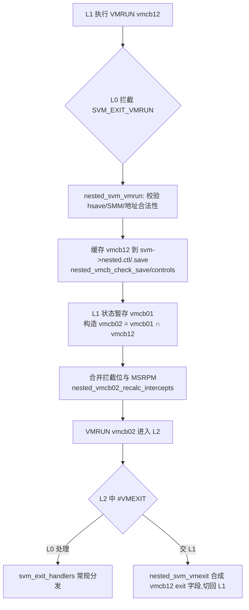

## 12. Hypervisor 生态:KVM/QEMU/Xen/Hyper-V/VMware

第 2 至 10 章描述的 VMCB、NPT、AVIC、SEV 等硬件机制,最终都要由 hypervisor 软件消费。本章按"机制定义 → 数据结构/流程 → 行为分析 → 影响与对比 → 局限"的脉络,考察五大主流 hypervisor 对 AMD-V 的软件实现:KVM 的 kvm_amd 模块如何用一段裸汇编驱动 VMRUN/#VMEXIT 主循环,QEMU/libvirt 如何把 SEV-SNP 封装为可声明的配置对象,以及 Xen、Hyper-V、VMware、VirtualBox 各自的依赖形态与共存冲突。除注明外,源码证据取自 torvalds/linux master 分支与 QEMU/libvirt 上游文档,检索时间为 2026 年。

### 12.1 Linux KVM

#### 12.1.1 kvm_amd.ko:vmenter.S 裸汇编主循环、svm_exit_handlers 分发表、VMCB clean bits 与 ASID 管理

现代内核(5.x 之后)将 AMD SVM 支持集中于 `arch/x86/kvm/svm/` 目录,职责划分如下[^377^][^125^]:

| 源文件 | 职责 |
|---|---|
| `svm/svm.c` | VMCB 初始化/切换、vCPU 创建、`svm_vcpu_run()`、`svm_handle_exit()` 与退出处理函数表 |
| `svm/vmenter.S` | `__svm_vcpu_run()` 裸汇编:VMLOAD/VMSAVE/VMRUN 序列与推测执行缓解 |
| `svm/nested.c` | 嵌套 SVM:`nested_svm_vmrun()`、`nested_svm_vmexit()`、vmcb12↔vmcb02 合并 |
| `svm/avic.c` | AVIC/x2AVIC 虚拟中断控制器 |
| `svm/sev.c` | SEV/SEV-ES/SEV-SNP 主机侧 ioctl 与密文上下文管理 |
| `svm/pmu.c` | SVM PMU 虚拟化(含 mediated PMU) |
| `include/asm/svm.h` | `struct vmcb`、`vmcb_control_area`、`vmcb_save_area` 与 `SVM_EXIT_*` 编码 |

每个 vCPU 在创建时分配一个 4 KiB 的 VMCB 页(`vmcb01`),SEV-ES guest额外分配一个独立的 VMSA(VM Save Area)页用于加密保存寄存器状态;`vmcb01.pa` 经 `__sme_set()` 设置 C-bit,以适配宿主机 SME 加密内存的场景[^125^]。

进入guest的调用链为通用框架 `virt/kvm/kvm_main.c: vcpu_enter_guest()` → 架构钩子 `.vcpu_run = svm_vcpu_run`(注册于 `struct kvm_x86_ops`)→ `svm_vcpu_enter_exit()` → 裸汇编 `__svm_vcpu_run()`[^125^]。`svm_vcpu_enter_exit()` 的关键语义是:KVM 始终以 VMCB 的 `V_INTR_MASKING` 位运行,VMRUN 瞬间宿主的 `RFLAGS.IF` 决定物理中断是否被屏蔽,因此进入前先 `raw_local_irq_enable()`,且整条路径 GIF=0,host 代码段内中断实际不会递送[^125^]。`vmenter.S` 的核心序列如下(注释为笔者所加):

```asm
	/* KVM 始终对 vmcb01 做 VMLOAD/VMSAVE,避免嵌套切换时复制 VMCB */
	mov SVM_vmcb01_pa(%_ASM_DI), %_ASM_AX
1:	vmload %_ASM_AX              /* 装载 guest 段寄存器/MSR 快速切换域 */
	mov SVM_current_vmcb(%_ASM_DI), %_ASM_AX
	mov KVM_VMCB_pa(%_ASM_AX), %_ASM_AX   /* 当前 VMCB(vmcb01 或嵌套的 vmcb02)*/
	LOAD_REGS ...                  /* 恢复 guest 通用寄存器(除 RAX/RSP)*/
3:	vmrun %_ASM_AX                 /* ← 进入guest */
4:	/* #VMEXIT 返回点 */
	STORE_REGS ...
5:	vmsave %_ASM_AX                /* 保存 guest 段状态 */
7:	vmload %_ASM_AX                /* 恢复 host save area(GSBASE 等)*/
	FILL_RETURN_BUFFER %_ASM_AX, RSB_CLEAR_LOOPS, X86_FEATURE_RSB_VMEXIT
	RESTORE_HOST_SPEC_CTRL         /* Spectre v2 / RETBleed 缓解 */
```

这段汇编体现了两个设计决策。其一,VMLOAD/VMSAVE 固定作用于 vmcb01(其始终有效),仅承担段寄存器与 MSR 的快速切换;VMRUN 则使用 `current_vmcb` 指针(嵌套时为 vmcb02),从而在嵌套 VMCB 切换时无需在两份 VMCB 间复制状态[^125^][^378^]。其二,#VMEXIT 返回后立刻执行 `FILL_RETURN_BUFFER` 与 `RESTORE_HOST_SPEC_CTRL`:RETBleed 缓解的源码注释明确要求"RET should be untrained as soon as we exit the VM",即返回内核后的第一条 RET 之前就必须清空返回栈缓冲区的 guest 训练痕迹[^378^]。

#VMEXIT 的软件处理由 `svm_handle_exit()` 完成:先判断退出是否发生在 guest mode(L2)中,若是则交嵌套层消化;再检查 VMRUN 失败(`SVM_EXIT_ERR`,置 `KVM_EXIT_FAIL_ENTRY` 并转储 VMCB);命中 fastpath 条件(关闭中断上下文直接处理 `SVM_EXIT_MSR`/`HLT`/`INVD`,前提是 CPU 具备 NRIP 特性,因为访问 guest 内存解码指令可能触发缺页睡眠)则直接返回;否则经 `svm_exit_handlers[]` 分发表按退出码调用处理函数[^125^]。退出码与 AMD APM Volume 2 一致,例如 `SVM_EXIT_HLT=0x78`、`SVM_EXIT_IOIO=0x7B`、`SVM_EXIT_MSR=0x7C`、`SVM_EXIT_VMRUN=0x80`、`SVM_EXIT_NPF=0x400`、`SVM_EXIT_AVIC_INCOMPLETE_IPI=0x401`、`SVM_EXIT_VMGEXIT=0x403`(SEV-ES)[^379^][^380^]。分发表中 `SVM_EXIT_VMRUN` 映射到 `vmrun_interception()` 进而进入 `nested_svm_vmrun()`,`SVM_EXIT_NPF` 映射到嵌套页错误处理,AVIC 的两个退出码映射到 IPI 未完成与未加速 APIC 访问的回退路径[^379^]。

VMCB 的运行时管理依赖两个硬件特性。**VMCB clean bits**(CPUID 特性 `VMCB_CLEAN`):KVM 用 `vmcb_mark_dirty()`/`vmcb_mark_all_dirty()` 维护脏位图,VMRUN 前只回写被修改的域,避免每次全量重载 VMCB 状态。**ASID 管理**:每物理核维护 `asid_generation`,vCPU 迁移到不同物理核时强制分配新 ASID 并标脏全部域——`pre_svm_run()` 的源码注释指出"Hardware's vmcb clean bits are per logical CPU, as are KVM's asid assignments",即 clean bits 与 ASID 的有效性都是 per-CPU 的,跨核复用会导致 TLB 污染[^125^]。

#### 12.1.2 模块参数全集与特性探测

kvm_amd 的可调面由模块参数(module_param)暴露,下表汇总源码(modinfo 级别)证据中的参数全集[^125^][^381^][^382^]:

| 参数 | 默认值 | 作用与备注 |
|---|---|---|
| `npt` | true | 嵌套页表;硬件或 host 内核不支持时由 `svm_hardware_setup()` 强制关闭并回退影子页表[^125^] |
| `nested` | true(上游) | 嵌套 SVM;2.6.32 时代为 kvm_amd 独有参数,Intel 多年后才跟进[^383^] |
| `nrips` | true | Next-RIP-Save:#VMEXIT 时硬件自动保存下一条指令 RIP |
| `vgif` | true | Virtual GIF:虚拟化全局中断标志 |
| `lbrv` | true | LBR(Last Branch Record)虚拟化 |
| `tsc_scaling` | true | TSC 比率缩放(MSR 乘法器) |
| `avic` | false | AVIC/x2AVIC 总开关,同时控制 SVM 侧与 IOMMU 侧 AVIC[^114^] |
| `enable_ipiv` / `force_avic` | — / unsafe | IPI 虚拟化;`force_avic` 为 `module_param_unsafe`,跳过部分安全检查[^382^] |
| `sev` / `sev_es` / `sev_snp` | true | SEV 家族主机支持,加载时按硬件/固件能力自动回退[^381^][^298^] |
| `ciphertext_hiding_asids` | uint | 密文隐藏(ciphertext hiding)特性预留的 ASID 数量[^381^] |
| `intercept_smi` | true | SMM 的 SMI 拦截 |
| `vnmi` | true | vNMI:硬件维护 NMI 阻塞状态 |
| `enable_device_posted_irqs` | — | 设备 posted interrupt(配合 IOMMU) |
| `enable_mediated_pmu` | — | mediated PMU:按 VM 隔离性能计数器 |
| `pause_filter_thresh` / `pause_filter_count`(_grow/_shrink/_max) | ushort | PAUSE 指令退出过滤(PLE),自适应增长/收缩 |

运行时探测沿两条路径。模块参数层面,`cat /sys/module/kvm_amd/parameters/sev` 返回 `Y` 即表示 SEV 已激活[^298^];硬件能力层面,`svm_hardware_setup()` 读取 CPUID `0x8000000A:EDX`(SVM 特性叶)填充位图:NPT(bit0)、LBRV(1)、SVML(2)、NRIP(3)、TSC_RATE(4)、VMCB_CLEAN(5)、FLUSH_ASID(6)、DECODE_ASSIST(7)、PAUSE_FILTER(10),这些位决定对应模块参数是否真正生效[^110^]。

需要澄清一个常见的 API 误解:**上游 KVM 不存在 `KVM_CAP_SEV` 能力号**(对 `Documentation/virt/kvm/api.rst` 全文检索无命中)[^384^]。SEV 家族的用户态探测通过 `KVM_CAP_VM_TYPES`(system ioctl)完成,其返回支持的 VM 类型位图:`KVM_X86_DEFAULT_VM=0`、`KVM_X86_SW_PROTECTED_VM=1`、`KVM_X86_SEV_VM=2`、`KVM_X86_SEV_ES_VM=3`、`KVM_X86_SNP_VM=4`、`KVM_X86_TDX_VM=5`[^384^]。QEMU 的 strace 实录印证了这一流程:`KVM_CHECK_EXTENSION, KVM_CAP_VM_TYPES` 返回 31(0b11111),随后以 `KVM_CREATE_VM, 0x4` 直接创建 SNP 类型 VM[^385^]。创建之后,SEV 操作经 `KVM_MEMORY_ENCRYPT_OP` ioctl 下发子命令(`KVM_SEV_INIT2`、`KVM_SEV_LAUNCH_START/UPDATE_DATA/MEASURE/SECRET`、`KVM_SEV_SNP_LAUNCH_START/UPDATE/FINISH` 等共 21 个),参数结构 `struct kvm_sev_cmd` 的 `sev_fd` 字段指向 `/dev/sev`[^386^]。SNP 的 `LAUNCH_UPDATE` 要求目标 GPA 范围预先设置 `KVM_MEMORY_ATTRIBUTE_PRIVATE` 属性,页类型可标记为 NORMAL/ZERO/UNMEASURED/SECRETS/CPUID[^386^]。启动与运行期的关键子命令语义如下[^386^]:

| 子命令 | 阶段 | 语义要点 |
|---|---|---|
| `KVM_SEV_INIT2` | 初始化 | 建立 SEV 平台上下文;以 `KVM_X86_SEV_VM`/`KVM_X86_SEV_ES_VM` 创建的 VM 在调用此命令前不可运行(替代已废弃的 `KVM_SEV_INIT`/`KVM_SEV_ES_INIT`) |
| `KVM_SEV_LAUNCH_START` | 启动 | 创建内存加密上下文,需 guest policy、所有者 PDH 公钥与 session 信息 |
| `KVM_SEV_LAUNCH_UPDATE_DATA` | 启动 | 加密一段内存区域并累计启动度量 |
| `KVM_SEV_LAUNCH_MEASURE` / `KVM_SEV_LAUNCH_SECRET` | 启动 | 取回度量供 owner 验证;验证通过后才注入机密,构成"先度量、后投递秘密"的启动证明顺序 |
| `KVM_SEV_SNP_LAUNCH_START/UPDATE/FINISH` | 启动(SNP) | SNP 启动流;UPDATE 逐页建立私有页并写入 RMP |
| `KVM_SEV_SEND_*` / `KVM_SEV_RECEIVE_*` | 迁移 | SEV 迁移流(START/UPDATE_DATA/FINISH/CANCEL),密文态传输 |
| `KVM_SEV_DBG_DECRYPT/ENCRYPT` | 调试 | policy 允许时访问密文;policy 禁止调试则直接返回错误 |
| `KVM_SEV_SNP_ENABLE_REQ_CERTS` | 运行期(SNP) | 配置 KVM 在处理guest证明报告请求时以 `KVM_EXIT_SNP_REQ_CERTS` 退出到用户态,由 VMM 补充证书链 |

这张命令表勾勒出 SEV 编程模型的两个边界条件。第一,`INIT2` 与 VM 类型的耦合是硬约束:类型在 `KVM_CREATE_VM` 时一次性确定,之后不可变更,`KVM_CAP_VM_TYPES` 探测必须先于创建发生。第二,度量与秘密注入的先后次序把"启动证明(launch attestation)"编码进了 ioctl 序列本身——hypervisor 无法绕过 owner 的度量验证直接投递秘密,因为 `LAUNCH_SECRET` 的会话密钥由 owner 持有。嵌套状态的导入导出另有专用 API:`KVM_GET_NESTED_STATE`/`KVM_SET_NESTED_STATE`(capability `KVM_CAP_NESTED_STATE`)支持 `KVM_STATE_NESTED_FORMAT_SVM` 格式,2026 年的 nSVM gPAT 系列补齐了 SVM 侧文档[^384^][^387^]。

#### 12.1.3 嵌套 SVM:vmcb12 缓存与 vmcb02 合并、限制清单与 2026 年加固补丁

KVM 的 nSVM 模型中,L0 为 kvm_amd,L1 为 guest 内 hypervisor,L2 为嵌套guest。L1 执行 `VMRUN`(操作数 vmcb12 的 GPA 存于 RAX)被 L0 拦截(`SVM_EXIT_VMRUN`),进入 `nested_svm_vmrun()`[^388^]:



机制要点有三。**vmcb12 缓存**:L1 提供的 VMCB 位于 L1 的guest物理内存,L0 将其拷贝到 `svm->nested` 缓存并做合法性校验(`nested_vmcb_check_save/controls`),校验失败则以 `SVM_EXIT_ERR` 合成一次嵌套 #VMEXIT——拷贝-校验-使用三步分离是嵌套安全的结构性前提[^387^][^388^]。**vmcb02 合并**:L0 实际 VMRUN 的硬件 VMCB 由 vmcb01(L0 对 L1 的控制面)与 vmcb12 逐域合并而成,包括拦截位合并、`V_INTR_MASKING` 处理与 MSR 权限位图(MSRPM)合并[^388^]。**嵌套 NPT**:`npt=1` 时 L0 为 L2 构造 l1GPA→HPA 的嵌套分页,该实现源于 Joerg Roedel 2010 年的原创系列;`npt=0` 时退化为影子页表[^389^]。

启用方法在发行版文档中高度一致:`modprobe kvm_amd nested=1` 或将 `options kvm_amd nested=1` 写入 `/etc/modprobe.d/kvm.conf`,并以 `cat /sys/module/kvm_amd/parameters/nested` 验证;L1 guest的 CPU 配置使用 `host-passthrough`,或命名模型加显式 `<feature policy="require" name="svm"/>`[^390^][^391^][^392^]。但嵌套 SVM 的限制清单相当长:

| 限制 | 状态与出处 |
|---|---|
| L1 不可用 AVIC/IOMMU 等硬件加速 | 正式文档明确"APICv cannot be used by the L1 hypervisor"[^393^] |
| 不支持 L3 | "Use of L2 guests as hypervisors … is not supported"[^393^] |
| 嵌套guest热迁移受限 | 历史上不支持;`KVM_CAP_NESTED_STATE`(SVM 格式)后部分支持[^384^][^393^][^392^] |
| SLES 标注为技术预览 | "provided for testing purposes and is not supported"[^392^] |
| SEV-ES guest内不能运行 KVM | Proxmox 文档明示[^394^] |
| CVE-2021-29657 | vmcb12 double-fetch TOCTOU 致 host MSR 越权,CVSS 7.4,<5.11.12 受影响[^17^] |

这些限制背后是同一结构性事实:vmcb12 位于攻击者(L1)可控的内存中,L0 对它的多次读取天然构成 TOCTOU 窗口。CVE-2021-29657 正是 double-fetch 竞态的典型形态,而 2026 年上游(KVM 7.1/7.2 合并窗口)仍在发布 nSVM 加固系列:修复 VMRUN 仿真中单步与 PMC 更新的副作用处理、修复 AVIC 对 x2APIC MSR 拦截的多处缺陷、引入 guest PAT(gPAT)独立虚拟化并新增 `KVM_X86_QUIRK_NESTED_SVM_SHARED_PAT` 兼容旧行为,同时补齐 SVM 侧 `KVM_{GET,SET}_NESTED_STATE` 文档[^387^][^373^]。历史沿革与修复现状合起来构成一个可操作的判断:2.6.32 时代 kvm_amd 独有的 `nested` 参数让 AMD 平台最早用上嵌套虚拟化[^383^],但同一公开 VMCB 布局也使 nSVM 十余年后仍是持续修补的攻击面——生产环境开放 nSVM,应视为接受一条需要持续跟踪上游补丁的维护承诺。

### 12.2 QEMU 与 libvirt

#### 12.2.1 -cpu EPYC 型号、sev-guest/sev-snp-guest 对象与 confidential-guest-support;libvirt launchSecurity XML

QEMU 为 AMD 提供两组 CPU 模型。命名模型覆盖 `EPYC`/`EPYC-IBPB`(Zen 1,2017)、`EPYC-Rome`(Zen 2)、`EPYC-Milan`(Zen 3)、`EPYC-Genoa`(Zen 4,满足 x86-64-v4 ABI),均有版本化别名(`-v1..v4`)以支持跨代迁移;`host-passthrough`(`-cpu host`)则把宿主特性原样暴露给guest,是无需热迁移场景的推荐项[^395^]。AMD 平台需要显式打开的guest侧特性包括 `ibpb`、`stibp`、`virt-ssbd`、`amd-ssbd`(文档注明其性能高于 `virt-ssbd`)与 `pdpe1gb`(1 GB 大页);默认 `qemu64` 模型会使guest暴露于多个 CPU 硬件漏洞,官方明确劝阻使用[^395^]。

机密计算guest的声明式配置以机密计算支持(confidential-guest-support)对象为中心:SEV/SEV-ES 使用 `-object sev-guest`(SEV-ES 通过 policy bit2 表达,如 `policy=0x5`),SEV-SNP 使用独立的 `-object sev-snp-guest`[^206^]。SEV-ES 有三条硬性限制源于寄存器状态加密:不支持 SMM、不支持 reboot(系统复位需要重写加密的 VMSA)、必须 in-kernel irqchip[^206^]。一个可运行的 SNP 完整命令行(EPYC Genoa,内核 6.11 + QEMU 9.1,取自 AMDESE/AMDSEV 仓库实录)如下[^396^]:

```bash
qemu-system-x86_64 -nodefaults -enable-kvm -cpu host \
  -object memory-backend-memfd,id=mem0,size=2048M,share=on \
  -object sev-snp-guest,id=sev0,policy=0x30000,cbitpos=51,reduced-phys-bits=1 \
  -machine q35,confidential-guest-support=sev0,memory-encryption=sev0,memory-backend=mem0 \
  -bios ./OVMF.fd
```

各配置项的语义与取值依据汇总如下[^385^][^206^][^396^][^397^][^398^]:

| 配置项 | 取值/示例 | 说明 |
|---|---|---|
| `-object sev-snp-guest,id=` | `sev0` | SNP 机密guest对象,被 machine 属性引用 |
| `cbitpos` | Genoa=51;Naples/Rome/Milan=47 | 页表 C-bit 位置,依代际不同,可经 QMP `query-sev` 读回[^397^] |
| `reduced-phys-bits` | `1` | C-bit 占用导致的物理地址位缩减 |
| `policy` | `0x30000` | 64 位 guest policy;默认含义为允许 SMT、无最低 ABI 版本要求[^398^] |
| `guest-visible-workarounds` | 16 字节 base64 | 向guest声明的平台固件缺陷位 |
| `id-block` / `id-auth` / `author-key-enabled` / `host-data` | 可选 | `SNP_LAUNCH_FINISH` 的 ID 块、作者密钥与 32 字节宿主数据[^206^] |
| `-object memory-backend-memfd,…,share=on` | 必需 | SNP 要求共享 memfd 后端,配合 guest_memfd/private 页管理[^385^][^396^] |
| `-machine confidential-guest-support=` / `memory-encryption=` | `sev0` | 分别声明机密计算支持与内存加密上下文 |
| `-bios OVMF.fd` | 必需(单镜像) | 上游 QEMU 仅支持单镜像 OVMF;split `OVMF_CODE/VARS + if=pflash` 会致 `SNP_LAUNCH_UPDATE` 返回 -22[^385^] |

表中有两个极易踩中的工程细节。其一,`cbitpos` 不是可自由约定的参数而是硬件事实:Naples 到 Milan 为 47,Genoa 起为 51,写错会导致度量与启动失败,实践中应从 `virsh domcapabilities` 的 `<sev>` 元素或 QMP 读回而非硬编码[^397^][^398^]。其二,OVMF 加载方式的约束来自上游 QEMU 的 SNP 度量路径——`-bios` 单镜像的固件会被纳入启动度量,而 split pflash 模式的可变区不被该路径支持,AMD 工程师在邮件列表中明确"with upstream QEMU only the single-image OVMF is supported (via -bios)"[^385^]。策略值 `0x30000` 的位语义(bit16 允许 SMT、bit17 保留置位)与 libvirt 文档交叉一致[^398^]。

libvirt 将上述对象抽象为域 XML 的 `launchSecurity` 元素:`type='sev'` 自 libvirt 4.4.0 起支持,`type='sev-snp'` 自 10.5.0(2024)起支持[^398^]:

```xml
<launchSecurity type='sev-snp' authorKey='yes' vcek='no'>
  <cbitpos>51</cbitpos>
  <reducedPhysBits>1</reducedPhysBits>
  <policy>0x00030000</policy>
  <hostData>...</hostData>
</launchSecurity>
```

SNP policy 的关键位包括:bit16 允许 SMT、bit17 保留(必须置位)、bit19 允许调试、bit20 限定单 socket 激活、bit22 要求 AES-256-XTS 内存加密、bit24 要求启用密文隐藏(ciphertext hiding)[^398^]。发行版落地层面,RHEL 9/10 提供 `virt-install --launchSecurity sev-snp,policy=0x30000` 与存量 VM 的 `virt-xml --edit` 流程[^399^];已知部署坑包括 Ubuntu 上 libvirt AppArmor 抽象缺少 `/dev/sev` 访问(需手工添加 `/dev/sev rw,`)、SEV-ES 要求 OVMF 固件描述声明 `amd-sev-es` 特性,以及加密内存必须配置 `<memoryBacking><locked/>` 防止换出[^400^]。


*图 12-1:KVM(kvm_amd)、QEMU、libvirt 三层栈对 AMD 虚拟化特性的支持落地时间线(版本号以各上游合入/发布记录为准;2026 年条目为合并窗口状态)[^385^][^386^][^387^][^401^][^389^][^373^][^398^]。*

时间线呈现两个可量化观察。第一,从 SEV 主机支持(4.16,2018)到 SNP 主机支持(6.11,2024)跨越约 6.5 年,而同一特性在三层栈间的纵向拉通极快:SNP 的内核(6.11)、QEMU(9.1)、libvirt(10.5.0)支持在 2024 年同年内全部落地,说明 CoCo(confidential computing)特性的栈间协同已高度同步[^385^][^401^][^398^]。第二,nSVM 是图中唯一"起点最早(2010)而 2026 年仍在修补"的条目,与 12.1.3 节的"长尾债务"判断互为印证[^387^][^389^][^373^]。

### 12.3 其他 hypervisor

KVM 之外,各 hypervisor 对 AMD-V 的依赖形态可以浓缩为一张支持矩阵(出处随单元格标注;"—"表示不适用或未公开):

| Hypervisor | AMD-V(SVM) | NPT/RVI(SLAT) | AMD-Vi(IOMMU) | SEV/机密计算 | 嵌套虚拟化 |
|---|---|---|---|---|---|
| Linux KVM | 必需(kvm_amd) | 默认开(`npt=1`)[^125^] | 直通与 AVIC 联动[^114^] | SEV/ES/SNP 全支持(6.11 起 SNP)[^401^] | nSVM 上游默认开,持续加固中[^125^] |
| Xen HVM/PVH | 必需(官方 Supported)[^402^] | HAP 默认,影子页表已弃用[^402^][^403^] | 官方 Supported;PCI 直通仅限 IOMMU 系统[^402^] | RFC 阶段,仅 plain SEV、仅 HVM[^404^] | Experimental(`nestedhvm`)[^405^] |
| Hyper-V/VBS | 必需(AMD 镜像 `hvax64.exe`)[^406^][^407^] | **硬性要求** SLAT=RVI/NPT[^198^][^199^] | HVCI/DMA 保护要求设备置于 IOMMU 之后[^200^][^201^] | 不支持 AMD SEV | — |
| VMware ESXi/Workstation | AMD-V trap-and-emulate[^408^] | RVI 消除影子页表,官方推荐[^408^] | VMDirectPath 直通[^408^] | ESXi 7.0 U1(2020)起支持 SEV-ES[^409^];ESXi 9.0 起支持 SEV-SNP(配置见 Lenovo LP2349)[^260^];SNP 激活时 IOMMU 直通受限(Broadcom KB 442645)[^410^];Workstation 不提供 SEV | vHV 要求 AMD-V **且** RVI[^411^] |
| VirtualBox | 64 位与 SMP guest**必需**[^412^] | 支持 nested paging[^412^] | PCI 直通需 AMD-Vi[^413^] | 不支持 | 6.1 起,AMD 支持晚于 Intel[^414^] |

*表 12-1:各 hypervisor 对 AMD 硬件虚拟化特性的依赖矩阵(未标注 dim 的编号引自 dim12 报告)。*

矩阵揭示了三条结构性差异。第一,SVM 是所有 x86 hypervisor 的准入门槛,但 NPT/RVI 的地位不同:对 KVM、Xen、VMware 它是"默认且可回退"的性能路径,对 Hyper-V 的 VBS 则是不可协商的安全前提——没有 SLAT 就无法建立 VTL 隔离[^415^][^198^]。第二,AMD-Vi 的角色从"直通辅助"升级为"安全组件":Xen 将 PCI 直通严格限定于 IOMMU 系统[^402^],微软则把"具备 DMA 能力的设备必须位于 IOMMU 之后"列为 HVCI 高安全设备的附加要求[^201^]。第三,机密计算能力呈梯度分布而非完全断层。KVM 提供 SEV 全家族(SEV/SEV-ES/SEV-SNP)的开源支持且栈间协同最快——SNP 的内核(6.11)、QEMU(9.1)、libvirt(10.5.0)支持在 2024 年同年落地[^401^][^398^];VMware 自 ESXi 7.0 U1(2020)起支持 SEV-ES、ESXi 9.0 起跟进 SEV-SNP[^409^][^260^],但栈闭源且功能有裁剪:SEV-ES guest不支持 vMotion、挂起与开机快照,SEV-SNP 激活时 ESXi 无法将主机 IOMMU 配置为 passthrough(硬件旁路)模式,代价是 IOMMU 内存开销低于 1%、768 GB Zen 5 主机初始化时间增加约 7 秒[^410^];Xen 的 SEV 支持截至 2025 年仍处 RFC 阶段,仅 plain SEV、仅 HVM[^404^];Hyper-V 则不向guest暴露 SEV。就机密 VM 而言,开源栈的现实选择仍收敛于 KVM/QEMU,而 vSphere 9.0 构成闭源替代路径。

#### 12.3.1 Xen:HVM/PVH 强制 SVM、NPT 默认、vIOMMU 路线与 SEV RFC 现状

Xen 的 x86 HVM 实现按厂商分为 `vmx/` 与 `svm/` 两套后端,SVM 后端核心为 `svm.c`(约 2870 行,负责 VMRUN/#VMEXIT、VMCB 管理与 ASID)与 `vmcb.c`[^416^]。官方 SUPPORT.md 将 HVM 明确定义为"Requires hardware virtualisation support (Intel VMX / AMD SVM)"且 domU 状态为 Supported;PVH(PVHv2)同样强制要求硬件虚拟化,PVH dom0 额外强制 IOMMU,且缺失 PCI SR-IOV、原生 NMI 转发与向 domU 的 PCI 直通[^402^]。AMD 平台上的实机启动日志显示 Xen 逐项探测并启用 NPT、LBR 虚拟化、Next-RIP、DecodeAssists、Pause-Intercept Filter 与 TSC Rate MSR,HAP 支持 4 KiB/2 MiB/1 GiB 页[^417^]。AMD 工程师正推动 PVH dom0 在 AMD APU 平台落地,动机是 GPU 直通场景需要硬件 IOMMU 替代 swiotlb 做缓冲拷贝,而 PV dom0 仅支持 swiotlb——这说明 PVH dom0 的 AMD 化与 AMD-Vi 的成熟度是直接耦合的[^418^]。分页路径上,`xl.cfg` 的 `hap=` 选项"Use of HAP is the default when available",且因 XSA-495 类安全问题,影子页表已降级为"Supported, not security supported",AMD NPT 成为事实上的唯一受支持路径[^402^][^403^]。

IOMMU 与嵌套是 Xen 在 AMD 侧的两条未完成曲线。AMD IOMMU 本体为 Supported 且中断重映射可用[^402^][^417^],但 guest 侧 vIOMMU 存在两条并行演进线:Xen 社区走 PV-IOMMU 半虚拟化接口的 AMD-Vi 移植(Vates 主导的 v7 系列,"基本可用但有怪癖")[^419^];AMD 自研的硬件加速 vIOMMU(Command Buffer/Event Log/PPR Log 硬件加速,guest 对 8–12 KiB 偏移的 MMIO 访问由 IOMMU 直接服务)则首先在 Linux/KVM 的 IOMMUFD 框架落地(2026 年 v4 系列,24 个补丁)[^420^]。嵌套方面,`nestedhvm=` 默认关闭,AMD 上状态为 Experimental,且源码级门槛要求 HAP、LBRV、NRIPS、FlushByASID、DecodeAssists、VLOADSAVE 一整组特性齐备才置位 `nested_virt` 能力[^405^][^421^][^422^];XCP-ng 的措辞更保守,直接声明其实验性实现"不安全,不予官方支持"[^423^]。

机密计算方面,截至 2025 年 Xen 的 AMD SEV 支持处于 RFC 阶段(Vates 主导):16 个补丁的系列引入 `XEN_DOMCTL_CDF_coco` 域创建标志与 `xl` 的 `coco = 1` 参数,**仅支持 plain SEV、仅 HVM 域**,作者明确倾向后续以 SEV-ES 为基线,理由是 plain SEV 存在非平凡的仿真路径且 hypervisor 可通过操纵寄存器破坏 guest 加密[^404^]。该系列还伴随 Xen 级 ASID 分配器重构(ASID 与加密密钥绑定)与面向加密 guest 的"物理地址 ABI";FOSDEM 2025 与 Xen Summit 2025 均报告了早期运行结果,但 SEV-ES/SNP 的类型区分接口仍在讨论,主线合入状态未定[^404^][^424^][^425^][^426^]。

#### 12.3.2 Hyper-V/VBS:hvax64.exe、VTL0/VTL1 与 Credential Guard/HVCI 依赖;VMware vHV 与 WHPX 共存;VirtualBox NEM 回退

先校正一个广泛流传的命名错误(交叉验证为高置信,四个独立来源一致):**AMD 平台的 Hyper-V hypervisor 镜像是 `hvax64.exe`,`hvix64.exe` 是 Intel VT-x 版本**(Arm64 为 `hvaa64.exe`)——"a"=AMD、"i"=Intel[^406^][^407^][^427^][^428^]。启动链为 `winload.efi` 依据 BCD 的 `hypervisorlaunchtype` 触发,`hvloader.dll`/`hvboot.sys` 检测 CPU 虚拟化能力并选择镜像[^427^][^428^]。因此在 AMD 平台上,占据 SVM host 模式、执行 VMRUN、处理 #VMEXIT 并管理 VMCB 的正是 `hvax64.exe`;Hyper-V 作为 type-1 hypervisor 启动后,root OS 降级为根分区,经 hypercall(AMD 上为 `vmmcall` 触发 #VMEXIT)与 hypervisor 通信[^406^][^429^]。

VBS(Virtualization-based Security,基于虚拟化的安全)的设计前提是"假设内核可被攻陷":hypervisor 建立两级虚拟信任等级,VTL0 承载常规内核 `ntoskrnl.exe`,VTL1 承载安全内核 `securekernel.exe`,VTL1 经 hypercall 配置 VTL0 的二级地址转换(SLAT)页表项[^429^][^415^]。这使 VBS 的硬件要求在 AMD 侧收敛为三元组:**AMD-V + RVI/NPT(SLAT,硬性)+ AMD-Vi(IOMMU)**——微软文档原文将 SLAT 表述为"Intel VT-x with EPT,or AMD-V with Rapid Virtualization Indexing (RVI)",IOMMU 侧为"Intel VT-d,AMD-Vi"[^198^][^199^]。Credential Guard 把 LSA 机密移入 VTL1 的 `LsaIso.exe`,HVCI(Hypervisor-protected Code Integrity,内存完整性)把内核代码完整性校验移入 VTL1 并强制内核内存 W^X;OEM 整理的需求表逐项列出"Intel VT-x, AMD-V, and extended page tables"与"VT-D or AMD Vi IOMMU"(Credential Guard 必需)[^200^],HVCI 高安全设备另要求一切 DMA 设备位于 IOMMU 之后[^201^]。启用路径分两层:固件层的 **"SVM Mode"** 开关(关闭则 OS 完全看不到 SVM 能力),与 OS 层的 `bcdedit /set hypervisorlaunchtype auto`[^430^][^431^]。

硬件虚拟化扩展同一时刻只能由一个 VMM 处于 root 模式,这构成 Windows 上第三方 hypervisor 的共存问题:"Only one software component can use Intel VT-x or AMD-V at a time"[^432^]。微软的解法是 WHPX(Windows Hypervisor Platform):向第三方虚拟化栈开放的用户态 API,用于在 Hyper-V 之上创建分区、配置 GPA 映射并运行 vCPU,前提为"Hardware that supports virtualization (Intel VT-x or AMD-V)"且固件已开启虚拟化[^433^][^434^]。各家的 WHPX 后端形态不同:VMware Workstation 15.5.5+/Windows 10 20H1(19041.264)起自动进入 ULM(User Level Monitor,亦称 Host VBS 模式),VMM 作为用户态进程经 WHPX 间接使用被 Hyper-V 托管的 SVM,功能与性能较 CPL0 直用 SVM 有折损(可在 `vmware.log` 中检索 `Monitor Mode:` 确认)[^435^][^436^][^432^][^437^];VirtualBox 回退到 NEM(Native Execution Manager)并在 VM 窗口显示"乌龟"图标,日志明示 "Attempting fall back to NEM: AMD-V is not available … Snail execution mode is active!"[^438^];QEMU/Android Emulator 则提供 `-accel whpx`,在 Intel 与 AMD CPU 上均可不关闭 Hyper-V 而获得硬件加速[^439^][^440^]。彻底让位方案为 `bcdedit /set hypervisorlaunchtype off` 并关闭内存完整性与 VBS 相关组策略,重启后 VMware/VirtualBox 恢复直接使用 SVM[^436^][^441^]。

VMware 侧的其余要点有二。ESXi/Workstation 以 AMD-V 做 trap-and-emulate 式 CPU 虚拟化,以 RVI/NPT 消除影子页表维护;官方性能文档同时提示 RVI 会拉长 TLB miss 服务时间,缓解手段是guest侧配置大页[^408^]。嵌套方向,vHV(virtualized HV)自 ESXi 5.1+/Workstation 9+ 起完全支持,但要求宿主同时具备 AMD-V **和** RVI,guest侧对应 vmx 配置 `vhv.enable = "TRUE"`;ESXi 5.0 时代该功能默认禁止(`vhv.allow = TRUE`)且**在 AMD "Bulldozer" CPU 上不可用**,还需手工放开 `cpuid.80000001.ecx.amd` 等 SVM CPUID 叶子[^411^][^411^][^442^]。VirtualBox 方面,64 位与 SMP guest强制要求 AMD-V,固件未开启时报 `VERR_SVM_DISABLED`;嵌套虚拟化自 6.1 起提供,AMD 平台支持晚于 Intel[^412^][^443^][^414^]。
