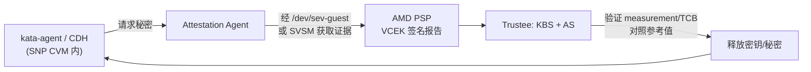

## 14. 云落地、生态与路线图

到 2026 年年中,AMD SEV-SNP(Secure Encrypted Virtualization-Secure Nested Paging)已从"单一云厂商的差异化功能"演变为三大美国超大规模云(Azure、Google Cloud、AWS)机密虚拟机(Confidential VM,CVM)的主力可信执行环境(Trusted Execution Environment,TEE)[^28^][^30^][^29^]。本章按"云落地 → 开源生态 → 硬件路线图与竞争格局"的次序收束全书:第 10 章讨论的是 SNP 的机制,第 13 章讨论的是 SNP 的开销,本章回答的问题是——这些机制与开销数据如何在云产品形态、开源项目治理与下一代 EPYC 硬件中兑现。

### 14.1 云厂商落地

#### 14.1.1 Azure DCasv5→DCasv6、GCP N2D SEV-SNP GA、AWS M6a/C6a/R6a、腾讯云 SA5/阿里云现状

云落地的时序与第 13 章的开销曲线高度耦合。2020-07 Google Cloud 首家以 AMD SEV(N2D)推出机密 VM,彼时仅有内存加密而无完整性保护[^26^];2022-07-19 Azure 将首个 SEV-SNP 机型 DCasv5/ECasv5(3rd Gen EPYC Milan)GA,配套 Secure Boot、每 VM 独立 vTPM 与首次启动前的云端机密磁盘加密[^28^][^462^];AWS 于 2023 年在 M6a/C6a/R6a(Milan)提供 `AmdSevSnp=enabled` 开关,GA 区域为 us-east-2 与 eu-west-1,启用后约增加 10% 实例费用[^29^][^463^];Google Cloud 则于 2024-08 宣布 SEV-SNP 在 N2D GA、在 C3D 预览[^30^]。至此 SEV-SNP 在三大云完成 GA 闭环。

**Azure:两代机型与证明架构。** 第二代 DCasv6/ECasv6(4th Gen EPYC Genoa)于 2025-09-16 GA,区域滚动延伸至 2026-04,特性包括硬件根证明、在线密钥轮换(online key rotation)、默认 AES-256 内存加密、最高 96 vCPU/672 GiB,官方口径较上一代提升 25% 性能[^464^]。Azure 的证明架构为:开源化的 Host Compatibility Layer(HCL/OpenHCL)运行在 VMPL0 管理 vTPM,guest OS 在 VMPL2 经公开接口使用;SNP 证明报告由 AMD PSP 内 VCEK 签名,启动时经 Microsoft Azure Attestation(MAA)验证后,密钥才从 Key Vault/Managed HSM 释放以解锁 vTPM 状态与 OS 盘[^465^][^466^]。在此基础上 Azure 叠加了两条产品线:NCC H100 v5 机密 GPU 机型(2024-09 GA,AMD SEV-SNP CVM + NVIDIA H100 机密计算模式,PCIe 通信加密,CPU 与 GPU 均可出具远程证明)[^467^][^468^];AKS 机密容器(Kata-CoCo + Cloud-Hypervisor,运行时类 `kata-cc-isolation`,需 DCa_cc/ECa_cc 规格)[^469^]。同时 Azure 明确 SGX 系 DCsv2 于 2026-06-30 退役,Intel 侧由 TDX 机型 DCesv6/ECesv6(2026-02-26 GA)承接[^470^][^471^]。

**Google Cloud:向 SEV-SNP/TDX 基线收敛。** GCP 当前机型映射为:AMD SEV 支持 N2D/C2D/C3D,SEV-SNP 支持 N2D(Milan/Genoa 平台),且"默认选 AMD SEV"已被标记为弃用(deprecated),引导用户迁移至 SEV-SNP 或 Intel TDX[^472^][^473^]。Google 官方(2025-11)将两代技术分层表述:SEV 提供内存加密与 Google 托管 vTPM 证明,SEV-SNP/TDX 额外提供内存与 CPU 状态的完整性保护和硬件根证明[^474^]。两个生态信号值得注意:N2D 机密 VM 已支持实时迁移[^475^];Google 正向 Canonical 请求在 linux-gcp 内核(6.8+)合入 SVSM vTPM 驱动(`CONFIG_TCG_SVSM=y`),为 SEV-SNP 机密 VM 引入guest内可信 vTPM[^476^]。

**AWS:托管 SEV-SNP,但不开放自管路径。** AWS 在 M6a/C6a/R6a 之外已将 SEV-SNP 扩展至 Dedicated Hosts("Available in all AWS commercial Regions with AMD instances")[^477^],Ubuntu 24.04 与 RHEL 10 均提供官方启用与证明(virtee/snpguest)流程[^29^][^478^]。但边界清晰:`m6a.metal` 等裸金属实例因 Nitro 固件隔离不向客户暴露 `/dev/sev` 与 PSP 接口,即不支持客户自管 KVM/QEMU SEV guest,AWS 只以托管机密 VM 形式提供该能力[^479^];AWS 不支持 Intel TDX,其机密计算叙事仍以自研 Nitro Enclaves 为主,CoCo cloud-api-adaptor 矩阵中 AWS 栏为 "None / Under development"[^480^][^481^]。

**中国云厂商路径分化。** 阿里云的机密 VM 主力路线是 Intel TDX——g8i 实例(2023-03 起)以 TDX 提供机密虚拟机与机密容器[^482^];但 2024-09 发布的 Alinux "Confidential AI" 全栈同时支持 Intel TDX、AMD SEV 与海光 CSV 多种平台[^483^]。腾讯云在标准型 SA5(≤128 核,要求 TencentOS Server 4 + UEFI)实例提供 AMD SEV 机密计算,SEV-SNP 处于公测申请阶段[^484^]。基于公开资料判断(推断),阿里云与腾讯云的 AMD 路线目前均以 SEV 代际为主,未见 SEV-SNP 实例规格 GA 的公开声明。

**其他落地形态。** OVHcloud 自 2025-10 起将 Scale 系列换装 EPYC 9005 Turin 并标注"Enhanced AMD SEV"[^485^];Red Hat OpenShift 的机密集群分阶段推进——GCP 4.13 GA(SEV-ES)、Azure 4.14 技术预览(SEV-SNP),OpenShift Sandboxed Containers 1.13 起裸金属与 Azure peer-pod 的 SEV-SNP/TDX 均已 GA,Azure SEV-SNP + H100 机密 GPU 组合为技术预览[^486^][^487^];SUSE SLES 亦支持在 GCP 上以 SEV/SEV-SNP/TDX 运行机密 VM[^488^]。

| 云厂商 | 实例系列 | 平台 | SEV 特性 | 状态(截至 2026-09) | 关键能力与限制 |
|---|---|---|---|---|---|
| Azure | DCasv5/ECasv5 | EPYC 7003 Milan | SEV-SNP | 2022-07-19 GA[^28^] | 每 VM 独立 vTPM、Secure Boot、机密磁盘加密[^462^] |
| Azure | DCasv6/ECasv6 | EPYC 9004 Genoa | SEV-SNP | 2025-09-16 GA(滚动至 2026-04)[^464^] | 在线密钥轮换、默认 AES-256、≤96 vCPU/672 GiB[^464^] |
| Azure | NCC H100 v5 | Genoa + NVIDIA H100 | SEV-SNP + 机密 GPU | 2024-09 GA[^468^] | TEE 横跨 CPU/GPU,双向证明,PCIe 加密[^467^] |
| GCP | N2D | EPYC Milan/Genoa | SEV(deprecated)/ SEV-SNP | SEV 2020-07 首发;SNP 2024-08 GA[^30^][^26^] | 实时迁移可用[^475^];C3D 上 SNP 预览[^30^] |
| AWS | M6a/C6a/R6a(含 Dedicated Hosts) | EPYC 7003 Milan | SEV-SNP | 2023 起 GA(us-east-2/eu-west-1 起)[^29^] | `AmdSevSnp=enabled`;约 +10% 费用;metal 不开放 `/dev/sev`[^463^][^479^] |
| 阿里云 | g8i(TDX 主力)/ Alinux Confidential AI | Intel SPR/EMR 为主 | AMD SEV(非 SNP)列入全栈 | TDX GA;SEV 为 Confidential AI 支持项[^482^][^483^] | CoCo 云端矩阵中阿里栏为 TDX[^480^] |
| 腾讯云 | SA5(≤128 核) | AMD | SEV;SEV-SNP 公测申请中 | SEV 可用;SNP 未 GA[^484^] | 要求 TencentOS Server 4 + UEFI[^484^] |

*表 14-1:主要云厂商 AMD 机密计算实例矩阵(截至 2026-09,以各厂商官方公告与文档为准)。*

矩阵呈现三条结构性趋势。其一,**SEV-SNP 已成为新基线、plain SEV 进入存量维护**:GCP 明确弃用默认 SEV 选项,Azure 的新代际(DCasv6)与 GPU 产品线全部建立在 SNP 之上[^464^][^472^]。其二,**代际跟进存在 1–2 年延迟**:Azure 2025-09 GA 的 DCasv6 仍基于 Genoa 而非已发布一年的 Turin(推断:Turin 系机密 VM 机型在三大云均未见公开公告),云厂商对固件成熟度与证明基线的验证周期明显长于普通机型。其三,**开放度分层**:Azure/GCP 允许guest内证明工具链直连(snpguest 等),AWS 则把 SEV-SNP 封装在 Nitro 边界之内、裸金属不暴露固件接口——同一硬件特性在不同云上的可编程性差异,是架构选型时比"是否支持"更关键的变量[^479^]。

### 14.2 开源生态

#### 14.2.1 Confidential Containers、Kata、SVSM/vTPM、IETF CoRIM;Linux coco 子系统

**Confidential Containers(CoCo,CNCF)与 Kata。** CoCo 构建于 Kata Containers 之上:kata-agent 运行于 TEE guest(SNP CVM 或 TDX Trust Domain)内,Attestation Agent 与 Confidential Data Hub(CDH)负责证明与秘密分发,外部 Trustee(KBS + 验证服务,Red Hat build of Trustee 1.1 已产品化)在验证 TEE 证据后释放秘密;Peer Pods 经 cloud-api-adaptor 在云 API 上直接创建 CVM[^489^][^490^]。官方硬件矩阵(2026-08)确认裸金属支持 AMD SEV-SNP(含证明),云端支持 SNP@Azure 与 SNP@GCP,AWS 与 TDX@GCP 在开发中[^480^]。2026 年的重大治理变化是:CoCo Operator 仓库于 2026-02-01 归档(版本线止于 v0.17.0),Helm Chart(`oci://ghcr.io/confidential-containers/charts/confidential-containers`)成为官方推荐部署方式,理由是简化安装、GitOps 集成并与 kata-containers 版本直接对齐[^491^]。主机侧基线为内核 ≥ 上游 6.16.1、SEV 固件 ≥ 1.55(证明报告 v3+)[^307^]。SNP CVM 的典型证明数据流如下:

**SVSM 与 vTPM 的两条路线。** COCONUT-SVSM(SUSE 发起,2024-07 加入 Confidential Computing Consortium,贡献者含 AMD、Microsoft、IBM、Intel、Red Hat、Google)在 VMPL0 为 CVM 提供主机 VMM 无法安全提供的服务:vTPM 模拟、UEFI 变量存储(Secure Boot)、CVM 实时迁移[^492^]。其 vTPM 基于 TCG 参考实现,当前为临时性(ephemeral,每次启动重新 manufacture),社区正推进持久化状态以支撑跨重启的 vTPM 与 UEFI 变量[^278^]。内核侧,Linux 6.16(2025-05)合并了 `tpm_svsm.c` 驱动(`CONFIG_TCG_SVSM`),使 VMPL≥1 的 SEV-SNP guest可按 AMD SVSM 规范(#58019)与 VMPL0 的 vTPM 通信——设计意图即"TPM 由可信实体而非不受信主机模拟"[^493^][^494^]。由此形成两条并存的 vTPM 路线:云厂商 paravisor 路线(Azure HCL + MAA、Google 托管 vTPM)与开源 SVSM 路线(guest 内可信实体、纳入启动度量、对 hypervisor 与 guest OS 双向防护)[^465^][^474^]。标准化方面,IETF 的 draft-deeglaze *CoRIM profile for AMD SEV-SNP attestation report* 将 SNP 报告字段映射为 CoRIM 参考值,是证明证据跨验证方互操作的关键草案[^281^]。

**Linux coco 子系统。** 内核以 `cc_platform_has()` 抽象 SEV-SNP 与 TDX 差异,2024–2025 年间代码从 `arch/x86/kernel/sev.c` 重组为 `arch/x86/coco/sev/core.c`,guest侧驱动集中于 `drivers/virt/coco/`(sev-guest、tdx-guest、tsm)[^495^][^476^]。该层持续吸收硬件新特性:2026-02 AMD 发布 SEV-SNP BTB Isolation 补丁(VMSA feature bit 7,Turin 硬件已具备),防止 SNP guest的分支目标缓冲被上下文外状态污染[^496^]。

### 14.3 路线图与竞争格局

#### 14.3.1 EPYC 9006(RMPOPT/Caliptra/PQC-LMS)、Zen6 Venice(2026-07);SNP vs TDX 竞争与性能对照

**Turin(EPYC 9005)的落地状态。** 2024-10 发布的 Turin 引入 Trusted I/O(SEV-TIO/PCI-SIG TDISP,PSP 充当 TSM,允许 SNP VM 的加密 DMA 与安全 MMIO 直通)与 Segmented RMP、Secure AVIC、PMC 虚拟化、Ciphertext Hiding 等增强[^12^][^497^]。但软件就绪度滞后:发布日 Secure AVIC、Ciphertext Hiding 的内核支持尚在邮件列表;SEV-TIO 截至 2026-07 的独立评估结论为"内核中唯一可验证的是 IDE-only Phase 1,设备绑定、安全 DMA 与证明仍是未来阶段",评估方建议在云端出现可证明的设备绑定前继续采用纯 SEV-SNP CVM[^31^][^314^]。

**Venice(EPYC 9006,Zen 6)。** AMD 官方 SEV 代际表已列至 9006:RMPOPT(RMP 优化)、增强型 AMD Secure Processor(ASAP)信任根、集成 Caliptra、后量子密码支持(仅 LMS)、物理与侧信道攻击缓解[^12^]。Venice 于 2026-07-22/23 Advancing AI 大会正式发布,采用 TSMC N2 工艺、SP7/SP8 插座,Zen 6 型号最高 96 核、Zen 6c 最高 256 核;下一代 Verano(Zen 7)已预告 2027 年[^32^][^498^][^499^]。

| EPYC 代际(架构) | SEV 新特性 | 规模与能力指标 |
|---|---|---|
| 7001 Naples(Zen 1) | SEV:内存加密 | 128-bit AES-XEX;15 keys[^12^] |
| 7002 Rome(Zen 2) | SEV-ES:寄存器状态加密 | 509 keys[^12^] |
| 7003 Milan(Zen 3) | SEV-SNP:完整性 + guest证明 | 免 SMT 攻击强化(guest 可要求非 SMT 平台)[^500^] |
| 8004/9004 Genoa/Bergamo(Zen 4) | CXL 附加内存加密(SMKE) | 256-bit AES-XTS;1006 keys;63 个 Multi-Host Key[^12^][^310^] |
| 8005/9005 Turin(Zen 5) | Segmented RMP、Secure AVIC、PMC 虚拟化、Guest Intercept Controls、Ciphertext Hiding;9005 增 Trusted I/O(TDISP) | SEV-ES 在支持 SNP 的 CPU 上被禁用[^12^][^497^] |
| 9006 Venice(Zen 6) | RMPOPT、ASAP 信任根、集成 Caliptra、PQC(仅 LMS)、物理/侧信道缓解 | 各特性固件/内核启用时间未定(官方前瞻)[^12^] |

*表 14-2:EPYC 各代 SEV 特性演进(依据 AMD 官方开发者页代际表与方案简报整理;8005/9005 行在两份官方文档间归属粒度略有差异,以平台为准[^12^][^308^])。*

代际表揭示了 AMD 的路线逻辑:**前两代补机密性(加密内存、加密寄存器),第三代补完整性(RMP),此后每一代都在为"已暴露的攻击与已实测的开销"做硬件回应**——Ciphertext Hiding 回应密文侧信道(见 14.3.1 末段),RMPOPT/新指令(RMPREAD/RMPCHKD,LLVM 已先行支持)回应 RMP 操作延迟,Caliptra 与 PQC-LMS 则把信任根与签名算法纳入行业标准化轨道[^12^][^461^]。对采购而言,关键含义是"SNP-capable CPU"不再是充分条件:CoCo 已把 SEV 固件 ≥1.55、证明报告 v3+ 写成准入门槛,证明报告中的 TCB 版本正在取代硬件型号成为真正的信任锚[^307^]。

**CXL 内存是一个独立的观察轴。** Genoa 起官方代际表明确支持 CXL 附加内存加密,配合 SMKE(Secure Multi-Key Encryption)使 CXL 附加的存储级内存跨重启保持加密[^12^][^310^];Turin 集成 CXL 2.0(内存池化、分层内存用例)[^31^]。但池化内存若跨主机共享,RMP 完整性与加密密钥域如何划分仍是开放工程问题——规划时需同时评估"不信任 Host"与"不信任远程内存控制器"两类威胁[^501^];Venice(SP7,16 通道内存、PCIe Gen6)将把该议题推向 CXL 3.x 时代[^498^]。

**SNP vs TDX:性能与云覆盖。** TUM 的实证研究(SIGMETRICS 2025,EPYC 9654P Genoa vs Xeon 8570,Linux 6.8)给出同代对照:

*图 14-1:SEV-SNP 与 TDX 关键性能指标对照。左图为相对普通 VM 的开销/增幅(%,对数刻度;启动时间取 8 vCPU/64 GB、内核 6.9 的 SNP 数据与 TDX 数据;populate 为 32 GB 首次 mmap),右图为获取证明报告的延迟。测量平台:2×EPYC 9654P(Genoa)对 2×Xeon Platinum 8570,Linux 6.8,QEMU 8.2,关 HT/Turbo/C-state[^34^]。*

读图需区分两类指标。TDX 的短板在**退出路径**:VMEXIT 延迟平均增幅 472%,约为 SNP(240%)的两倍,启动时间增幅(394% vs 231%)与内存 populate 增幅(92% vs 59%)同向——这与其 TD Module 介入每次 VM 进入/退出的架构一致[^34^]。SNP 的短板在**证明原语延迟**(6.19 ms vs TDX 2.75 ms)与 Phoronix 内存套件(7.29% vs 4.06%),但 SNP 的内存注入带宽开销更低(均值 2.88% vs 7.86%),且其可信计算基(TCB)中 ASP SEV 固件仅约 29 KLoC,是可审计性上的量化优势[^34^]。综合看两者应用层开销总体接近、各有结构性短板;云侧 SNP 在三大美国云均 GA,TDX 在 Azure(2026-02)与 GCP(C3)GA 而 AWS 不支持[^471^][^481^]。SNP 自身开销的行业口径(2026-02,EPYC 9005 Turin 平台)已收敛到典型 2–10%、数据库/I-O 密集 10–12%[^454^]。

**安全事件与固件治理。** 2025–2026 年 SEV-SNP 连续曝出高危研究:RMPocalypse(CVE-2025-0033,2025-10-13 披露,SNP 初始化窗口期对 RMP 单次 8 字节写入破坏完整性,影响 EPYC 7003/8004/9004/9005,微软确认 Azure ACC AMD 集群受影响并滚动修复)[^261^];StackWarp(CVE-2025-29943,2025 年协同披露、2026-01 公开,Zen 1–5 全线,主机特权攻击者可篡改机密 VM 内栈指针)[^365^];密文侧信道(AMD SB-3021,2025-08,利用 hypervisor 搬移/换出加密页的能力实施密文观察)[^349^]。三者的共同点是均需主机高权限,属威胁模型内的残余风险而非全盘失效;但它们共同确立了本节最重要的工程结论——机密计算的安全性已从"一次性硬件属性"变为"持续性固件治理服务",评估云机密 VM 时应核验云商的固件修复声明与证明报告版本(v3+),而非仅核验 CPU 型号[^307^][^502^]。
